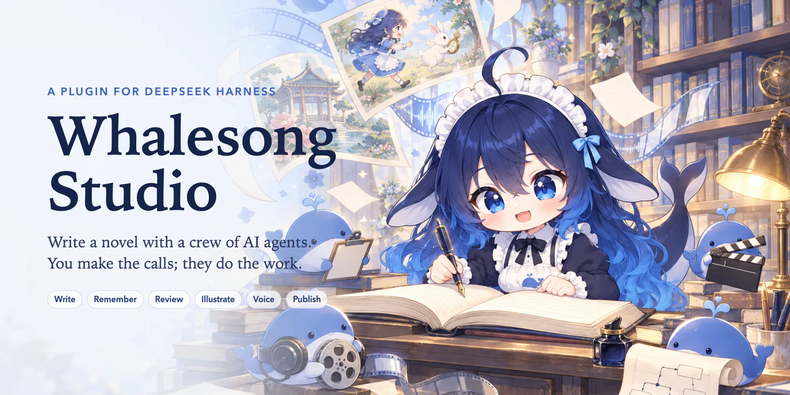
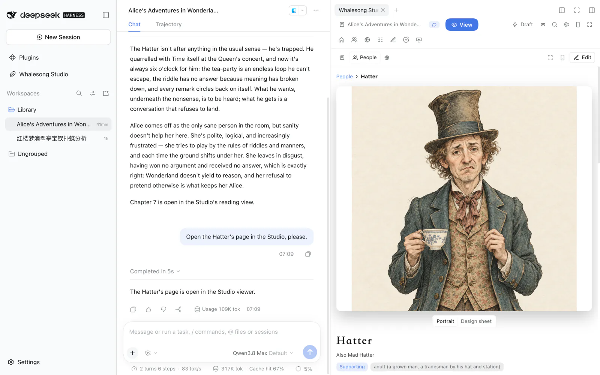
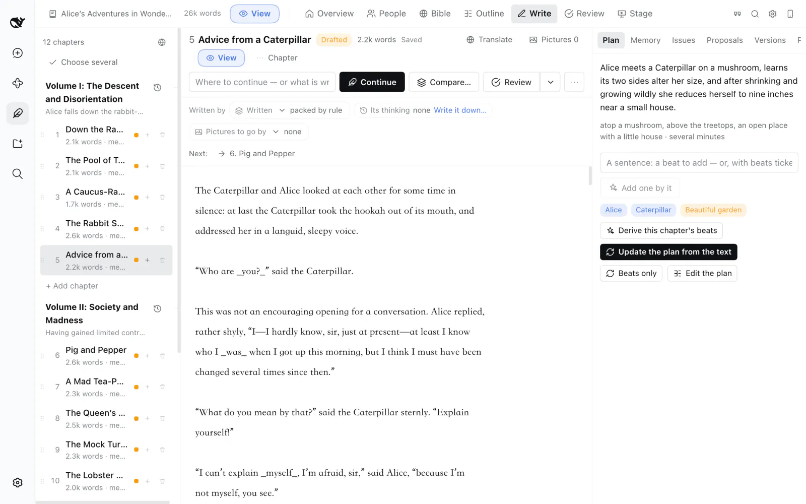
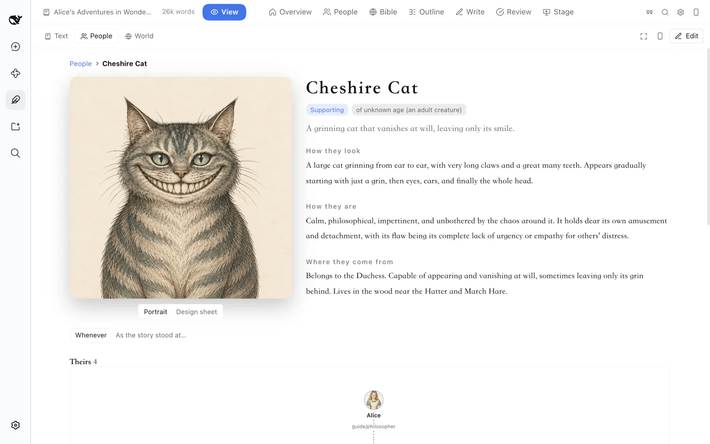
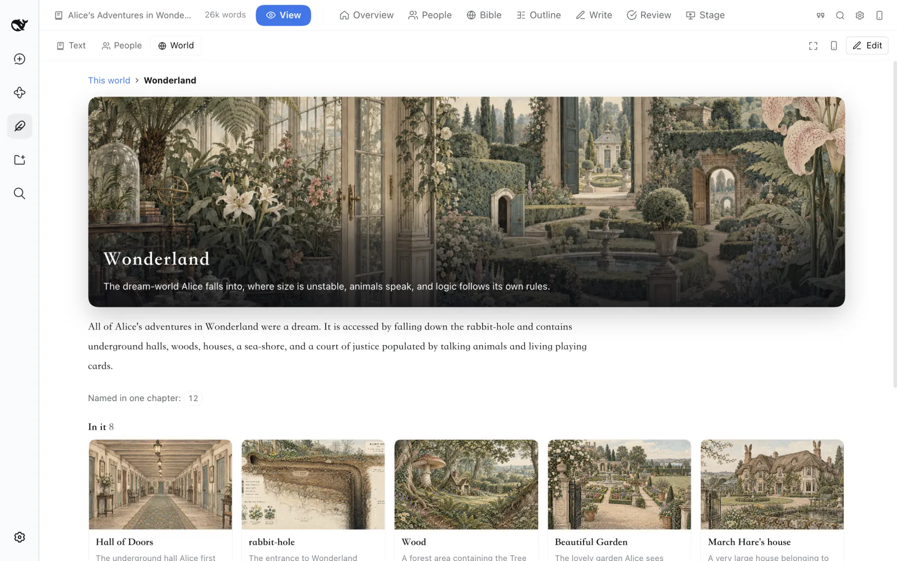
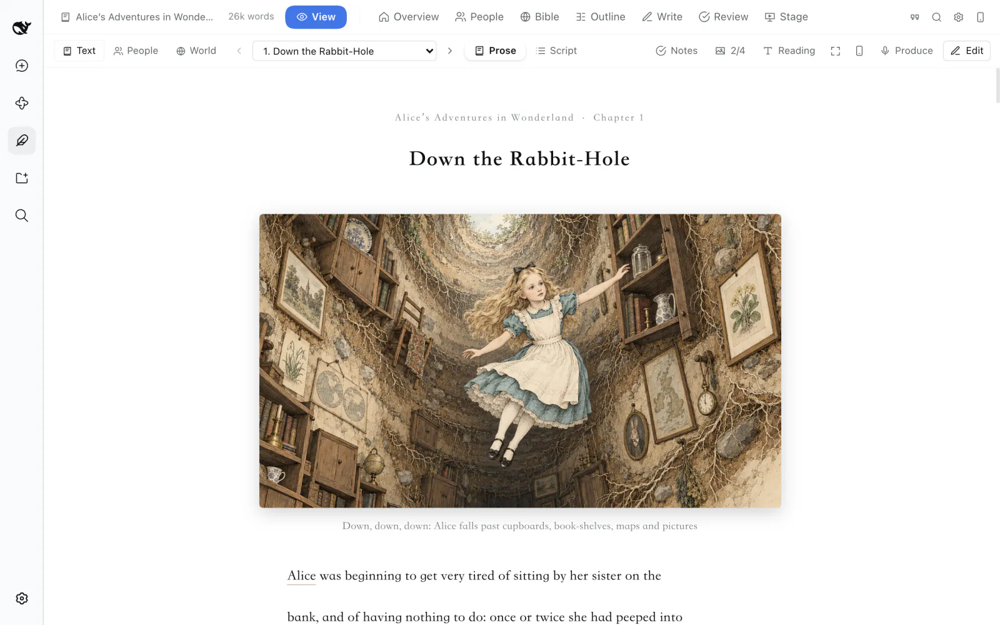
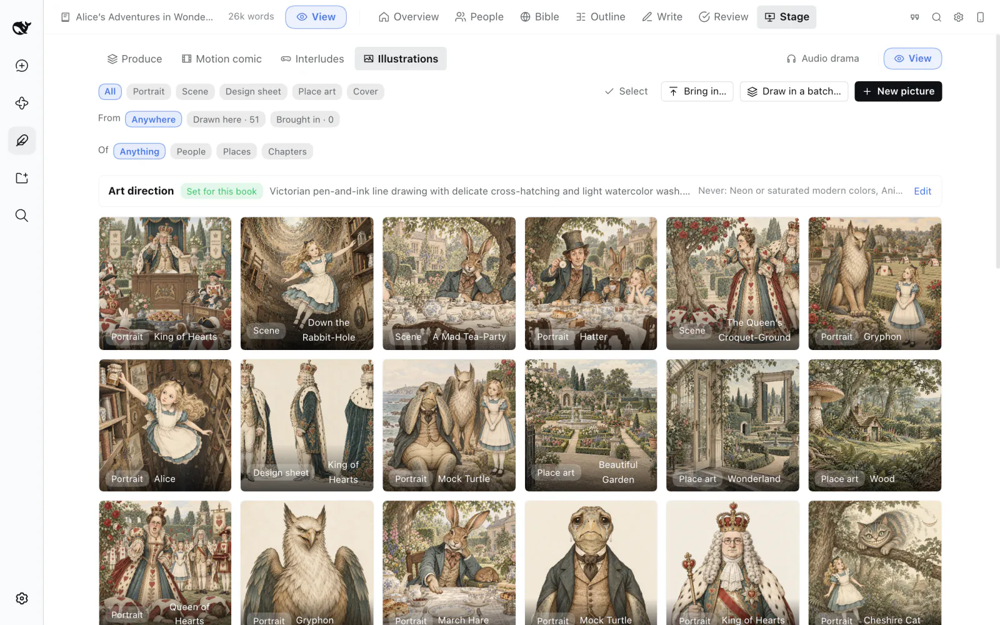
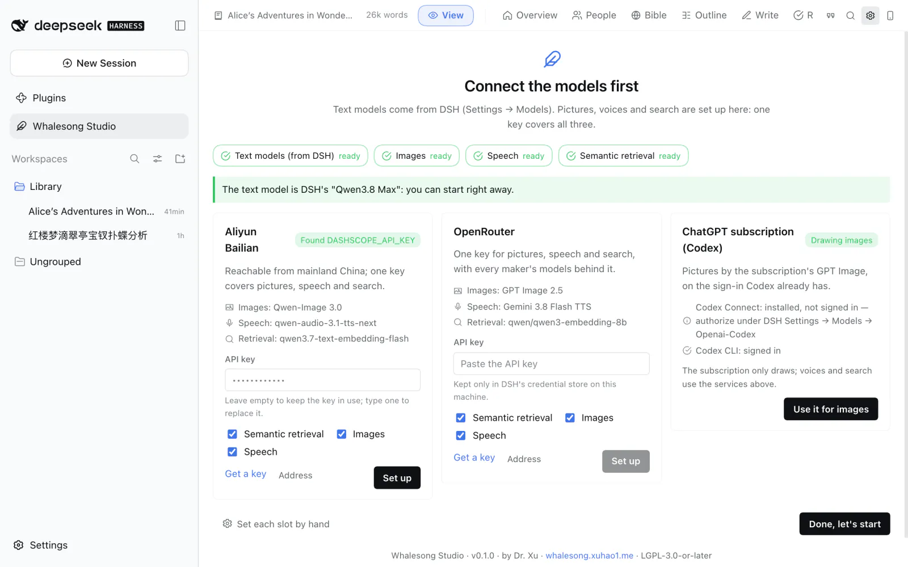

<p align="center">
  
</p>

<p align="center">
  <b>English</b> · <a href="./README.zh.md">简体中文</a> · <a href="./docs/tutorial.md">Tutorial</a> · <a href="./docs/features.md">Everything it does</a> · <a href="https://whalesong.xuhao1.me">Website</a>
</p>

<p align="center">
  <a href="./LICENSE"></a>
  <a href="https://github.com/deepseek-ai/deepseek-harness"></a>
  
</p>

# Whalesong Studio

**Write a long novel with a crew of AI agents — a plugin for [DeepSeek Harness](https://github.com/deepseek-ai/deepseek-harness).**

**Whalesong Studio** (鲸歌工坊) is for writing long fiction with AI. You talk to a showrunner; behind it, a small crew writes, keeps track of the story, reviews, draws and gives it a voice. Hundreds of thousands of words in, your characters are still themselves and the story still adds up. When the book is done, you can publish it as an illustrated website in one click.

It isn't a role-play front end or a "generate a chapter" button: you make the calls, and each model does the part it is good at.



<sub>*Lewis Carroll's* Alice's Adventures in Wonderland *imported into the Studio, open beside a conversation with the showrunner. Every picture in these screenshots was drawn in the Studio.*</sub>

**See what it makes:** two classics published with Whalesong Studio — read *[Alice's Adventures in Wonderland](https://whalesong.xuhao1.me/books/alice/)* or *[Dream of the Red Chamber](https://whalesong.xuhao1.me/books/hongloumeng/)* (红楼梦, in Chinese) online.

> **New here?** The [tutorial](./docs/tutorial.md) walks you through it with screenshots, from installing to your first illustrated chapter.

## A crew, not a single model

Models that plan well and use tools well rarely write beautiful prose, and the best prose writers rarely manage a big project well. So Whalesong Studio doesn't ask one model to do everything:

| Role | What it does |
|---|---|
| **Showrunner** (总编) | The one you talk to, on any model you like. Works out what you want, plans what comes next, hands out the work and reports back. It never writes the story itself. |
| **Writer** (写手) | Writes the prose, on a model you choose. Before every chapter it is handed everything that chapter needs: the setting, where each character stands, what came before, the open threads, the outline and the style. |
| **Continuity** (场记) | Remembers. After every chapter it notes what happened and how everyone has changed. It also reviews like an editor — and when it says something contradicts an earlier chapter, it shows you the passage. |
| **Planner** (策划) | Has the ideas. Works out what could happen next, fleshes out the characters and the world, tries "what if…" turns of the story, and can look things up on the web. |
| **Director** (导演) | Sound and pictures. Adapts chapters into audio drama and storyboards, and plays everyone else when you step into a scene as one of the characters. |
| **Post-production** (后期) | Edits voices, sound and pictures into a video, checks the result itself, and hands it over only when it passes. |

The four crew members are real agents running on DeepSeek Harness's own agent loop, and every job they do leaves a full record in your conversation: what they looked up, what they handed in, what it cost. Prefer buttons to chat? Everything can be done from the Studio's own screens, too.

## Highlights

### Hundreds of thousands of words in, nothing is forgotten

After every chapter the Studio notes what happened, where each character stands and which threads moved. When the next chapter is written, the writer gets a summary of everything before plus the last few chapters in full — the whole book, while it's short enough — along with any earlier passages that matter. A style profile keeps the voice steady. Ask for what comes next, a fix to a paragraph, a rewrite of a chapter or one change carried through the whole book: every change is shown to you first, side by side, and the previous version is always kept.



### Every character gets a page, every place can be explored

Each character has a card — personality, relationships, what they go through in the book, how they look and sound — and every later picture and spoken line follows it. Places nest inside one another: Wonderland holds the hall of doors, the wood, the garden and the March Hare's house. Beside the text, **People** shows each character's page with a large portrait, and **World** opens any place to show its picture, what it contains and who lives there.

| | |
|---|---|
|  |  |
| *People — who they are, how they look, what they go through* | *World — what is in a place, and who lives there* |

### Read it, hear it, watch it

A reader with careful typography and the book's own pictures in the text; one switch turns it into an audiobook, with every character keeping one voice through the whole book. Pictures stay consistent too: each character first gets a design sheet — front, side and back — and every later picture is drawn to match. Go further with an **audio drama**, a **motion comic** that plays along with the voices, a chapter cut into a **video**, or an **interlude** — play one of the characters in a scene while the others answer you.

| | |
|---|---|
|  |  |
| *Read — and with one switch, listen* | *Gallery — one look per book; every picture remembers how it was made* |

The pictures can come from any image model you like — GPT Image, Qwen-Image, FLUX, Seedream… or a model running on your own computer.

### Publish it as a work of digital art

When the book is ready, publish it as a website in one click: the text set for reading, a portrait and a short biography for every character, and places your readers can step into. Nothing to install, and it reads well on a phone. The two classics linked above were made exactly this way.

### Bring in a book you've already written

Drop in a `.txt`, `.md`, `.epub` or `.docx`. The Studio finds the chapters, sorts out the characters and the world, rebuilds the outline and learns the style — then you can carry on writing, revise it, or turn it into an audio drama. The screenshots on this page are *Alice's Adventures in Wonderland* imported this way; the Chinese README shows *Dream of the Red Chamber*.

### Yours, on your own machine

- **Your book is an ordinary folder** of Markdown and JSON. Edit it in the Studio, in your own editor or through the showrunner — all three see the same files, and it works well with git.
- **Branching plots**: try another way the story could go on a branch; whichever works better becomes the main line, and nothing you wrote is lost.
- **On your phone** over Wi-Fi with one button, read-only or editable.
- **Private books**: lock a book — text, pictures, audio and your conversations about it — behind a password or your computer's own unlock.
- **Export** to Markdown, plain text, HTML or EPUB, and see **usage and cost** per model, book and day.

Everything it does, in full: **[docs/features.md](./docs/features.md)**.

## Install

Requires DeepSeek Harness `0.2.0-rc.2` or later (`< 0.3`). It works in the Desktop app and the Web UI (`dsh web`).

### Desktop app

The Desktop app owns its `desktop` profile, so plugins are installed from inside the app — `dsh plugin --profile desktop …` is refused by design.

1. Open **Plugins** in the left sidebar and choose **Add plugin**.
2. Enter one of:
   - `github:xuhao1/whalesong-studio` — the app asks before it runs the package's build script;
   - the absolute path of a release tarball, e.g. `/Users/you/Downloads/dsh-novel-writer-0.1.0.tgz`;
   - the absolute path of a built checkout, e.g. `/Users/you/src/dsh-novel-writer` — it is linked rather than copied, so rebuilding the checkout updates the plugin.
3. Install. *Whalesong Studio* appears in the left sidebar and *小说家 Novelist* in the preset menu of a new session; restart the app if they do not.

To upgrade, uninstall the plugin on the same page and add the new version. Your books are ordinary directories in your workspaces and are not touched.

### Web UI and other profiles

`dsh plugin` runs pnpm, which must be on your `PATH`.

```sh
dsh plugin --profile web add /absolute/path/to/dsh-novel-writer-0.1.0.tgz
dsh plugin --profile web remove dsh-novel-writer
```

A built checkout path or `github:xuhao1/whalesong-studio` works in place of the tarball; for the latter pnpm must be allowed to run the build script, see [Package and install a plugin](https://deepseek-harness.github.io/deepseek-harness/en/develop/basic/publish).

### Building it yourself

Needs Node.js 22+.

```sh
git clone https://github.com/xuhao1/whalesong-studio.git
cd whalesong-studio
npm install     # installs dependencies; builds lib/ when the checkout has none
npm pack        # writes dsh-novel-writer-<version>.tgz
```

## Quick start

The [tutorial](./docs/tutorial.md) does the same step by step, with screenshots; this is the short version.

1. Open **Whalesong Studio** in the left sidebar. The first time, it asks you to **connect the models**: pick a service, paste one API key and click **Set up** — pictures, voices and search are configured at once. Writing uses the text models you already have in DeepSeek Harness, so you can also skip this and come back later.
2. **Start a new book** from a sentence or a paragraph about the story. Tick "draft the foundation" and the planner proposes a premise, the main characters, the world, volumes and the opening chapters — all yours to change. Or **bring in a book you've written** by dropping in the file.
3. Start a session with the **小说家 Novelist** preset and say what you want: "write chapter two and end it on the knock at the door", "the villain feels flat — give him a reason", "what if she turns the deal down?", "make chapter one into an audio drama". The Studio opens beside the conversation as soon as the work starts.
4. Read the chapter in the Studio and select anything you'd like changed. Accept or turn down the proposed changes under *Review*. Go full screen when you want more room.



In the message box, `/novel status`, `/novel mode <ideate|bible|outline|draft|revise|review|stage|play>`, `/novel digest` and `/novel export <format>` work as well.

## Configuration

Everything lives in *Whalesong Studio → Settings*, and the showrunner will change any of it for you if you ask. **Writing uses DeepSeek Harness's own models** — whatever you've connected under its *Settings → Models*, including sign-ins such as a ChatGPT subscription through [Codex Connect](https://github.com/franksong2702/dsh-codex-connect); in the Studio you just choose which role uses which. The Studio itself only needs models for pictures, voices and search, and one key sets them all up:

| Service | Images | Speech | Retrieval |
|---|---|---|---|
| Aliyun Bailian | Qwen-Image 3.0 | qwen-audio-3.1-tts-next | qwen3.7-text-embedding-flash |
| OpenRouter | **GPT Image 2.5** | Gemini 3.8 Flash TTS | Qwen3 Embedding 8B |
| OpenAI | GPT Image 2 | gpt-4o-mini-tts | text-embedding-3-small |
| ChatGPT subscription (Codex) | the subscription's GPT Image, no key | — | — |

Or set each one up yourself: any OpenAI-compatible service, ComfyUI, or a model on your own computer. Keys are kept in DeepSeek Harness's credential store, never in a settings file. Every option in detail: [docs/configuration.md](./docs/configuration.md).

## Documentation

| | |
|---|---|
| [Tutorial](./docs/tutorial.md) | from installing to the album, with screenshots |
| [Everything it does](./docs/features.md) | every part of the Studio, in full |
| [Configuration](./docs/configuration.md) | each setting, per-book overrides, deployment defaults |
| [What a book looks like on disk](./docs/project-format.md) | the files of a book, field by field |
| [Design and internals](./docs/design.md) | why the roles are split, the memory layers, the context packer, the stage pipelines ([中文](./docs/design.zh.md)) |
| [Contributing](./CONTRIBUTING.md) | the layout of the code, the dev server, the tests |
| [Changelog](./CHANGELOG.md) | what changed in each release |

## What is sent where

- Text goes to the models you chose for the roles: a role that follows the conversation model or uses a Harness model goes through the Harness LLM runtime (the same routes, credentials and retry policy as your conversations); a role with an endpoint of its own is called by the Studio directly.
- Image prompts, the text of lines to be spoken and (if enabled) text chunks to be embedded go to the media endpoints you configured. Nothing is sent to any endpoint you did not configure; there is no telemetry.
- Keys stay in the Harness credential store on your machine and are only ever sent to the endpoint host they were entered for.
- Books stay in your workspace. Settings live in `$DSH_HOME/novel-writer/`.

## License

[GNU Lesser General Public License v3.0 or later](./LICENSE) (the LGPL supplements the [GNU GPL v3](./COPYING)). You may use the plugin with any Harness setup and combine it with other plugins under their own terms; changes to the plugin itself stay under the LGPL.

**Icon and art.** DeepSeek-chan, the "maid whale-girl" (女仆鲸鱼娘): the icon and the cover drawn for this project with GPT Image through Codex, the pictures on the Studio's home page with Qwen-Image after it. Character reference: 溟月 by 上善无形, in the DeepSeek maid design by ZipZipPipe. The books in the screenshots are in the public domain: *Alice's Adventures in Wonderland* by Lewis Carroll (text from [Project Gutenberg](https://www.gutenberg.org/ebooks/11)) and 《红楼梦》 by 曹雪芹; their pictures were drawn in the Studio with GPT Image through Codex.

The novels you write with it are yours.

---

By Dr. Xu · <https://whalesong.xuhao1.me>
