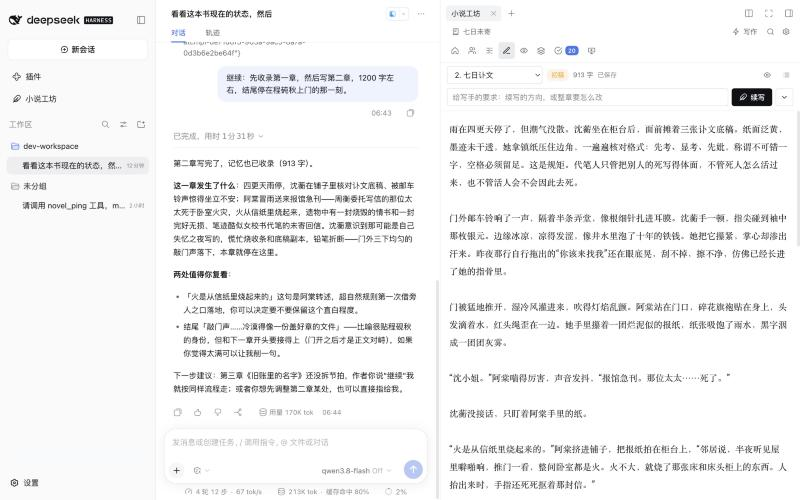
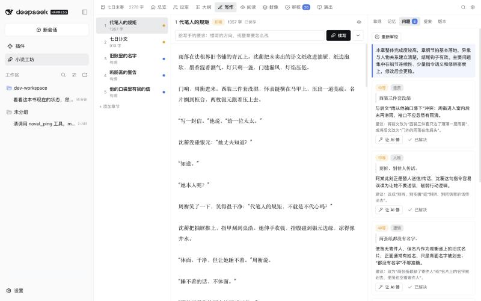
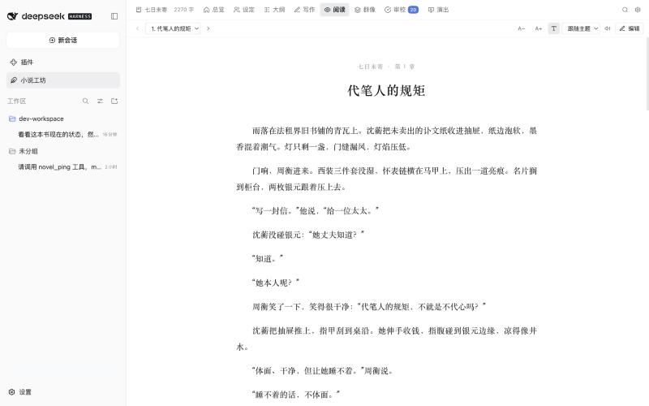
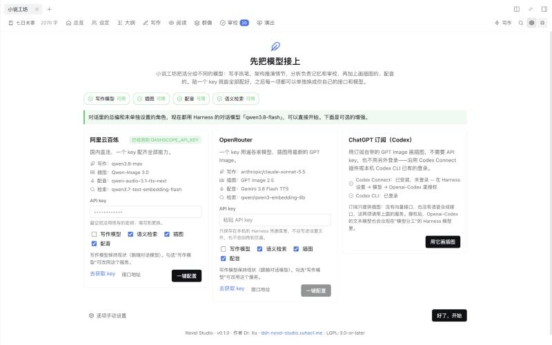

# 小说工坊 · DeepSeek Harness 长篇小说插件

[English](./README.md) | **简体中文**

`dsh-novel-writer` 把 [DeepSeek Harness](https://github.com/deepseek-ai/deepseek-harness) 变成一间写长篇小说的工坊。它不是"酒馆"式的角色扮演前端，也不是"一键生成一章"的按钮，而是为**长线故事**准备的：让一个故事里的人、世界和对读者许下的承诺，在几十万字的跨度里不走样——你来定夺，模型各司其职。




## 核心想法：总编与写手分离

擅长规划、调用工具、把一个大工程理得井井有条的模型，文笔往往平平；文笔最好的模型，又常常管不好一个工程。小说工坊把这两件事拆开：

| 角色 | 由谁担任 | 做什么 |
|---|---|---|
| **总编**（编排器） | 你在对话里交谈的 Agent——任意模型，按会话选择 | 听懂你要什么，做规划，决定下一步写哪里，给其他模型下简报，向你汇报 |
| **写手** | 你为"写正文"专门挑的模型 | 起草、续写、改写正文；每次调用都会收到为它打包好的上下文 |
| **架构** | 推理强的模型 | 推演大纲与节拍，完善人物与世界观，做"如果……会怎样"的分支推演 |
| **分析** | 快而稳的模型 | 把每章收录成记忆，像责任编辑一样审校，切分有声脚本与分镜 |
| **导演** | 响应快的模型 | 你下场演戏时，实时扮演其他人物 |

总编自己从不写正文：它调用 `novel_write` 并附上一段简报；写手拿到的是设定、在场人物及其当前状态、此前的故事、相关的旧段落、未回收的线索、本章章纲和文风。你也可以完全不经过对话，直接在工坊里操作——每一项能力在两边都有。

## 你会得到什么

**一本书一个正史。** 一个项目就是一个普通目录：凡是人写的东西都是 Markdown（人物卡、世界观条目、文风、章节），结构与机器记忆是 JSON。在工坊里改、用你自己的编辑器改、让 Agent 改，三者看到的是同一批文件，也适合用 git 管理。

**有"人"的设定集。** 人物卡不只是小传：还有结构化的人格（带强度的特质、按优先级排列的价值观、说话习惯、绝不会做的事、压力下的反应）、人物关系、生命周期状态、绘图用的外貌描述和配音设置。世界观条目分级——核心设定始终随上下文提供，细节按相关性取用。

**群像调度。** 每个人物都有生命周期（未登场 → 活跃 → 暂离 → 已退场 / 已死亡）。收录章节时会从正文里发现登场、退场与死亡，并提出状态变更建议。"群像"页有生命周期看板、出场分布图（已出场 / 计划出场 / 计划了却没出场）和关系图，并会提醒：谁消失太久了、哪份章纲还在安排已死之人、哪个主要人物还没有弧光。

**随篇幅增长的记忆。** 每写完一章，分析模型提取摘要、硬事实、每个人物在章末的状态、新出现的实体以及线索的推进；每十章汇总成一段"篇章摘要"。之后每次调用都会现场打包上下文：稿子装得下时给全文（默认上限 50 万 token，且不超过模型可读窗口的七成）；装不下时用分层记忆（篇章摘要 → 章节摘要 → 紧邻上文原文）加上检索到的相关旧段落（关键词检索，可选向量检索混合排序）。

**文风是一等公民。** 文风档案包含视角、时态、基调、用词、节奏、意象、对白习惯、必须遵守的规则、禁用清单和范文。可以从你喜欢的文字里提炼，可以先试写一段听听笔触，也可以每本书换一套。

**五种改书的方式**——对应作者心里的几种"模式"：

| 你想…… | 在工坊里 | 通过总编 |
|---|---|---|
| 推演接下来发生什么（大纲推演） | 大纲 → 推演（后续章节、节拍、假设分支） | `novel_derive` |
| 改一小段（局部修改） | 写作页选中文字 → 润色 / 扩写 / 精简 / 按你的要求改 | `novel_revise scope=passage` |
| 重做一章 | 写作页 → 按要求修改整章 | `novel_revise scope=chapter` |
| 改贯穿全书的东西（全文修改） | 审校 → 全书修订 | `novel_revise scope=book` |
| 改世界观或人物，并同步到正文（世界观修改 / 人物修改） | 审校 → "同步一条世界观变更 / 一次人物变更" | `novel_bible` + `novel_revise scope=book` |

修订以**提案**的形式出现，带差异对比，由你采纳或放弃。每次生效的改动都会先给旧稿存一份快照，任何历史版本都可以对比与恢复。

**从已有稿件一键导入。** 给它一份已有的稿子（`.txt` / `.md`，UTF-8 或 GBK）：自动拆章、逐章收录、把人物归并成人物卡、整理世界观条目、重建大纲与线索，并提炼文风。

**读，也可以听——同一页。** 认真排版的阅读器：内嵌插图、主题、字号，以及选中文字后的工具条——"去修改"、"配图"、"和总编讨论"。顶上的开关在**看**和**听**之间切换：听的时候正文不变，正在念的那一句在文中亮起，点任何一句就从那里开始播，一章听完接下一章。作者在同一页上方还有有声版的制作台。

**在手机上读。** 阅读页里点一下手机图标，这本书就开放给同一个 Wi-Fi 下的手机和平板：扫码或输入地址，看和听两种模式都在。默认关闭、逐本开启、只读，地址里带一段可以随时更换的随机口令；模型、密钥和没分享的书都碰不到。

**演出。**

- *插图*——选中一段文字，配一张图，直接嵌在这段之后。全书保持同一种样子，而且没有任何一处是藏起来的：每本书一份**画风**（写在 `novel.json` 里，画图的地方就看得到、改得了）；一份**"不要出现"清单**，写这个世界里没有的东西；每个人物一条写给绘图模型看的**视觉锚点**（不是写给读者的那段外貌）；以及一张**人设图**——正面、侧面、背面三视图——之后每一张有此人的图都把它当参考图一起交给模型。多套服饰各有从主人设图衍生出来的人设图，常去的地点有场景设定图；每张图都记着自己的提示词是由哪几部分拼成的。
- *有声剧*（就是阅读页的"听"）——分析模型把一章切成旁白、对白和心声，标出每句是谁说的、带什么情绪，并标注场景环境音。**声音表**让每个说话的人——有人物卡的，和没有卡的路人——全书、跨章、连幕间都用同一个声音。每一句合成后都会被**听检**：没念完、没声音，或者明显不像这个人的声音，就自动重念，留下最好的一次；所有句子统一音量。环境音（雨、酒馆、夜、紧张……共 18 种）由浏览器实时合成。语音服务可插拔：Qwen Omni 实时接口（WebSocket）、阿里云百炼 Qwen-TTS（HTTP，支持声线设计）、任意 OpenAI 兼容的 `/audio/speech`。
- *有声漫*——与有声脚本绑定的分镜，人物形象前后一致，配合缓慢的镜头运动和语音播放。分镜切多细由你定：精简、适中、细密，或交给分镜导演自己判断，还可以给一个格数上限；长段旁白中途也会换画面。
- *幕间*——下场扮演故事里的某个人物（或只当导演），其他人物由导演模型实时演出：背景、立绘、配音、环境音、选项——一部现场生成的视觉小说（Galgame）。幕间不会影响正史，除非你让写手把它写成一章；否则可以留作番外，或直接作废。

**声音设计。** 有声脚本除了台词，还安排每个场景听得到什么：环境底声、音效、配乐。它们作为注释显示在正文旁边（读的时候也看得到，给读者气氛），也可以由声音模型逐处生成、垫在人声下面——语音用百炼的音频生成模型时不需要另配模型。旁白不再一段一录：相邻的旁白合成一口气念的大段，夹在对白之间的"他说"默认不念。

**看得见模型在想什么。** 写作和其他任务进行时，模型的思维链（开源模型）或思维链摘要（闭源模型）可以边想边看。

**总编有自己的手，但只有一条路。** 作者口述的一句话、一个名字、一处事实，总编用 `novel_edit` 原样改，不绕写手；该"写"的仍然交给写手。任何改动都留版本、重新收录记忆、记进总览页的"改动记录"，改过正文的可以一键撤销。总编想绕过工坊直接改书的文件会被拦下并指到正确的工具；工坊之外对文件的改动也会被发现、记录、补收录。

**群像里的小人物。** 正文里有名字但没立卡的人（路人甲、店员、"那位太太"）汇总在"群像 · 龙套"里：值得跟踪的立卡，其实是某个人物别名的并过去，其余不管。人物列表默认显示定妆照，也可以切成极简。

**在手机上不只是读。** 分享给手机的书可以设成"仅阅读"或"可编辑"：可编辑时能在手机上改正文、玩幕间；有声漫也能在手机上看。

**加密。** 一本书可以整本加密：正文、设定、记忆、图片、音频在磁盘上只剩密文，连文件名也加密。用密码或这台电脑的系统解锁（触控 ID / 电脑密码）打开；锁着的时候连总编也看不到。手机第一次读要输密码。

**导出**为 Markdown、纯文本、HTML 或 EPUB。

## 界面一览

| | |
|---|---|
|  |  |
| *总览——书写到哪了、下一步做什么* | *写作——编辑器与审校面板；选中文字即可改写* |
|  |  |
| *阅读——排版优先* | *演出——有声漫播放* |
|  |  |
| *先把模型接上——一键配置，或逐项自定义* | *对话就是操作界面，工坊在旁边随时可看可改* |


*幕间：你扮演一个人物，其余人物由导演模型演出。*

## 它怎样融入 Harness

写小说在这里就是和总编对话，书摊开在对话旁边。

- 一个 **Agent 预设**"小说家 Novelist"：选择它的会话获得总编人格、24 个 `novel_*` 工具、随对话携带的项目摘要、`/novel` 指令和 5 份工作流技能。其他会话不受任何影响。
- **对话就是操作界面**：工坊里每个页面能做的事，都可以直接在对话里说——"把这本 epub 导进来接着写"、"第三章的敲门声改成电话铃"、"给沈蘅画张立绘"、"打开大纲给我看"、"用百炼把配音配好"。总编会自己调用对应的工具，需要你看的时候把那个页面打开给你。
- 会话右侧栏的**"小说工坊"标签页**：书就在对话旁边，总编一开工它就自己打开。总编做的事实时可见（写手写的章节会流式出现在编辑器里），你选中的任何内容都能一键带进对话。想专心读写时点**全屏**（工坊顶栏最右，或侧栏自带的全屏键），再点一下回到对话旁边。
- 各个页面——设定、大纲、写作、阅读（看 / 听）、群像、审校、演出、设置——留给你**亲手细调和审阅**：模型做了什么，都能在这里看到、改掉、退回。凡是要等一会儿的事，按下去的按钮会写着它正在做什么，页面底部有一条"进行中"，列出这本书正在跑的每一件事和停止键。
- 左侧栏的**"小说工坊"页面**：书架、设置和任何一本书，不需要开对话。
- 对话记录里的**工具行**：写明"让哪个模型做了什么"，并能一键跳到工坊里对应的位置。
- **一场对话，一本当前的书。** 对话同一时间只在一本书上，旁边的工坊显示的也是这一本。在工坊里换书，对话跟着换——总编会被明确告知现在是哪本、之前谈的是哪本；让总编换书，工坊也跟着换。只想碰一下另一本书时，任何工具都可以带上 `book` 点名。
- 文本模型可以来自 Harness 已经接入的任何提供方——在"设置 → 模型"里填过 key 的，或者用登录接入的（比如经 Codex Connect 登录的 ChatGPT 订阅）——也可以给每个角色单独指定接口；密钥存进 Harness 的凭据库。
- **用量与成本。** 工坊每调用一次模型都会记账——各个角色的 token、图片张数、语音分钟数——按模型、作品和日期汇总；填上你实际付的单价，就能看到钱花在哪。

适用于 Web 界面（`dsh web`）和桌面版。

## 安装

需要 DeepSeek Harness `0.2.0-rc.2` 及以上（`< 0.3`）。

### 桌面版

桌面版的 `desktop` 配置档由应用自己管理，所以插件要在应用里安装——`dsh plugin --profile desktop …` 会被命令行直接拒绝，这是有意的设计。

1. 打开左侧栏的**插件**，点**添加插件**。
2. 在"包名或地址"里填下面任意一种：
   - 发布包的绝对路径，例如 `/Users/you/Downloads/dsh-novel-writer-0.1.0.tgz`；
   - 已构建好的源码目录的绝对路径，例如 `/Users/you/src/dsh-novel-writer`——这种方式是"链接"而不是复制，之后重新构建源码目录，插件随之更新；
   - `github:xuhao1/dsh-novel-writer`——应用会先询问是否允许运行本包的构建脚本。
3. 安装。左侧栏会出现*小说工坊*，新会话的预设菜单里会出现*小说家 Novelist*；没出现就重启一次应用。

升级：在同一页面卸载后再添加新版本。你的书只是工作区里的普通目录，不会被动到。

### Web 界面与其他配置档

`dsh plugin` 会调用 pnpm，需要它在 `PATH` 里。

```sh
dsh plugin --profile web add /absolute/path/to/dsh-novel-writer-0.1.0.tgz
dsh plugin --profile web remove dsh-novel-writer
```

发布包也可以换成已构建的源码目录，或 `github:xuhao1/dsh-novel-writer`；后者需要允许 pnpm 运行构建脚本，见官方文档[打包与安装插件](https://deepseek-harness.github.io/deepseek-harness/en/develop/basic/publish)。

### 自己构建

需要 Node.js 22+。

```sh
git clone https://github.com/xuhao1/dsh-novel-writer.git
cd dsh-novel-writer
npm install     # 安装依赖并构建 lib/
npm pack        # 生成 dsh-novel-writer-<版本>.tgz
```

## 快速开始

1. 打开左侧栏的**小说工坊**。第一次打开会先到**"先把模型接上"**这一页：选一个服务，贴一个 API key，点**一键配置**——写作模型、插图、配音、语义检索按推荐一次配好。已经在 Harness 里配过对话模型的话，这一步可以直接跳过，之后随时补。
2. **开一本新书**：一句话或一段话描述你想写的故事即可。勾选"让 AI 起草"后，架构模型会给出故事核、主要人物、世界观、分卷和开篇章纲——之后都可以改。
   或者**导入一本已有的小说**：把 `.txt` / `.md` / `.epub` / `.docx` 拖进去，工坊会拆章、逐章提炼摘要与事实、归并人物卡与世界观、生成大纲并学会它的文风。之后就能接着写、修订，或者做成有声剧。
   书保存在工作区里；没有合适的工作区就在"保存到工作区"里选**新建工作区**。
3. 用**小说家 Novelist** 预设开一个会话。直接说你要什么："把第二章写出来，结尾停在敲门声"、"反派太扁平了，给他一个站得住的理由"、"如果她拒绝了这笔交易会怎样？"、"把第一章做成有声剧"。总编开工时，工坊会自己出现在对话右侧。
4. 在工坊里读这一章，选中你想改的地方；在*审校*页处理提案和设定建议。需要大一点的地方就点全屏。

输入框里可以用 `/novel status`、`/novel mode <ideate|bible|outline|draft|revise|review|stage|play>`、`/novel digest` 和 `/novel export <格式>`。

## 配置

全部在*小说工坊 → 设置*里，也都可以在对话里让总编代劳；每个字段的含义、部署默认值与单本书的覆盖方式见 [docs/configuration.md](./docs/configuration.md)。

**一键配置**——贴一个 key，按推荐把四项能力一次配好：

| 服务 | 写作 | 插图 | 配音 | 语义检索 |
|---|---|---|---|---|
| 阿里云百炼 | qwen3.8-max / qwen3.8-flash | Qwen-Image 3.0 | qwen-audio-3.1-tts-next | qwen3.7-text-embedding-flash |
| OpenRouter | Claude Sonnet 5.5、DeepSeek V4 | **GPT Image 2.5** | Gemini 3.8 Flash TTS | Qwen3 Embedding 8B |
| OpenAI | GPT-6.1 Sol、GPT-6 Luna | GPT Image 2 | gpt-4o-mini-tts | text-embedding-3-small |
| ChatGPT 订阅（Codex） | — | 订阅自带的 GPT Image，无需 key | — | — |

**逐项自定义**——每一项都能单独指定服务、接口地址、密钥、模型和思考强度：

- **模型分工**——写手、分析、架构、导演各自可以：跟随对话模型；选用"设置 → 模型"里配好的模型；或者直接指定一个 OpenAI 兼容接口（百炼、OpenRouter、OpenAI、DeepSeek、本地服务、公司网关都行）。模型名可以从接口返回的列表里选，也可以直接填。推理型模型落笔前要先"思考"：给写手和分析选较低的思考档位，一次调用是几秒还是几分钟，差别就在这里。
- **上下文**——`自动`（装得下给全文，装不下走检索）、`始终检索` 或 `尽量全文`；上下文预算；续写时原样携带多少前文。
- **图像**（可选）——OpenRouter 的 `/images`（GPT Image、Gemini、Seedream、FLUX…）、OpenAI 兼容的 `/images/generations`、阿里云百炼（Qwen-Image、万相、Z-Image），或者 ChatGPT 订阅。
- **语音**（可选）——百炼音频生成 `qwen-audio-3.1-tts-next`（用文字描述音色，为每个人物生成并沿用一段参考音）、Qwen Omni 实时接口、百炼 Qwen-TTS（可设计声线）、OpenRouter 的 `/audio/speech`，或 OpenAI 兼容的 `/audio/speech`。
- **语义检索**（可选）——任意 OpenAI 兼容的 `/embeddings` 接口，与关键词检索混合排序。

**密钥**直接填在设置页里，和其他设置一起保存。它存进 Harness 的凭据库（按接口域名一条记录），不会写进设置文件，也不会回传到页面；同一个服务的各项能力共用一个密钥，填一次就够。习惯用环境变量的话，`DASHSCOPE_API_KEY`、`OPENROUTER_API_KEY`、`OPENAI_API_KEY` 会被自动识别，也可以给某一项指定别的变量名。

**ChatGPT 订阅**——如果装了 [Codex Connect](https://github.com/franksong2702/dsh-codex-connect) 插件并授权，或者本机的 Codex CLI 已用 ChatGPT 登录，插图可以直接用订阅里的 GPT Image，不需要 API key，工坊也不会另做一套登录。Codex Connect 提供的 Openai-Codex 文本模型同样可以分配给各个角色。订阅里没有向量接口和语音合成接口，这两项请用上面的服务。

## 一本书在磁盘上的样子

```
my-novel/
├── novel.json                 书名、故事核、语言、目标字数、当前文风
├── outline.json               分卷 → 章节 → 节拍，以及线索与伏笔
├── bible/
│   ├── characters/<名字>.md   front matter（人格、生命周期、外貌、声音）+ 备注
│   ├── world/<名字>.md        分级的世界观条目
│   └── styles/<名字>.md       文风档案
├── manuscript/ch001.md …      正文，一章一个文件
├── assets/                    图片与音频
├── export/                    导出的成书
└── .novel/                    机器记忆：章节收录、历史版本、提案、审校结果、
                               有声脚本、分镜、幕间记录、检索索引
```

详见 [docs/project-format.md](./docs/project-format.md)。

## 设计与实现

[docs/design.zh.md](./docs/design.zh.md) 解释了这些设计背后的考虑：角色怎么拆、为什么是这几种工作模式、记忆怎么分层、上下文怎么打包、群像的生命周期，以及演出部分的几条流水线（[English](./docs/design.md)）。

整个插件是一个 npm 包、三个入口：宿主端（项目存储、流水线、任务、工坊的接口）、Agent 端（挂在预设里：工具、提示词、指令）和浏览器端（工坊界面）。目录结构、开发服务器与测试见 [CONTRIBUTING.md](./CONTRIBUTING.md)。

## 数据去了哪里

- 文本发给你为各角色指定的模型：跟随对话模型或选用 Harness 模型的角色，走 Harness 的模型运行时（与你平时对话相同的线路、凭据和重试策略）；单独指定了接口的角色，由工坊直接请求那个接口。
- 绘图提示词、要朗读的台词，以及（启用时）要做向量化的文本片段，会发给你配置的媒体接口。除此之外不向任何地方发送数据；没有遥测。
- 密钥只保存在本机的 Harness 凭据库里，只发往它所属的那个接口域名。
- 书留在你的工作区里。设置保存在 `$DSH_HOME/novel-writer/`。

## 许可证

[GNU Lesser General Public License v3.0 或更高版本](./LICENSE)（LGPL 是在 [GNU GPL v3](./COPYING) 之上附加的许可）。你可以在任何 Harness 环境中使用本插件，并与其他插件按各自的许可组合；对本插件自身的修改须继续以 LGPL 发布。

**图标不在 LGPL 之内。** 图标画的是同人形象 DeepSeek 娘（“女仆鲸鱼娘”）：角色原案是上善无形的原创角色“溟月”，以 [CC BY-NC-SA 4.0](https://creativecommons.org/licenses/by-nc-sa/4.0/deed.zh-hans) 开放二次创作；DeepSeek 女仆版设定出自 ZipZipPipe，遵循同一协议。本项目里的几张图（`icon.png`、`docs/images/icon.png`、`docs/images/icon-alt.webp`）是为本项目用 GPT Image（经 Codex）绘制的，同样以 CC BY-NC-SA 4.0 提供：须保留署名、以相同方式共享、不得商用。以商业方式分发本插件时必须更换图标。

你用它写出的小说，版权归你。

---

作者：Dr. Xu · 项目主页：<https://dsh-novel-studio.xuhao1.me>
