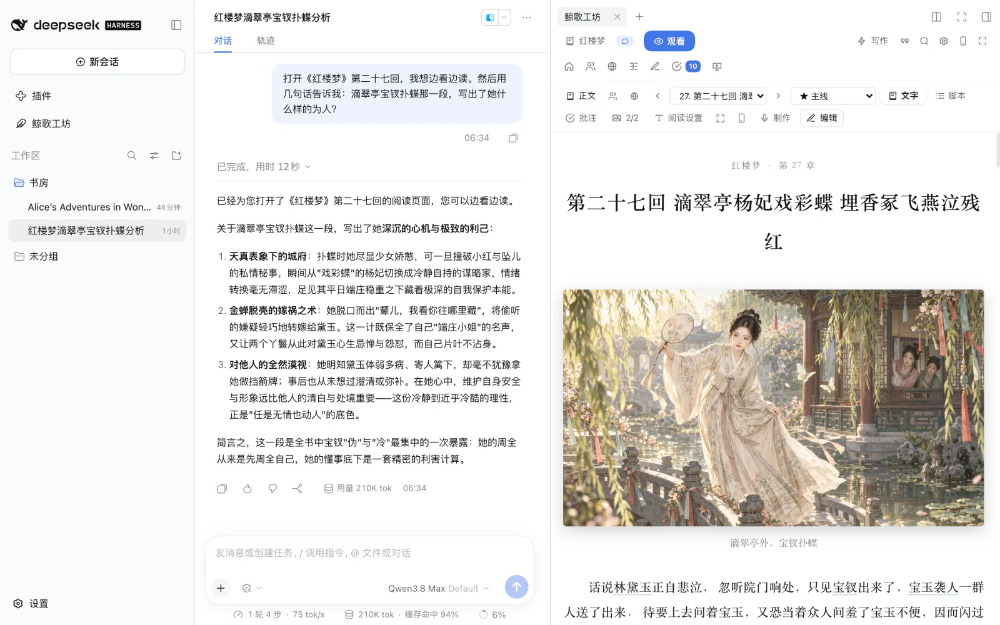
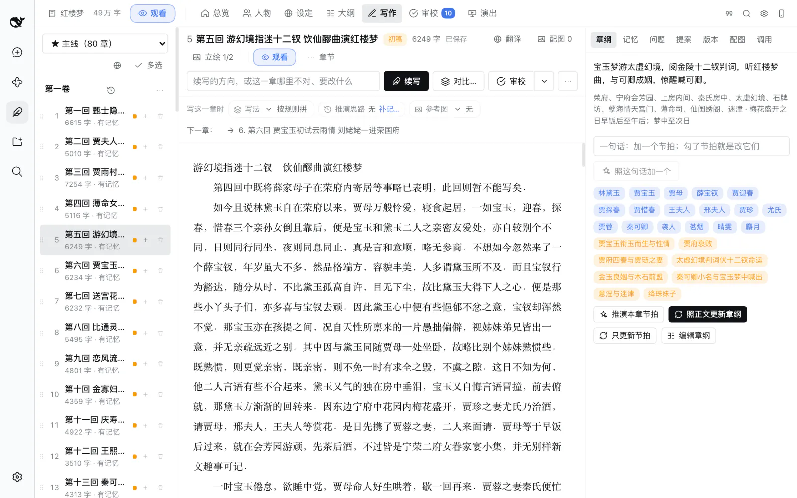
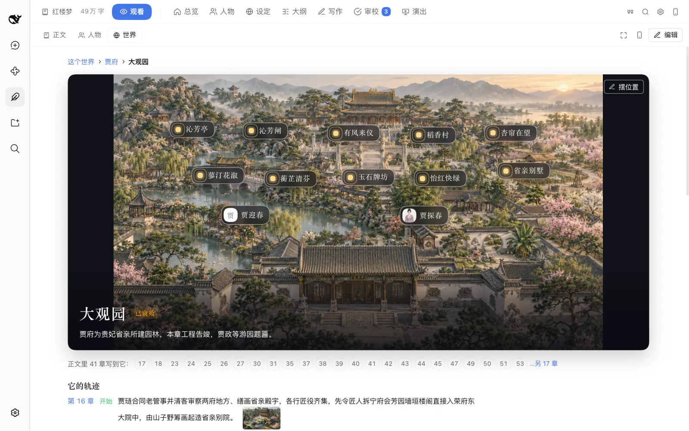
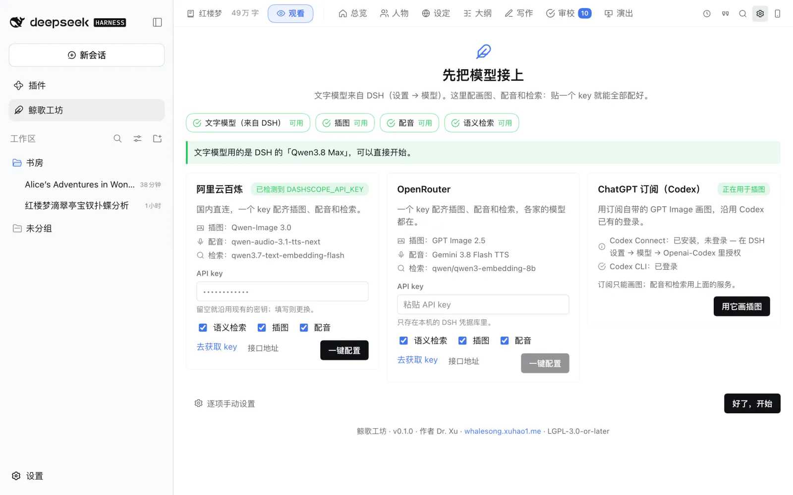

<p align="center">
  
</p>

<p align="center">
  <a href="./README.md">English</a> · <b>简体中文</b> · <a href="./docs/tutorial.zh.md">新手教程</a> · <a href="./docs/features.zh.md">全部功能</a> · <a href="https://whalesong.xuhao1.me">项目网站</a>
</p>

<p align="center">
  <a href="./LICENSE"></a>
  <a href="https://github.com/deepseek-ai/deepseek-harness"></a>
  
</p>

# 鲸歌工坊

**和一支 AI 剧组一起写长篇小说——[DeepSeek Harness](https://github.com/deepseek-ai/deepseek-harness) 插件。**

**鲸歌工坊**（Whalesong Studio）是用 AI 写长篇小说的工具。你和总编聊；在它身后，一个小剧组分头去写、去记、去审、去画、去配音。写到几十万字，人物还是那个人物，前后还对得上。书写完了，还能一键发布成配图的网站。

它不是角色扮演的聊天前端，也不是"一键生成一章"的按钮：你拿主意，每个模型做它最擅长的那部分。



<sub>导入工坊的《红楼梦》前八十回，开在和总编的对话旁边。截图里的每一张画都是在工坊里画的。</sub>

**看看做出来的作品**：两部用鲸歌工坊发布的经典，在线就能读——[《红楼梦》](https://whalesong.xuhao1.me/books/hongloumeng/)、[《爱丽丝漫游奇境》](https://whalesong.xuhao1.me/books/alice/)（英文原版）。前几章还能直接听：《红楼梦》前十回、《爱丽丝》前三章，都是工坊配的音。点进去以后，别忘了点点上面的「人物」「世界」：每个人物都有自己的一页，主要人物配了画像；书里的地方可以一层层走进去看。

> **第一次用？** 看[新手教程](./docs/tutorial.zh.md)，带着截图一步步走：从安装到画出第一章的插图。

## 一个剧组，而不是一个模型

会规划、会用工具的模型，文笔往往一般；文笔最好的模型，又管不好一部长篇。所以鲸歌工坊不指望一个模型包办一切：

| 角色 | 做什么 |
|---|---|
| **总编** | 和你对话的那一位，模型由你挑。听懂你想要什么，安排下一步写什么，把活派给大家，再向你汇报。它自己不写正文。 |
| **写手** | 专门写正文，模型由你挑。每次动笔前，都会拿到这一章需要的一切：设定、人物此刻的状态、前情、伏笔、章纲和文风。 |
| **场记** | 记性最好的那一位。每写完一章，就记下发生了什么、每个人变成了什么样；也像责任编辑一样审稿，说哪里前后矛盾，会把原文找出来给你看。 |
| **策划** | 出主意的那一位。推演接下来的情节，充实人物和世界观，陪你试试"如果……会怎样"的另一种走向，需要时上网查资料。 |
| **导演** | 管声音和画面。把章节改编成有声剧和分镜；你想亲自扮演书里的某个人时，由它来演其他所有人。 |
| **后期** | 把配音、音效和画面剪成一段视频，自己先检查一遍，合格了才交给你。 |

场记、策划、导演、后期都是真正的 agent，跑在 DeepSeek Harness 自己的 agent 循环上。每次干活，都会在对话里留下完整的记录：查了什么、交了什么、花了多少，一清二楚。不想聊天也没关系——所有功能在工坊的界面里都能直接点。

## 亮点

### 写到几十万字，也不会忘了前面

每写完一章，工坊都会记下这一章发生了什么、每个人物此刻怎样、哪些伏笔有了进展。写下一章时，前情梗概和最近几章的原文都会交到写手手里（书不长的时候就是全文），相关的旧段落也会一起找出来。文风档案让语气始终如一。想往下写、改一段、重写一章，还是全书统一改一处，说一声就行：所有改动都先给你看，改了哪里一目了然；采纳之后，原来的版本也一直留着。



### 每个人物都有自己的一页，每个地方都能走进去

每个人物有一张卡：性格、关系、在书里经历了什么，还有长相和声音——之后的每一张画、每一句配音都照着它来。书里的地方一层套一层：贾府里有大观园，大观园里有潇湘馆、怡红院。正文旁边，**人物**里每个人一页，配大幅画像；**世界**里有画的地方会展开成一幅场景，园中各处、住在里面的人都标在画上，点一下就进去。

| | |
|---|---|
|  |  |
| *人物——是谁、长什么样、经历了什么* | *世界——走进一个地方，园中各处和人都标在画上* |

### 读、听、看

阅读页排版讲究，书里的画就插在正文里；一个开关切到"收听"，就是一部有声书，每个人物的声音全书一致。画面也前后一致：每个人物先画一张正面、侧面、背面的设定图，之后每次画这个人都以它为准。还可以更进一步：导演改编的**有声剧**、跟着配音播放的**有声漫画**、剪成**视频**的一章，或者**亲自演一场**——扮演书中的一个人物，和其他角色对戏。

| | |
|---|---|
|  |  |
| *阅读——一个开关就能换成收听* | *图库——一本书一种画风，每张画都能查到是怎么画出来的* |

画图可以用任何你喜欢的模型：GPT Image、Qwen-Image、FLUX、Seedream……或者在自己电脑上跑的本地模型。

### 一键把你的创意变成电子艺术品

书写好了，一键发布成一个网站：正文排好了版，每个人物有画像和小传，书里的地方可以一层层走进去看。读者不用装任何东西，手机上也能读。上面那两部经典就是这样做出来的。

### 导入写完的书，接着写

把已有的书拖进来（`.txt`、`.md`、`.epub`、`.docx`），工坊会自动分章、整理人物和世界观、重建大纲、学会原作的文风——然后就能接着写、修改，或者做成有声剧。这一页的截图就是这样导入的《红楼梦》；英文 README 里是《爱丽丝漫游奇境》。

### 都在你自己的电脑上

- **你的书就是一个普通文件夹**，里面是 Markdown 和 JSON。在工坊里改、用自己的编辑器改、让总编改，三边看到的是同一批文件；放进 git 管理也很顺手。
- **剧情分支**：想试试另一种走向？开一条支线写写看。哪条更好，就把哪条定为主线，写过的一个字都不会丢。
- **手机上读**：一个按钮，同一个 Wi-Fi 下手机就能读，可以只读也可以编辑。
- **加密**：不想让人看到的书可以整本加密——正文、图片、音频，连同你和 AI 关于它的对话——用密码或电脑自带的解锁方式打开。
- **导出**为 Markdown、纯文本、HTML 或 EPUB；**用量和花费**按模型、书和日期记账。

所有功能的完整说明：**[docs/features.zh.md](./docs/features.zh.md)**。

## 安装

需要 DeepSeek Harness `0.2.0-rc.2` 及以上（`< 0.3`）。桌面版和 Web 界面（`dsh web`）都能用。

### 桌面版

桌面版的 `desktop` 配置档由应用自己管理，所以插件要在应用里安装——`dsh plugin --profile desktop …` 会被命令行直接拒绝，这是有意的设计。

1. 打开左侧栏的**插件**，点**添加插件**。
2. 在"包名或地址"里填下面任意一种：
   - `github:xuhao1/whalesong-studio`——应用会先询问是否允许运行本包的构建脚本；
   - 发布包的绝对路径：在 [Releases](https://github.com/xuhao1/whalesong-studio/releases) 下载 `whalesong-studio-x.y.z.tgz`，例如 `/Users/you/Downloads/whalesong-studio-0.1.0.tgz`；
   - 已构建好的源码目录的绝对路径，例如 `/Users/you/src/whalesong-studio`——这种方式是"链接"而不是复制，之后重新构建源码目录，插件随之更新。
3. 安装。左侧栏会出现*鲸歌工坊*，新会话的预设菜单里会出现*小说家 Novelist*；没出现就重启一次应用。

升级：在同一页面卸载后再添加新版本。你的书只是工作区里的普通目录，不会被动到。

### Web 界面与其他配置档

`dsh plugin` 会调用 pnpm，需要它在 `PATH` 里。

```sh
dsh plugin --profile web add /absolute/path/to/whalesong-studio-0.1.0.tgz
dsh plugin --profile web remove whalesong-studio
```

发布包也可以换成已构建的源码目录，或 `github:xuhao1/whalesong-studio`；后者需要允许 pnpm 运行构建脚本，见官方文档[打包与安装插件](https://deepseek-harness.github.io/deepseek-harness/en/develop/basic/publish)。

### 自己构建

需要 Node.js 22+。

```sh
git clone https://github.com/xuhao1/whalesong-studio.git
cd whalesong-studio
npm install     # 安装依赖；还没有 lib/ 时构建一份
npm pack        # 生成 whalesong-studio-<版本>.tgz
```

## 快速开始

想照着图一步步来，看[新手教程](./docs/tutorial.zh.md)；下面是最短的版本。

1. 打开左侧栏的**鲸歌工坊**。第一次打开会先请你**接上模型**：选一家服务、贴一个 API key、点**一键配置**——画图、配音、检索就都配好了。写作用的是你在 DeepSeek Harness 里已经接好的文字模型，所以这一步也可以先跳过，之后随时补。**有 ChatGPT Plus / Pro 的话**，点第一张卡片的**用 ChatGPT 登录并配置**，在浏览器里登录一次，写作和插图就都接上了，不用 key（[详细步骤](./docs/chatgpt.zh.md)）。
2. **开一本新书**：一句话或一段话讲讲你想写的故事就够了。勾上"让 AI 起草"，策划会给出故事核、主要人物、世界观、分卷和开头几章的章纲——都可以随便改。或者**导入写完的书**：把文件拖进来就行。
3. 用**小说家 Novelist** 预设开一个会话，直接说你要什么："把第二章写出来，结尾停在敲门声"、"反派太扁平了，给他一个站得住的理由"、"如果她拒绝了这笔交易会怎样？"、"把第一章做成有声剧"。一开工，工坊就会出现在对话旁边。
4. 在工坊里读这一章，选中想改的地方就能改；在*审校*里决定要不要采纳改动。需要大一点的地方就点全屏。



输入框里还可以用 `/novel status`、`/novel mode <ideate|bible|outline|draft|revise|review|stage|play>`、`/novel digest` 和 `/novel export <格式>`。

## 配置

所有设置都在*鲸歌工坊 → 设置*里，也可以直接让总编帮你改。**写作用的是 DeepSeek Harness 自己的模型**——你在它的"设置 → 模型"里接好的任何一个；在工坊里只需要给每个角色挑一个。**ChatGPT 订阅**是个例外：DSH 自带用 ChatGPT 登录，只是它自己的页面里没有入口——工坊引导页上的 ChatGPT 卡片替它点开，登录一次就把这条路由加进 DSH、给各角色配好 GPT 模型（[用 ChatGPT 订阅](./docs/chatgpt.zh.md)）。工坊自己只需要画图、配音、检索三种模型，贴一个 key 就能一次配好：

| 服务 | 插图 | 配音 | 语义检索 |
|---|---|---|---|
| 阿里云百炼 | Qwen-Image 3.0 | qwen-audio-3.1-tts-next | qwen3.7-text-embedding-flash |
| OpenRouter | **GPT Image 2.5** | Gemini 3.8 Flash TTS | Qwen3 Embedding 8B |
| OpenAI | GPT Image 2 | gpt-4o-mini-tts | text-embedding-3-small |
| ChatGPT 订阅（Plus / Pro） | 订阅自带的 GPT Image；写作也用它。登录一次，不用 key | — | — |

也可以一项一项自己配：任意 OpenAI 兼容的服务、ComfyUI，或者你自己电脑上的模型。密钥存在 DeepSeek Harness 的凭据库里，不会写进设置文件。每一项设置的详细说明见 [docs/configuration.md](./docs/configuration.md)（英文）。

## 文档

| | |
|---|---|
| [新手教程](./docs/tutorial.zh.md) | 从安装到画册，带截图 |
| [用 ChatGPT 订阅](./docs/chatgpt.zh.md) | Plus / Pro 用户：一键登录，写作和插图都用订阅 |
| [全部功能](./docs/features.zh.md) | 工坊的每一项能力，完整说明 |
| [配置](./docs/configuration.md) | 每一项设置、单本书的覆盖、部署默认值（英文） |
| [一本书在磁盘上的样子](./docs/project-format.md) | 一本书的文件，逐个字段（英文） |
| [设计与实现](./docs/design.zh.md) | 角色为什么这样拆、记忆怎么分层、上下文怎么打包、演出的几条流水线（[English](./docs/design.md)） |
| [参与开发](./CONTRIBUTING.md) | 代码的目录结构、开发服务器、测试（英文） |
| [变更日志](./CHANGELOG.md) | 每一版改了什么 |

## 数据去了哪里

- 文本发给你为各角色指定的模型：跟随对话模型或选用 Harness 模型的角色，走 Harness 的模型运行时（与你平时对话相同的线路、凭据和重试策略）；单独指定了接口的角色，由工坊直接请求那个接口。
- 绘图提示词、要朗读的台词，以及（启用时）要做向量化的文本片段，会发给你配置的媒体接口。除此之外不向任何地方发送数据；没有遥测。
- 密钥只保存在本机的 Harness 凭据库里，只发往它所属的那个接口域名。
- 书留在你的工作区里。设置保存在 `$DSH_HOME/novel-writer/`。

## 许可证

[GNU Lesser General Public License v3.0 或更高版本](./LICENSE)（LGPL 是在 [GNU GPL v3](./COPYING) 之上附加的许可）。你可以在任何 Harness 环境中使用本插件，并与其他插件按各自的许可组合；对本插件自身的修改须继续以 LGPL 发布。

你用它写出的小说，版权归你。

---

作者：Dr. Xu · <https://whalesong.xuhao1.me>

<sub>DeepSeek 娘的形象参考了上善无形的“溟月”和 ZipZipPipe 的 DeepSeek 女仆设定。</sub>
