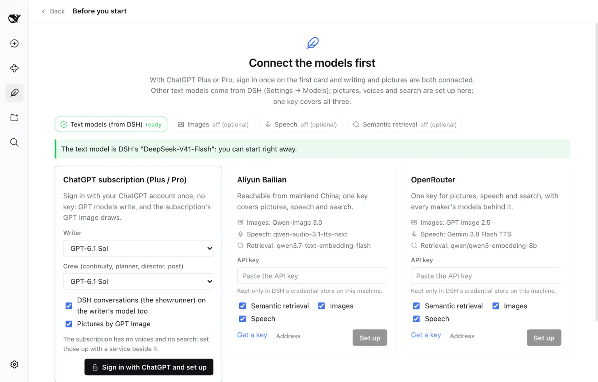
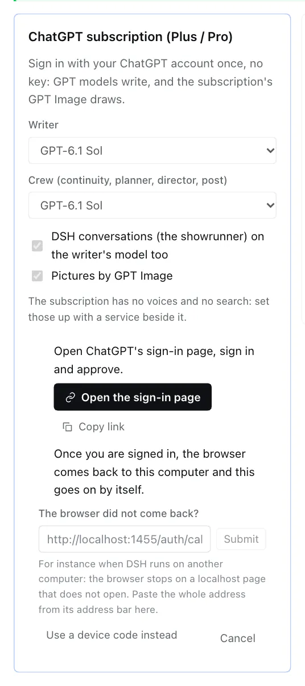
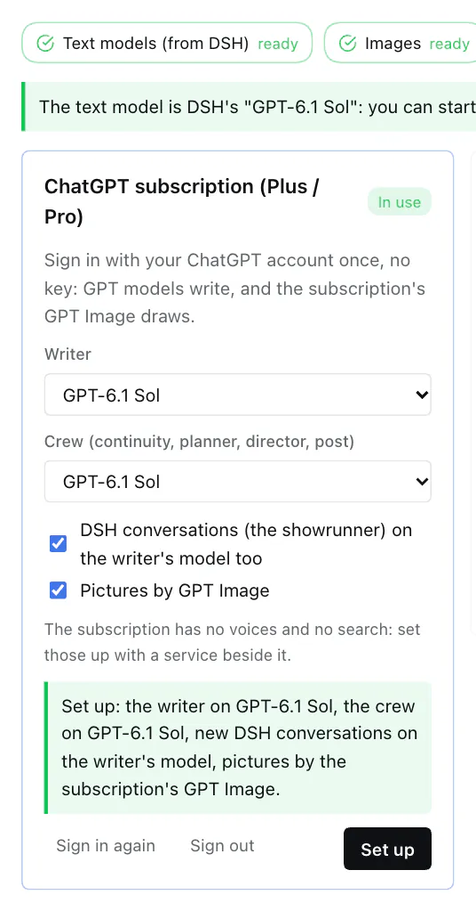

# Whalesong Studio on ChatGPT Plus / Pro

[中文](./chatgpt.zh.md)

With ChatGPT Plus or Pro (a plan that includes Codex) there is no API key to buy: sign in with your ChatGPT account once, and the writer, the crew and the showrunner run on GPT models while the subscription's GPT Image draws the pictures.

This page covers the one-click setup (recommended, no plugin to install), what to do if you already use the Codex Connect plugin, and another way to draw with the subscription. Common problems are at the end.

## What the subscription does and does not cover

| | In the subscription | Not in it |
|---|---|---|
| Writing (writer, crew, showrunner) | GPT-6 Sol and other GPT models | |
| Pictures | GPT Image | |
| Voices | | ✗ use a Bailian or OpenRouter key |
| Semantic retrieval | | ✗ the same (optional: without it, search goes by keywords) |

- Usage comes out of the subscription's allowance (a 5-hour and a weekly window, set by OpenAI), not per token. The Studio's *Usage and cost* page still counts tokens by role, without a price.
- A model DSH lists is not necessarily one your account may use: OpenAI decides. If one fails, pick another.

## One click (recommended)

**You need** DeepSeek Harness 0.2.0-rc.2 or later — DSH can sign in to ChatGPT by itself (in its model adapter `dsh-llm-pi-ai`, on the route `openai-codex`), it just has no page of its own that starts it — and a Whalesong Studio whose guide page has the **ChatGPT subscription (Plus / Pro)** card. **No other plugin.**

1. **Install DSH and Whalesong Studio** — see [Install in the README](../README.md#install). The first time DSH opens it asks for a DeepSeek API key (*Add an API key to get started*); if you only use ChatGPT, choose **Configure later**.

2. **Open the guide page.** The first time Whalesong Studio opens, its guide (*Connect the models first*) comes up by itself; later it is under *Whalesong Studio → Settings → One-click setup → Guide*.

3. **Look over the first card, *ChatGPT subscription (Plus / Pro)*,** and change what you want before pressing the button:
   - **Writer** and **Crew (continuity, planner, director, post)**: both GPT-6 Sol by default. To spare the allowance, put the crew on GPT-6 Luna — much cheaper, and the crew does a lot (each chapter's digest, reviews, storyboards…).
   - **DSH conversations (the showrunner) on the writer's model too**: ticked on a first setup. It makes the writer's model DSH's default for new conversations; if you already use another model in DSH and want conversations to stay on it, untick it.
   - **Pictures by GPT Image**: ticked.

   

4. **Press *Sign in with ChatGPT and set up*.** The card shows:
   - **Open the sign-in page** — sign in to ChatGPT in the browser and approve. Or *Copy link* and open it in the browser you normally use.
   - Once you are signed in, the browser lands on `localhost:1455` on this computer and says so — **the Studio goes on by itself; nothing more to press.**

   

5. **Done.** The card says what was set, for instance *Set up: the writer on GPT-6 Sol, the crew on GPT-6 Sol, new DSH conversations on the writer's model, pictures by the subscription's GPT Image.* The status pills above turn *Text models* and *Images* to *ready*.

   

Start a book, or talk to the showrunner.

### What it changed

All of it is in plain sight and can be put back:

- **DSH Settings → Models** has a provider *ChatGPT* (route `openai-codex`) with the GPT models DSH lists. To drop it, delete that row there.
- **DSH's default model** for new conversations is the writer's — only if *DSH conversations on the writer's model too* was ticked. Change it back in DSH's composer.
- **Whalesong Studio → Settings → Models**: the writer and the crew point at ChatGPT models. Change them one by one there, or pick again on the guide card and press *Set up*.
- **Whalesong Studio → Settings → Image generation**: the service is *ChatGPT subscription*, bridge *Automatic*, on this sign-in.

**Where the sign-in is kept**: DSH's own credential store (the `llm-pi-ai/openai-codex` entry of `~/.dsh/.credentials.yaml`), on this computer only, renewed by DSH. The Studio keeps no copy.

### Another account, signing out

On the card, once signed in:

- **Sign in again** goes through the sign-in once more.
- **Sign out** deletes the sign-in DSH kept. The writer, the crew and the pictures stay set to it and ask for a sign-in again when used. OpenAI is not told.

### DSH is not on the computer in front of you?

For instance DSH runs on another machine and you reach it in a browser (`dsh web`). After signing in, the browser goes to `localhost:1455`, which does not exist on your computer, and the page does not open. Two ways:

- **Paste the address**: the card has *The browser did not come back?*. Copy **the whole address from the address bar** of that page (`http://localhost:1455/auth/callback?code=…`), paste it there and press *Submit*.
- **Device code**: press *Use a device code instead*; the card shows a code and a page (`auth.openai.com/codex/device`). Open the page on any device, enter the code, sign in. (A device code is not always available; if it says so, paste the address instead.)

## Already using the Codex Connect plugin?

[Codex Connect](https://github.com/franksong2702/dsh-codex-connect) is a community plugin that serves the same route, `openai-codex`, with a sign-in of its own. They share the name, so **only one at a time**:

- **Keep Codex Connect**: authorize under *DSH Settings → Models → Openai-Codex*, then press *Set up* on the ChatGPT card of the guide page — the Studio sees Codex Connect's route and only gives the roles its models and sets the pictures, without signing in again.
- **Move to DSH's own**: remove Codex Connect under DSH's *Plugins*, restart DSH, and do the one click above. (Codex Connect keeps its sign-in in `~/.dsh/.openai-codex-auth.json`; removing the plugin leaves it; delete it yourself if you like.)

## Pictures only: the Codex CLI

If the [Codex CLI](https://github.com/openai/codex) is installed on this computer and signed in with `codex login` (*Sign in with ChatGPT*), pictures can go through it too — about a minute each, slower than the two ways above. Under *Whalesong Studio → Settings → Image generation* choose *ChatGPT subscription* and the bridge *Codex CLI*. It draws only; the text models still need connecting.

The three bridges for pictures, in the order *Automatic* takes whichever is signed in: Codex Connect → DSH's own sign-in → Codex CLI.

## Asking the showrunner

Tell the showrunner "set the Studio up with my ChatGPT subscription". Signed in, it runs the one click; not signed in, it opens the guide page and asks you to press *Sign in with ChatGPT and set up* — approving the sign-in in the browser is yours to do.

## Common problems

**I signed in in the browser, and the Studio keeps waiting.**
See where the browser stopped: on a `localhost` page that does not open, it is the "DSH is not on this computer" case above — paste the address back. Still on a ChatGPT page, you may not have approved yet.

**"The sign-in did not finish: OpenAI Codex token exchange failed …"**
The sign-in link expired, or was used twice. Press *Cancel*, then *Sign in with ChatGPT and set up* again.

**The browser says `localhost:1455` refused to connect, and DSH is on this computer.**
Only one program can listen on that port at a time. If `codex login` (the Codex CLI's sign-in) is running, close it and sign in again. Failing that, paste the address.

**Pictures fail with "ChatGPT refused the sign-in … sign in again".**
The sign-in is no longer valid (for instance you signed this device out in your ChatGPT account). Press *Sign in again* on the card.

**One model fails every time.**
Your account may not have that model, or the allowance is used up for now. Pick another under *Whalesong Studio → Settings → Models* (GPT-5.5, say), or wait for the window to reset.

**And voices, and semantic retrieval?**
The subscription has neither. The two other cards on the guide page (Aliyun Bailian, OpenRouter) set them up with one key — tick only *Speech* and *Semantic retrieval*, leave *Images* off, and pictures stay on the subscription.

**The card says "This DSH cannot sign in to ChatGPT by itself".**
Your DSH is older than 0.2.0-rc.2, or runs without its pi-ai model adapter. Update DSH, or install Codex Connect and follow that section.
