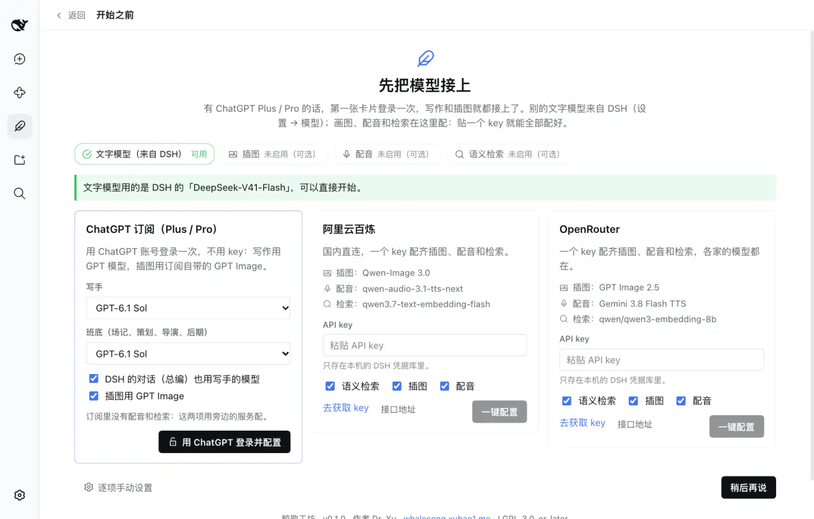
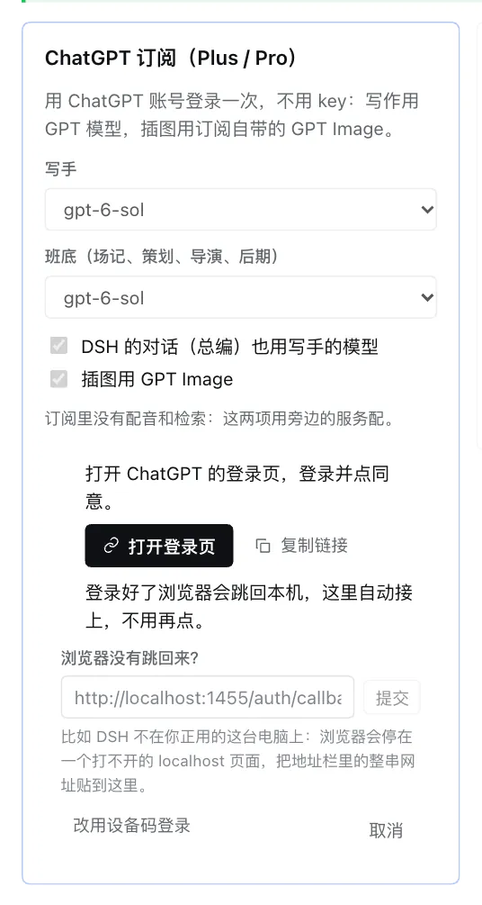
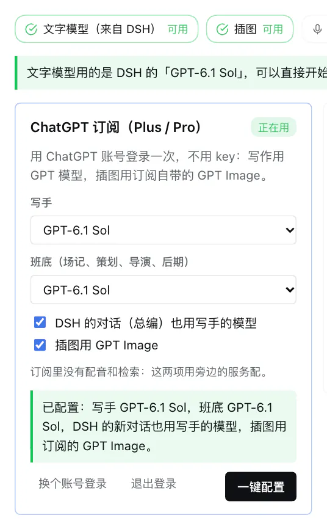

# 用 ChatGPT Plus / Pro 接上鲸歌工坊

[English](./chatgpt.md)

有 ChatGPT Plus 或 Pro（带 Codex 的订阅），就不用另买 API key：用 ChatGPT 账号登录一次，写手、班底、总编都用 GPT 模型，插图用订阅自带的 GPT Image。

这篇讲三件事：一键接上（推荐，不用装插件）、已经装了 Codex Connect 插件怎么办、只想用订阅画图的另一条路。最后是常见问题。

## 先说清楚：订阅能做什么、不能做什么

| | 订阅里有 | 订阅里没有 |
|---|---|---|
| 写作（写手、班底、总编） | GPT-6.1 Sol 等 GPT 模型 | |
| 插图 | GPT Image | |
| 配音 | | ✗ 用百炼或 OpenRouter 的 key |
| 语义检索 | | ✗ 同上（不配也能用，只是改成按关键词找） |

- 额度是订阅的额度（5 小时和每周两个窗口，由 OpenAI 定），不按 token 收钱。工坊的“用量和花费”页照样按角色记 token，但不算钱。
- DSH 列出来的模型不等于你的账号都能用：哪个能用由 OpenAI 决定。用不了的换一个就是。

## 一键接上（推荐）

**需要**：DeepSeek Harness 0.2.0-rc.2 或更新——DSH 自带“用 ChatGPT 登录”（在它的模型适配器 `dsh-llm-pi-ai` 里，路由叫 `openai-codex`），只是 DSH 自己的页面里还没有地方能点开它；鲸歌工坊要是引导页上有“ChatGPT 订阅（Plus / Pro）”这张卡片的版本。**不用装任何别的插件。**

1. **装好 DSH 和鲸歌工坊**，见 [README 的安装一节](../README.zh.md#安装)。第一次打开 DSH，它会弹出“添加一个 API Key 开始使用”要 DeepSeek 的 key——只用 ChatGPT 的话，点“**稍后配置**”。

2. **打开引导页。** 第一次打开鲸歌工坊，引导页（“先把模型接上”）会自己出来；以后在 *鲸歌工坊 → 设置 → 一键配置 → 引导页* 里。

3. **看一眼第一张卡片“ChatGPT 订阅（Plus / Pro）”**，要改的在点按钮之前改：
   - **写手**、**班底（场记、策划、导演、后期）**：默认都是 GPT-6.1 Sol。DSH 0.2.0-rc.2 的模型目录里还没有它，一键配置会把它加进 ChatGPT 这条路由（更新的 DSH 里本来就有）。想省额度，可以把班底换成 GPT-6 Luna——它便宜得多，班底的活又多（每章的收录、审校、分镜……）。
   - **DSH 的对话（总编）也用写手的模型**：第一次配置时默认勾上。勾上会把 DSH 新对话的默认模型换成写手的模型；你在 DSH 里已经用着别的模型、想让对话照旧，就取消勾选。
   - **插图用 GPT Image**：默认勾上。

   

4. **点“用 ChatGPT 登录并配置”。** 卡片里会出现：
   - **打开登录页**：点它，在浏览器里登录 ChatGPT，点同意。也可以点“复制链接”，粘到你常用的浏览器里打开。
   - 登录好了，浏览器会跳到本机的 `localhost:1455`，显示登录成功——**工坊这边自己接上，不用再点。**

   

5. **完成。** 卡片上会写出配了什么，比如“已配置：写手 GPT-6.1 Sol，班底 GPT-6.1 Sol，DSH 的新对话也用写手的模型，插图用订阅的 GPT Image。”上面的状态条里“文字模型”“插图”都变成“可用”。

   

然后就可以开始写了：新建一本书，或者跟总编说话。

### 它替你改了哪几处

都是看得见、改得回的地方：

- **DSH 设置 → 模型**里多了一个提供方“ChatGPT”（路由 `openai-codex`），下面是 DSH 列出的 GPT 模型。DSH 的目录里没有 GPT-6.1 Sol 时，这一行的设置里会写上模型列表：目录里原有的，加上 GPT-6.1 Sol。不想要了，在那里删掉这一行就行。
- **DSH 的默认模型**（新对话用的）换成写手的模型——只在勾了“DSH 的对话也用写手的模型”时。改回去：在 DSH 的对话框里换模型。
- **鲸歌工坊 → 设置 → 模型**：写手、班底都指向 ChatGPT 的模型。之后在那里逐个改，或者回引导页重选、再点“一键配置”。
- **鲸歌工坊 → 设置 → 图像生成**：服务是“ChatGPT 订阅”，通道“自动”，用的就是这次登录。

**登录存在哪里**：DSH 自己的凭据库（`~/.dsh/.credentials.yaml` 里 `llm-pi-ai/openai-codex` 那一条），只在你这台电脑上，由 DSH 自己续期。工坊不另存一份。

### 换账号、退出登录

卡片上（已登录时）：

- **换个账号登录**：重新走一遍登录。
- **退出登录**：把 DSH 存的这份登录删掉。写手、班底、插图的设置不动，下次用到时会要求重新登录。OpenAI 那边不会收到通知。

### DSH 不在你眼前这台电脑上？

比如 DSH 跑在另一台机器上、你用浏览器远程访问它（`dsh web`）。登录完浏览器会跳到 `localhost:1455`，而你这台电脑上没有这个地址，页面打不开。两种办法：

- **贴网址**：卡片里有“浏览器没有跳回来？”这一栏。把那个打不开的页面**地址栏里的整串网址**（`http://localhost:1455/auth/callback?code=…`）复制过来，贴进去，点“提交”。
- **设备码**：点“改用设备码登录”，卡片会给你一个码和一个页面（`auth.openai.com/codex/device`）；在任何一台设备上打开那个页面、输入码、登录。（设备码不是什么时候都能用；提示用不了的话，用上面的贴网址。）

## 已经装了 Codex Connect 插件？

[Codex Connect](https://github.com/franksong2702/dsh-codex-connect) 是社区插件，也提供 `openai-codex` 这条路由，有它自己的登录。两者用同一个名字，**同时只能有一个**：

- **继续用 Codex Connect**：先在 *DSH 设置 → 模型 → Openai-Codex* 里授权，再回工坊引导页点 ChatGPT 卡片上的“一键配置”——工坊会认出是 Codex Connect 的路由，只给角色挑模型、配插图，不另外登录。
- **改用 DSH 自带的**：在 DSH 左侧“插件”里移除 Codex Connect，重启 DSH，再按上面的一键接上。（Codex Connect 的登录存在 `~/.dsh/.openai-codex-auth.json`，移除插件不会删它；不用了可以自己删。）

## 只想用订阅画图：Codex CLI

本机装了 [Codex CLI](https://github.com/openai/codex) 并用 `codex login`（选“Sign in with ChatGPT”）登录过，插图也能走它：每张约一分钟，比上面两条慢。在 *鲸歌工坊 → 设置 → 图像生成* 里选“ChatGPT 订阅”，通道选“Codex CLI”。这条路只管画图，文字模型还要另外接。

插图的通道一共三条，“自动”按这个顺序挑已经登录的：Codex Connect → DSH 自带的登录 → Codex CLI。

## 让总编替你配

在对话里跟总编说“用 ChatGPT 订阅配置工坊”：已经登录的，它会直接做一键配置；还没登录的，它会打开引导页，请你点“用 ChatGPT 登录并配置”——登录要你自己在浏览器里点同意，它替不了。

## 常见问题

**点了“打开登录页”，浏览器里登录好了，工坊这边还在转。**
看浏览器最后停在哪：停在一个打不开的 `localhost` 页面，就是上面“DSH 不在你眼前这台电脑上”的情况，把网址贴回来。停在 ChatGPT 的页面上没动，可能是没点同意。

**“登录没有完成：OpenAI Codex token exchange failed …”**
登录链接过期了，或者同一个链接用了两次。点“取消”，再点一次“用 ChatGPT 登录并配置”。

**浏览器说 `localhost:1455` 拒绝连接，而 DSH 就在这台电脑上。**
1455 这个端口同时只能有一个程序用。如果这时候还开着 `codex login`（Codex CLI 的登录），先关掉它，再登录一次。实在不行，用贴网址的办法。

**插图报“ChatGPT refused the sign-in … sign in again”。**
登录失效了（比如在 ChatGPT 账号里注销了设备）。点卡片上的“换个账号登录”重新登录。

**某个模型一用就报错。**
DSH 列出来的模型你的账号不一定都有权限，或者这会儿额度用完了。在 *鲸歌工坊 → 设置 → 模型* 里换一个（比如 GPT-5.5），或者等额度恢复。

**配音、语义检索怎么办？**
订阅里没有这两项。引导页上另外两张卡片（阿里云百炼、OpenRouter）贴一个 key 就能配好，可以只勾“配音”和“语义检索”、不勾“插图”，插图继续用订阅的。

**卡片上写着“这个 DSH 不能自己登录 ChatGPT”。**
你的 DSH 比 0.2.0-rc.2 旧，或者没装它的 pi-ai 模型适配器。升级 DSH；或者装 Codex Connect 插件，走上面那一节。
