# Whalesong Studio · A first walk through

**English** | [简体中文](./tutorial.zh.md)

From putting the plugin into DSH (DeepSeek Harness) to taking one chapter from its outline to its pictures. One pass through this page and you have been on every main page of the Studio.

> The book in the screenshots is a short test story in Chinese, 七日未寄; the World page shows *Dream of the Red Chamber*. The interface moves a little with every release — go by what is in front of you. Labels in **bold** are the English interface's own.

**Contents**

1. [Install](#1-install)
2. [Connect the models](#2-connect-the-models)
3. [Two ways to work: talk to the showrunner, or press the buttons yourself](#3-two-ways-to-work)
4. [Get a book in: import a finished one, or start a new one](#4-get-a-book-in)
5. [The workflow of a chapter](#5-the-workflow-of-a-chapter): [derive](#51-derive-what-comes-next) → [beats](#52-get-the-beats-right) → [write](#53-write) → [digest](#54-digest-so-the-studio-remembers-the-chapter) → [review and mend](#55-review-and-mend) → [cards](#56-keep-the-cards-up-characters-bible-plans) → [draw](#57-draw-the-people-and-the-places)
6. [The gallery and the album](#6-the-gallery-and-the-album)
7. [What else there is](#7-what-else-there-is)
8. [Cost, and when something is off](#8-cost-and-when-something-is-off)

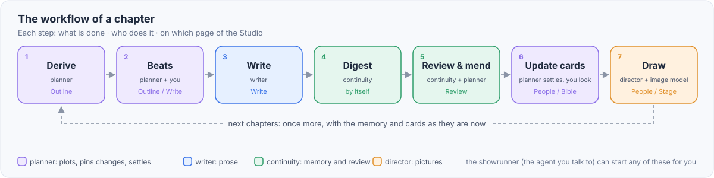

A few names first; they are used all the way down.

| Name | Who | Does what |
|---|---|---|
| **Showrunner** (总编) | the agent you talk to in a DSH conversation | listens, hands out work, reports. It never writes prose itself |
| **Writer** (写手) | the model you pick for prose | drafts, continues, rewrites |
| **Continuity** (场记; the interface also says *the scribe*) | a crew agent | digests each chapter into memory; reviews |
| **Planner** (策划) | a crew agent | derives outlines and beats; finds where a problem sits and mends it; settles suggestions for the bible |
| **Director** (导演) | a crew agent | everything seen: appearances, signature scenes, what a picture shows, storyboards, audio scripts |
| **Post-production** (后期) | a crew agent | cuts voices and pictures into a video |

---

## 1. Install

DeepSeek Harness `0.2.0-rc.2` or later (`< 0.3`).

### Desktop app

1. Open **Plugins** in the left sidebar and press **Add plugin** at the top right.
2. Fill in one of these and press **Install**:
   - the absolute path of a release package, e.g. `/Users/you/Downloads/dsh-novel-writer-0.1.0.tgz`;
   - the absolute path of a built source checkout — this is a *link*: rebuild the checkout later and the plugin follows;
   - `github:xuhao1/whalesong-studio` — the app first asks whether the package may run its build script.

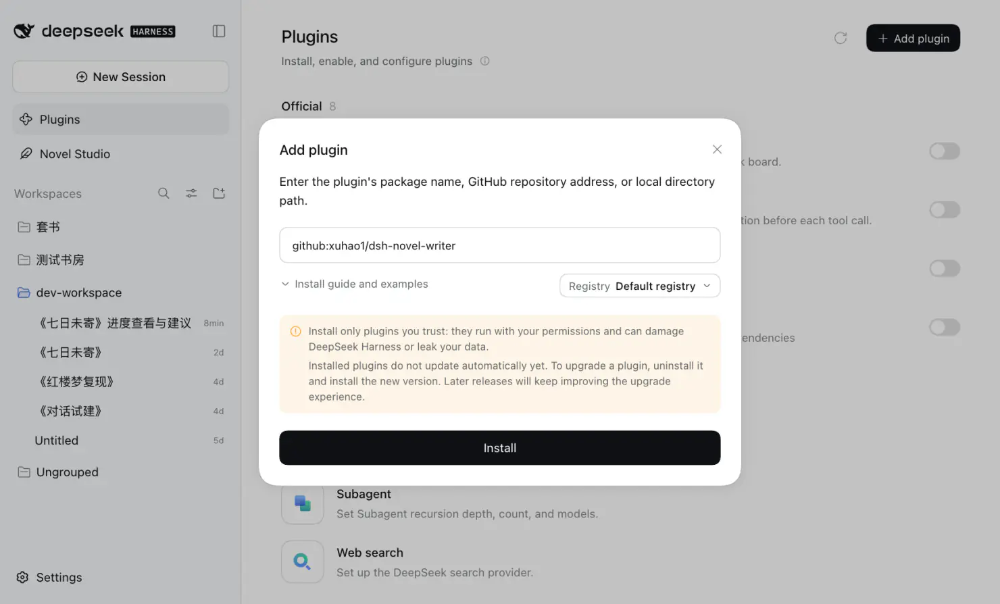

3. The sidebar gains **Whalesong Studio**, and the preset menu of a new session gains **小说家 Novelist**. If they are missing, restart DSH once.

### Web UI (`dsh web`)

`dsh plugin` calls pnpm; have it on `PATH`.

```sh
dsh plugin --profile web add /absolute/path/to/dsh-novel-writer-0.1.0.tgz
```

Where the package comes from, and how to build it yourself: [Install, in the README](../README.md#install).

### Once it is in

Press **Whalesong Studio** in the sidebar. This is the Studio's home: two large buttons (**Talk to the showrunner**, **New work**) and the bookshelf below.

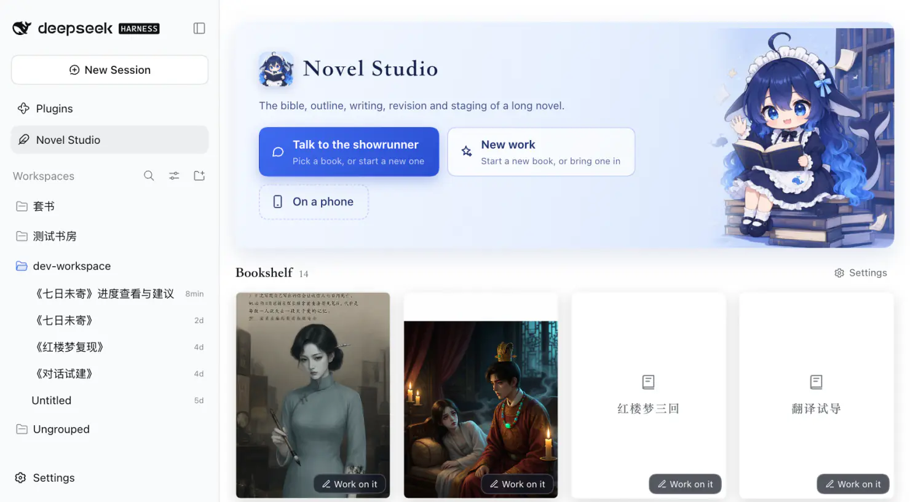

Two small things:

- **Upgrading.** Installed from a package: remove it on the Plugins page and add the new one — books are plain folders in your workspace and are not touched. Installed as a link to a checkout: after a rebuild the Studio shows "Whalesong Studio was updated **[Restart]**" at its top; that restarts the Studio's own back half only — DSH and your conversations stay as they are.
- **Optional programs.** `ffmpeg` is needed to cut videos and to compress pictures and sound when publishing a site. Without it those places say so; nothing else is affected.

---

## 2. Connect the models

The Studio uses two kinds of models, connected in two places.

### Text models: in DSH

The showrunner, the writer and the crew all run on **DSH's own models**. Open DSH's **Settings → Models** (bottom left) and give at least one provider its key — or sign one in (a ChatGPT subscription through Codex Connect, for instance).

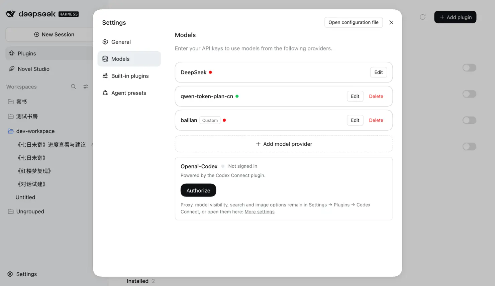

### Pictures, speech, retrieval: in the Studio

The first time the Studio opens, it opens on **Connect the models first**: pick a service, paste one API key, press **Set up** — pictures, speech and semantic retrieval are configured as recommended. To write only for now, press **Done, let's start**; the page is always back under Settings → **Guide**.

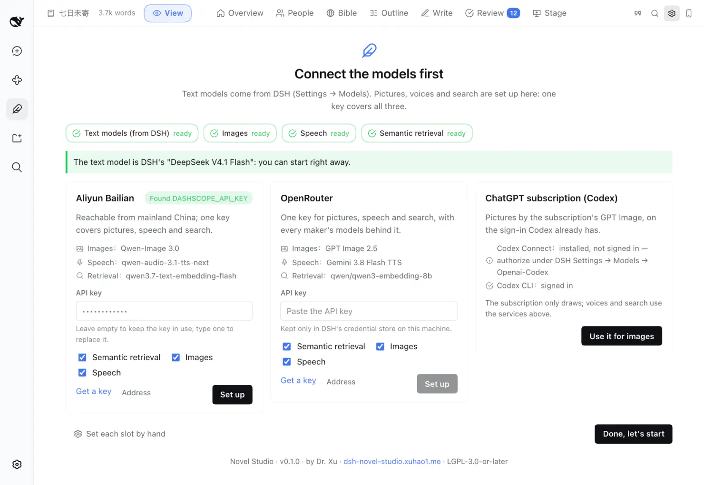

| Service | One key covers |
|---|---|
| Aliyun Bailian | pictures, speech, retrieval |
| OpenRouter | pictures, speech, retrieval (every maker's models) |
| OpenAI | pictures, speech, retrieval |
| ChatGPT subscription (Codex) | pictures only, no key |

Image models on your own machine connect too: **Settings → Image generation → Service** has a *custom endpoint* (OpenAI-compatible — a server of your own will do), *ComfyUI* and *Diffusers*.

Keys go to DSH's credential store. They are not written into the settings file and never come back to the page.

### Give the roles their models

The cog at the right of the Studio's header is **Whalesong Studio settings**. The Models section starts with these few rows; the defaults are fine to begin with.

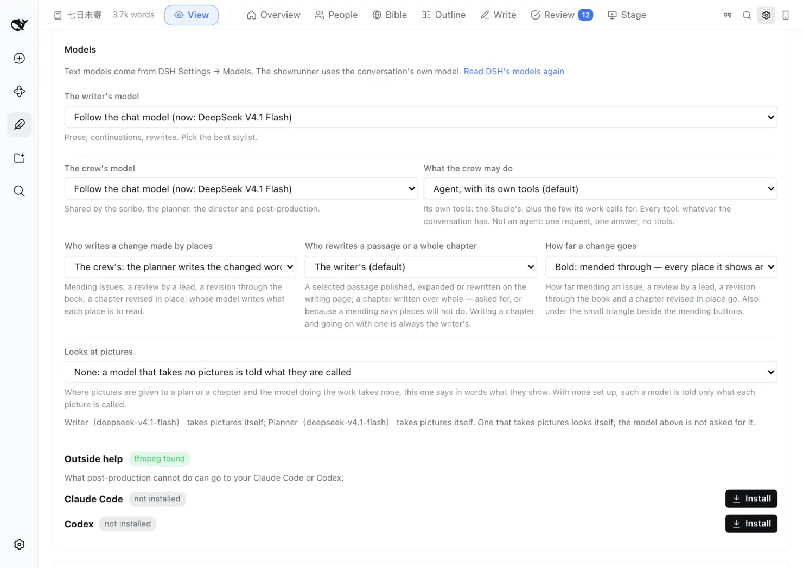

| Setting | Meaning | Advice |
|---|---|---|
| **The writer's model** | writes the prose | your best stylist |
| **The crew's model** | shared by continuity, the planner, the director and post-production | good with tools, cheap, fast |
| **What the crew may do** | which tools the crew has | the default (its own tools) |
| Who writes a change made by places / Who rewrites a passage or a whole chapter / How far a change goes | whose words a mending is, and how boldly it mends | leave until you know the Studio |
| **Looks at pictures** | reads a reference picture into words for a model that takes none | set it when you use reference pictures |

- **Advanced** (top right) opens the per-role models, reasoning effort, context budgets and concurrency.
- **Whose settings** at the very top: *Every book*, or *This book* — a book can have models, an image service and a speech service of its own.

### Done by itself: have a look

Further down the same page is **Done by itself** — what the Studio goes on to do once text is written or changed. Each line is model calls.

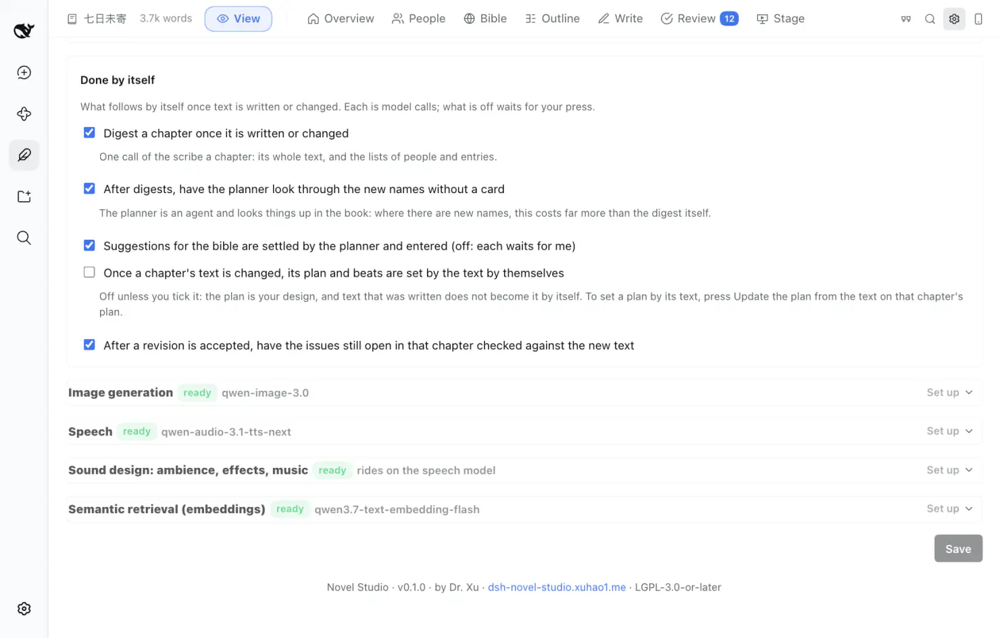

This is where to save tokens. Switch off "have the planner look through the new names" before you switch off the digest: the first is an agent looking things up in the book and costs far more than a digest; without the second, the Studio no longer remembers what was just written.

---

## 3. Two ways to work

Everything in the Studio can be done two ways, and you can change over at any moment.

### Talk to the showrunner

1. Start a new session and choose **小说家 Novelist** in the preset menu above the composer.

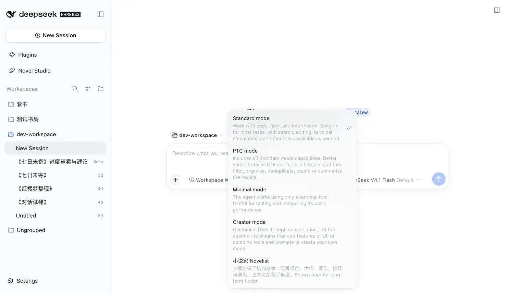

2. Say what you want. As the showrunner starts work, the Studio appears beside the conversation, on the book being worked on.


Things to say:

- "Bring in this txt: `/path/to/book.txt` — I want to go on writing it."
- "Derive the next three chapters, darker in tone. Show me first; do not add them to the outline."
- "In chapter three, make the knock on the door a ringing telephone."
- "Draw a portrait of her: a rainy night, looking back."
- "Where does the book stand? What would you do next?"

**Talk to the showrunner** on the Studio's home (pick a book first) and **Talk it over** on a book's overview take you to that book's own conversation.

### Press the buttons yourself

Inside a book, the header reads:

| Page | For |
|---|---|
| **Overview** | where the book stands, and *Next steps* |
| **People** | cards, the table of lives, the relationship graph, walk-ons |
| **Bible** | places, houses, things, ideas of the world, style, art direction, references, jottings |
| **Outline** | chapters and their plans, deriving, the plot graph, threads |
| **Write** | the editor, with the plan, memory, issues, proposals, versions and pictures beside it |
| **Review** | proposals, suggestions for the bible, issues, book-wide revision, the archive |
| **Stage** | produce in one go, motion comic, interludes, illustrations (the gallery) |
| **View** (the blue button beside the title) | the book as a reader meets it: text, people, world, side stories |


When in doubt, do what **Next steps** on the overview says.

Whatever takes a while shows as a bar at the bottom of the page: who is doing what, with a stop button. Where a crew agent is at work, the bar opens its run — a child conversation where you can read what it looked up and what it handed back.

---

## 4. Get a book in

Press **New work** on the home page.

### Bring in an existing novel

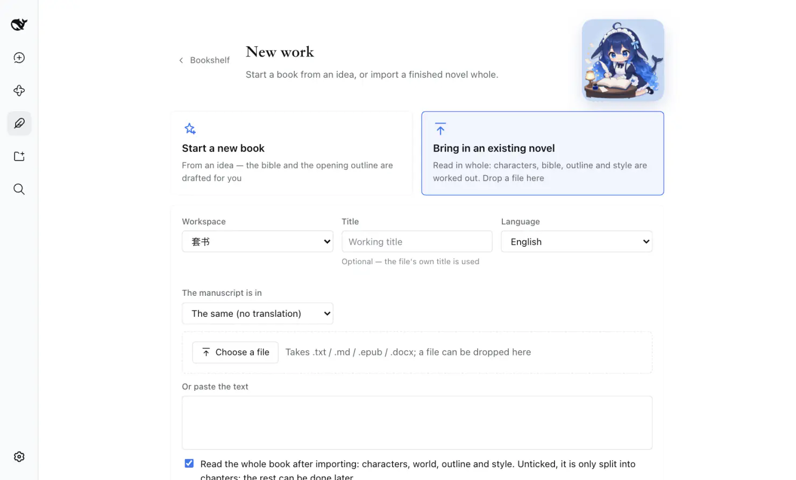

1. Choose **Bring in an existing novel**.
2. **Workspace**: the book becomes a folder in it.
3. **Title** may stay empty — the file's own is used. **Language** is the language the book is written in.
4. **The manuscript is in**: the same language means no translation; anything else is translated into the book's language on the way in (a glossary of names first, then chapter by chapter).
5. **Choose a file** (`.txt` / `.md` / `.epub` / `.docx`; dropping it works), or paste the text into the box.
6. Leave **Read the whole book after importing** ticked — unticked, the manuscript is only split into chapters, and characters and world are for later.
7. Tick **Seal this book** to have it encrypted from its first file on.

After you press the import button, the bar at the bottom goes step by step:

| Step | Who | What comes of it |
|---|---|---|
| Find the chapters | an editor (continuity) | reads the manuscript, finds its real chapters, cleans away what a web page left |
| Digest each chapter | continuity | a summary, facts, who is there, threads, signature scenes |
| Make the cast | planner | character cards; the several names of one person become aliases |
| Stretches of their lives | planner | the leads' ages, and where they change |
| The world, and its ties | planner | places / houses / things / ideas; who lives where and belongs to whom |
| Synopsis and volumes, style, art direction | planner / director | the outline, the book's style profile and its art direction |

A long book takes long (one call a chapter; the cast is written in batches). Stopping is fine: the overview shows **Go on**, which picks up where it broke off.

When it is done, look at three places first:

- **Overview**: chapters, characters, what is not finished.
- **People**: whether the leads are right, and whether one person became two cards.
- **Review → Bible suggestions**: what the planner entered by itself and what it left out (see [5.6](#56-keep-the-cards-up-characters-bible-plans)).

### Start a new book

Choose **Start a new book** and say in a sentence or a paragraph what you want to write. With the drafting box ticked, the planner proposes a premise, the main cast, the world, volumes and the opening chapters' plans — all yours to change.

Once the book exists, the Studio opens a conversation of its own for it; the overview has the way in.

> A book is a plain folder: what people write is Markdown (cards, entries, chapters), structure and memory are JSON. Edit it with your own editor; keep it in git. The layout is in [project-format.md](./project-format.md).

---

## 5. The workflow of a chapter

Seven steps take a chapter from nothing to illustrated. You need not walk all of them every time: to just write, 5.1–5.4; to mend an imported book, start at 5.5.

### 5.1 Derive: what comes next

On **Outline**, the chapters are on the left and the chosen chapter's plan on the right (synopsis, purpose, point of view, who appears, threads, beats).

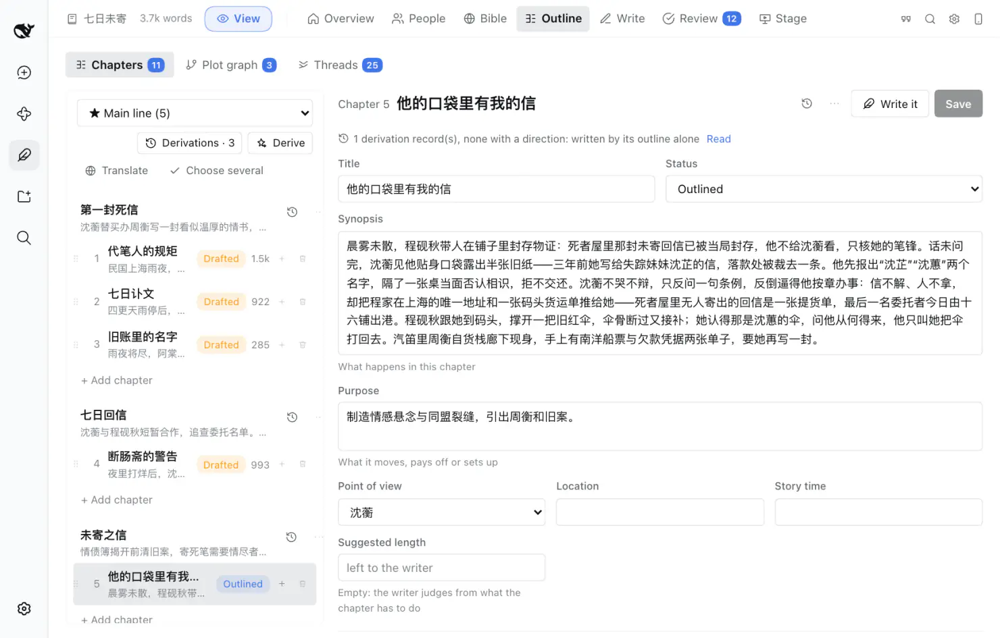

Press **Derive** above the chapter list:

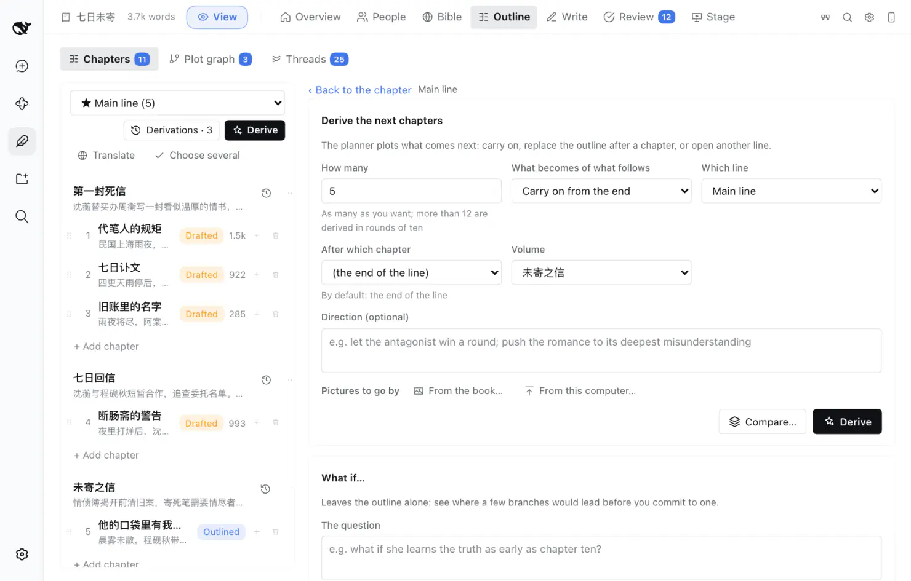

1. **How many** chapters.
2. **What becomes of what follows**: carry on from the end, **replace** the outline after a chapter, or **open another line** of the plot.
3. **Direction** (optional): in your own words — what happens, how light or dark it is. It is kept, and handed on later to whoever lays out the beats and writes these chapters.
4. **Pictures to go by**, if you want the planner to plot from pictures.
5. Press **Derive**. The planner — an agent — reads what came before, the people and the bible, and hands back a plan in a minute or two.

What comes back is **shown to you first; it is not in the outline yet**:

- Something is off: write a sentence under **What to change** and press **Adjust by this** — the same planner goes on from where it was; chapters you did not mention stay as they are.
- A chapter you do not want: untick it.
- Good: press **Add N chapters to the outline**.

Closing the panel loses nothing; the button then reads "N to read". (More than twelve chapters at once are derived in rounds of ten and go straight into the outline.) Every derivation is kept under **Derivations**: the direction you gave, what the planner said, which chapters it became.

**What if…**, below, asks a question instead: the planner answers with a few ways the story could go and leaves the outline alone.

### 5.2 Get the beats right

Beats are a chapter's scenes, one by one. The writer writes to them, so **tone and course are settled here** — a chapter laid out cold is hard to warm up with a late "make it funny".

In the chapter's plan on the Outline page, scroll down to **Beats**:

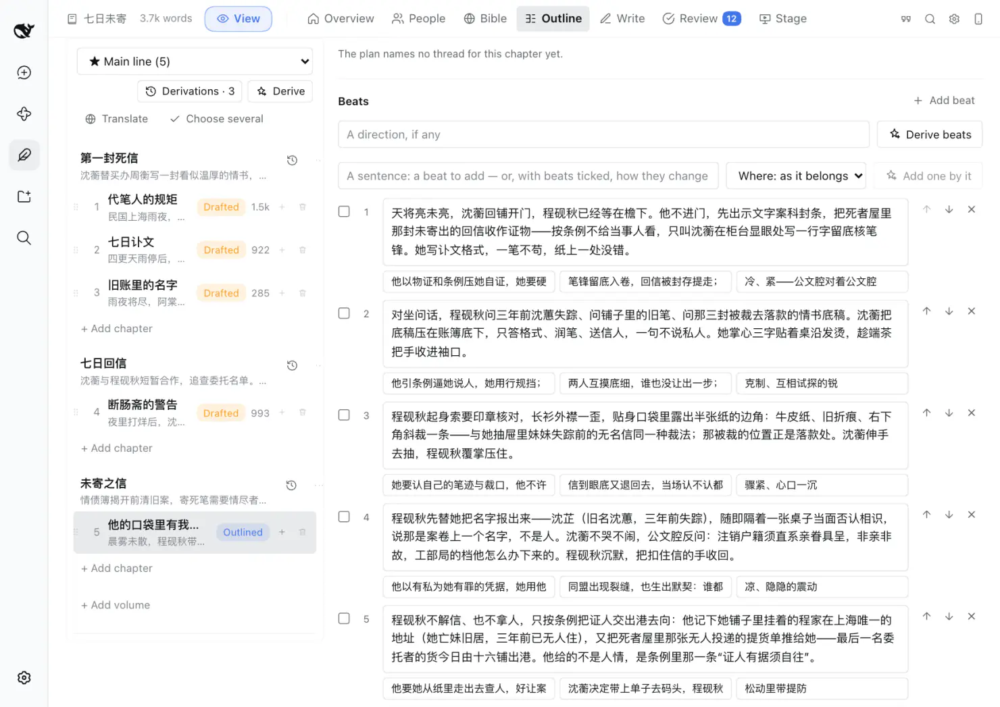

| You want | Do this |
|---|---|
| the planner to lay out the whole chapter | write a direction (or none) and press **Derive beats** |
| one more scene | write it on the sentence row and press **Add one by it** (where it goes can be left to the planner) |
| to change a few only | tick those beats, write a sentence, press **Change these N by it** — nothing else moves |
| to write them yourself | **Add beat**, or edit the words and reorder with the arrows |

Press **Save** at the top right. What the plan was before is under the clock icon, **History**, and can be put back.

### 5.3 Write

On **Write**: chapters on the left, the editor in the middle, and on the right the chapter's plan / memory / issues / proposals / versions / pictures.

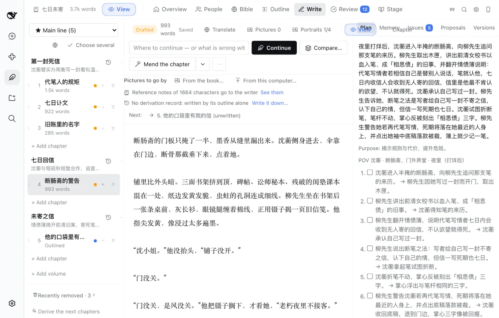

- A chapter not written yet: put what you ask of the writer into the brief box (or nothing) and press **Write it**. The prose arrives in the editor sentence by sentence.
- A chapter half written: **Continue**.
- **Compare…**: several models each write a draft; read them side by side and take one.
- Or simply type. It saves by itself.

To change what is written:

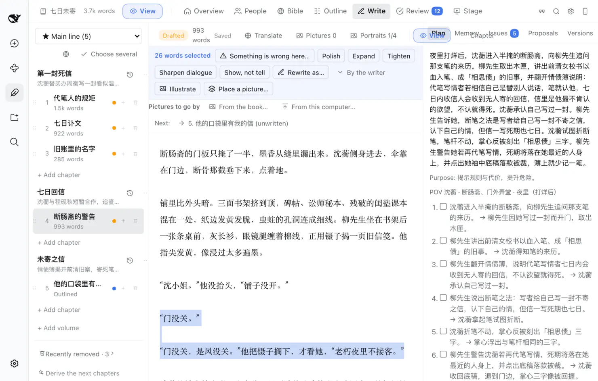

| You want | Do this |
|---|---|
| to say what is wrong with a passage | select it → **Something is wrong here…** → say what, press Enter. The planner finds the same fault wherever it shows in the chapter and mends it |
| another wording | select → **Polish / Expand / Tighten / Rewrite as…** |
| to say what is wrong with the chapter, or what should change | write it into the brief box and press **Revise** — the planner tells whether it is a fault or a request (the small triangle beside it holds *Find only* and *Write the chapter over*). With the box empty the button is **Review** |

None of these goes straight into the text. Each comes as a **proposal** (see [5.5](#55-review-and-mend)).

For several chapters at once, **Write in batch** below the chapter list:

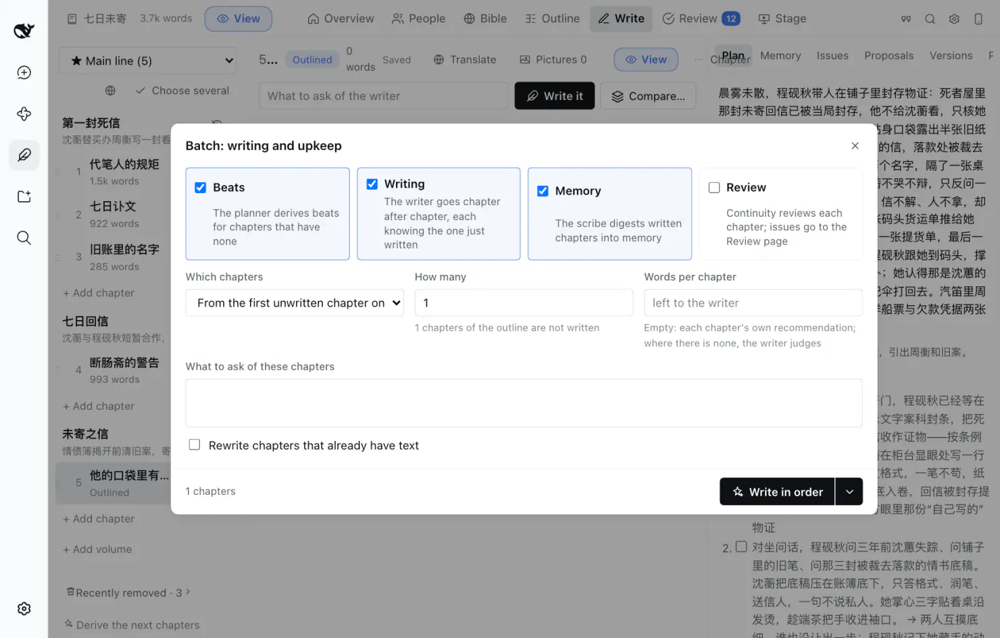

Tick the steps, say from which chapter and how many. The triangle beside the start button chooses how: **in order** (chapter after chapter, the most consistent), **side by side** (at once, faster), or **in rounds** (write, review, mend in a batch, review again, until nothing grave is left).

### 5.4 Digest: so the Studio remembers the chapter

When a chapter is written or changed, continuity **digests** it into memory — by itself, unless you switched that off. The **Memory** tab in the side column shows the result:

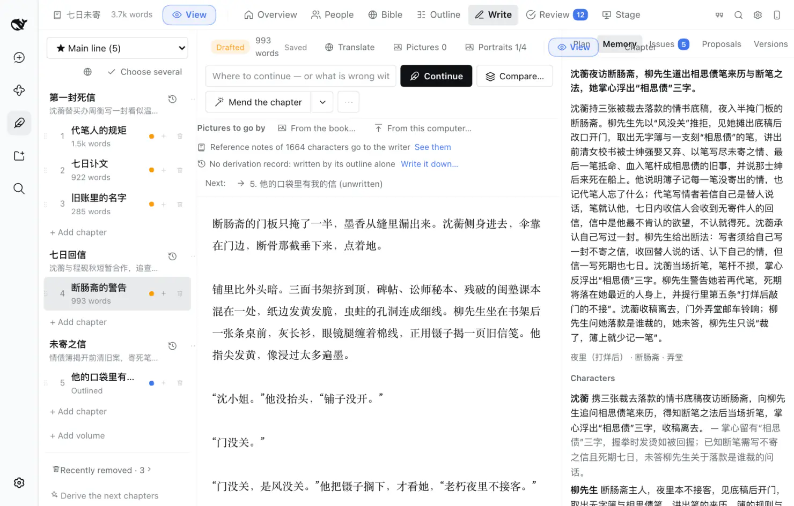

One digest keeps: a summary, hard facts, where each person stands at the chapter's end, who came in / left / died, threads planted and paid off, new names and new things of the world, and any moment worth calling a signature scene.

Everything later reads it: what the next chapter is told of the story so far, a person's life, suggestions for the bible, review. So:

- By hand: **⋯ → Digest** on the Write page.
- The whole book again: **Digest again…** on the overview.
- With the automatic digest off ([section 2](#done-by-itself-have-a-look)), pages say "N chapters not digested"; one press catches up.

### 5.5 Review and mend

On **Review → Review and revision**: with nothing written in the bar at the top, press **Review N unreviewed** (or **Review** on one chapter's row). Continuity reads the chapter against what came before, the bible and its plan, and lists what it finds; by default what it finds goes on to the planner, and a proposal appears beneath each issue (the small triangle beside the button makes a review list the issues only).

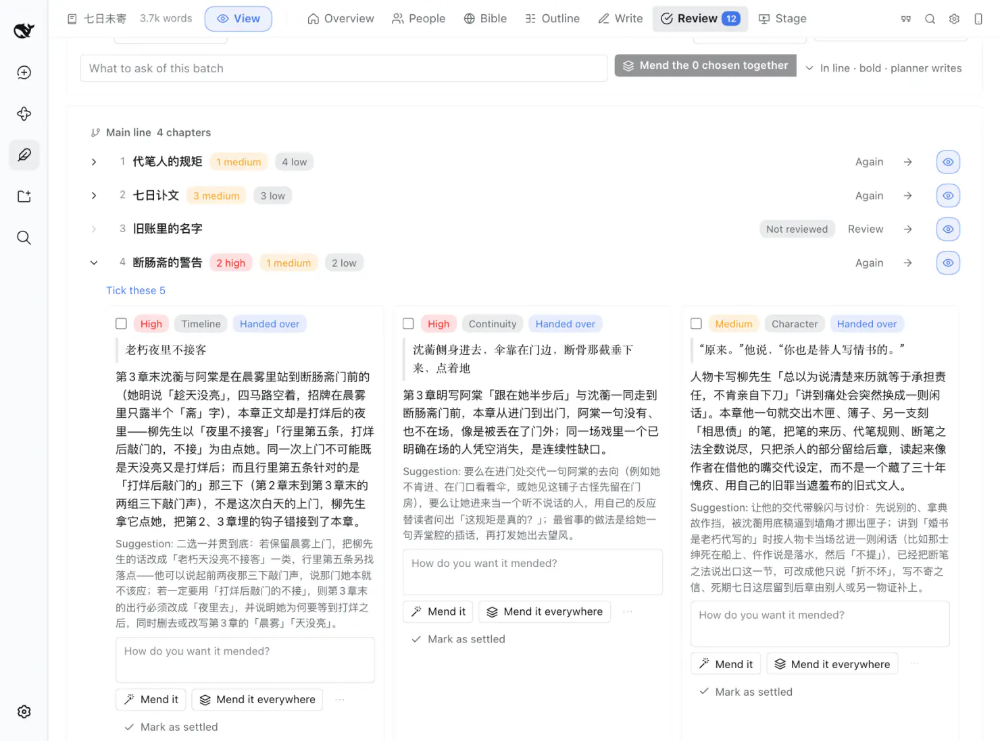

A card an issue: how grave (high / medium / low), of what kind (timeline, continuity, character, style…), the words quoted, what is wrong, a suggestion.

| You want | Do this |
|---|---|
| this one mended | **Mend it** — the planner decides which places to change; the changes appear beneath the card |
| what it touches in other chapters mended too | **Mend it everywhere** |
| to say how | write under "How do you want it mended?" first |
| several at once | tick them → **Mend the N chosen together** |
| the serious ones only | **Mend the grave ones** |
| to say it is wrong about this | **Mark as settled** |

Write a sentence into the same bar and press **Revise**: a fault you have already seen ("his glasses come and go"), or a change you want made ("call it X everywhere, not Y") — the planner tells which. A fault: it finds every place it shows, files each as an issue, and mends them, the changes beneath the issues. A request: it is carried out, and the changes wait as one round under **Proposals**. **Find only** looks and changes nothing. The brief box of the writing page, its Issues panel and *Review and revise…* on a selected passage are the same thing, kept to that chapter or passage.

**Every change is a proposal**, with what goes in red and what comes in green:

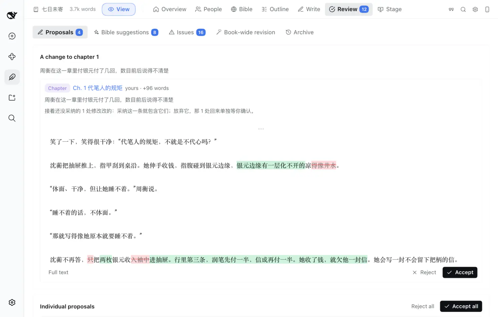

- **Accept**: it is written into the text; the old text is kept as a version. The Studio then checks the issues still open in that chapter against the new text and settles the ones that are gone.
- **Reject**: not this one. A slip of the hand is undone under **Archive**.

### 5.6 Keep the cards up: characters, bible, plans

The more is written, the more the bible has to keep up. Most of that happens by itself; you look it over.

**Bible suggestions** (the second tab of Review). New things of the world and new threads found in a digest, and new people the planner judged worth a card, are **entered by the planner**. This page says what it entered and what it left out, with a reason each:

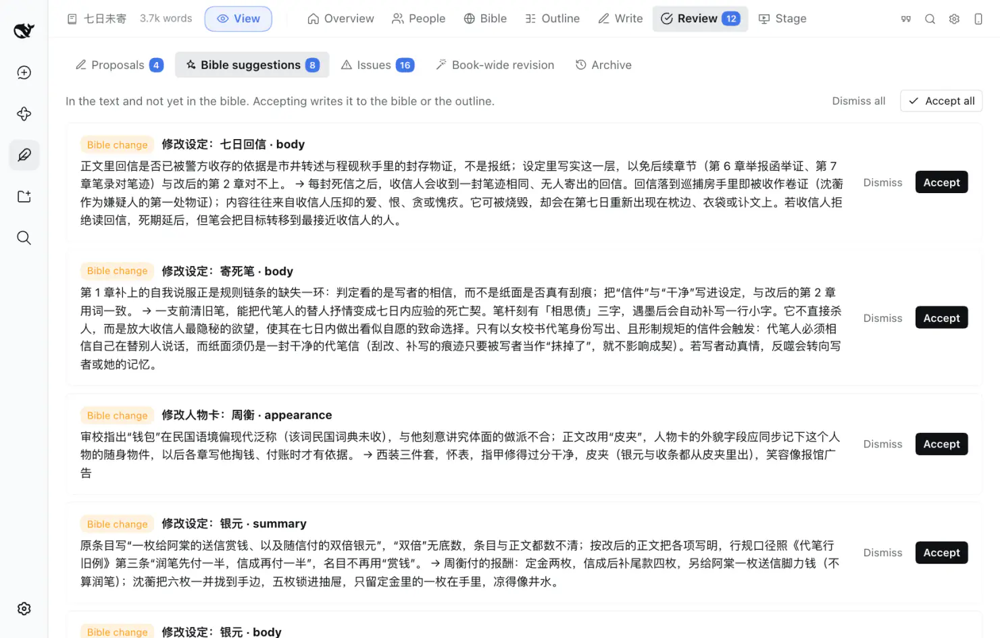

- **Entered by the planner**: open one to change it, or **Take back**.
- **Left out**: **Enter**.
- Only a suggestion to *change* something already in the bible waits for your **Accept** — that is your own writing.

**People**:

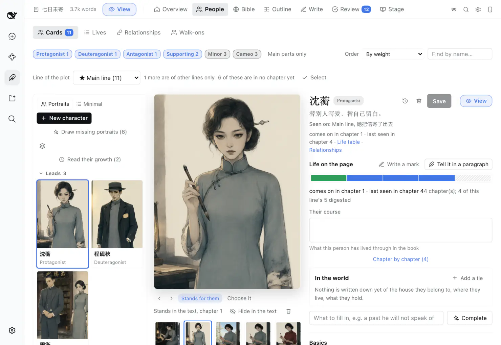

- **Cards**: a one-line identity, appearance, nature, history, relationships, voice. To fill one out, write a direction and press **Complete**.
- A person's **life** is not typed in; it is read off the digests — where they come in, where they are present, where they leave. Correct it with **Write a mark**.
- **Walk-ons**: names in the text without a card. Tick a few and give them cards; the planner writes each from what the digests hold.

**Lives** lays everybody out as one table — who has been gone too long shows at a glance:

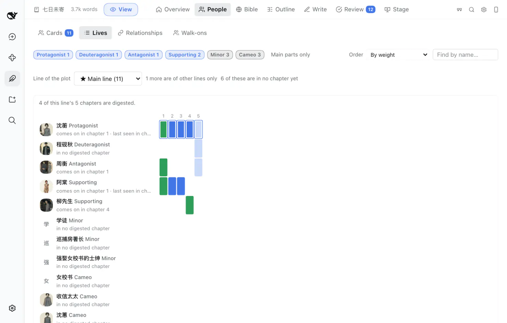

**Bible** is Places / Houses / Things / World. An entry has a summary, its text, its ties (what it lies in, who lives there) and its course (built in this chapter, fallen in that):

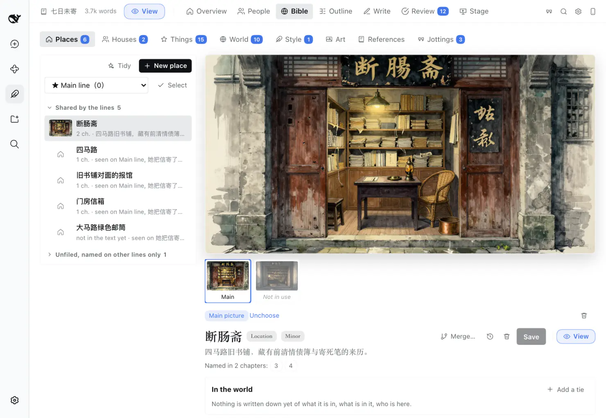

- **Tidy**, above the list: the planner finds entries kept twice and entries filed under the wrong kind; you tick what to merge.
- A book with several lines of plot can file entries and people under a line: what belongs to one line only is not handed to the others.

**A plan does not follow its text by itself** — the plan is your design. If the text went its own way and you want the plan to follow, press **Update the plan from the text** on that chapter's plan (or the beats only).

Cards, entries, styles, the art direction and plans all have a **History** (the clock icon): put back the whole, or one field. What was deleted waits at the foot of its list.

### 5.7 Draw the people and the places

The order is **art direction → appearance → design sheet → portraits and everything else**. Each is drawn against the one before, and that is what keeps one face through the book.

**① Art direction** (Bible → Art). Every picture carries it:

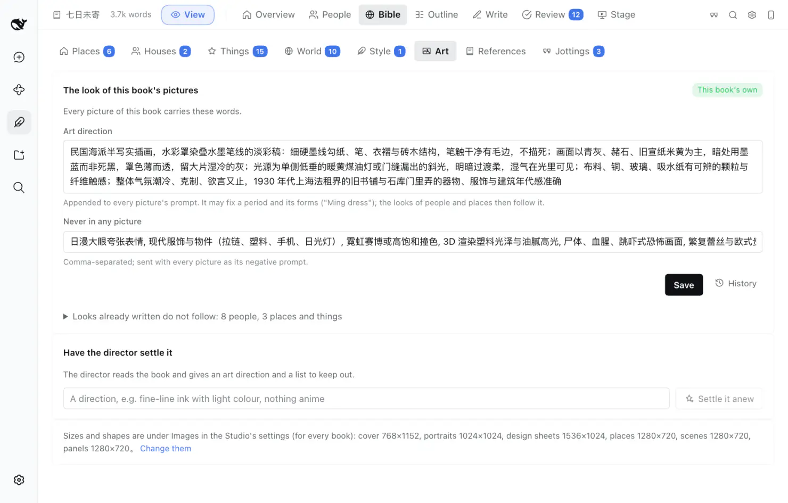

An import or a draft has settled one already. To change it, write a direction and press **Settle it anew**, or edit the words. A period and its forms can be fixed here ("dress is Ming").

**② Appearance** (on the card). One paragraph: the writer writes by it, the pictures are drawn by it. Empty? Have the director write it.

**③ The design sheet.** Press **Design sheet** in the left column of the People page (later: *Another sheet*): front, side and back. From then on every picture with this person in it takes the sheet as its reference.

**④ Portraits.** Press **Draw portrait**. Two are drawn by default: a plain likeness and a **signature scene** — the director finds the moments that are most this person's in the book and lists them on the card:

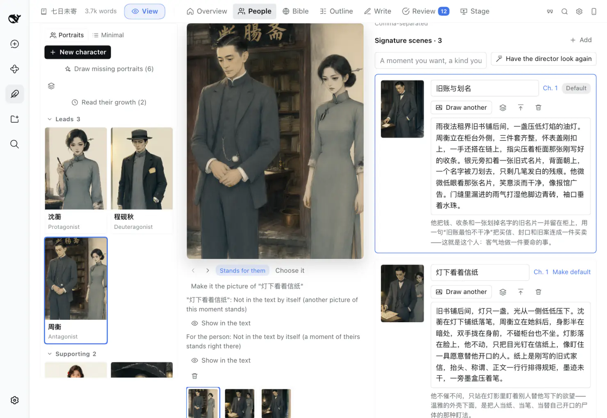

Often needed:

| You want | Do this |
|---|---|
| this one to look a certain way | write it in the box under the buttons before drawing ("a scar through the left brow; this one on a snowy night, looking back"). What is about the person goes into the appearance; what is about this picture is used this once |
| to draw from a reference picture | the sheet's reference row: **From the book…**, **From this computer…**, or **Somebody else's sheet…** (for close kin) |
| to see which model draws it best | the stacked-layers icon beside a draw button: several models draw one each, you take one |
| to use a picture of your own | the upward arrow beside the button brings one in from this computer |
| places, things, houses | **Draw its design art** on the entry's page |

Before a picture with people in it, the Studio may ask "This will first draw N design sheets" — regulars without a sheet get one first, so that what follows agrees.

---

## 6. The gallery and the album

### The gallery: every picture of the book

**Stage → Illustrations**.

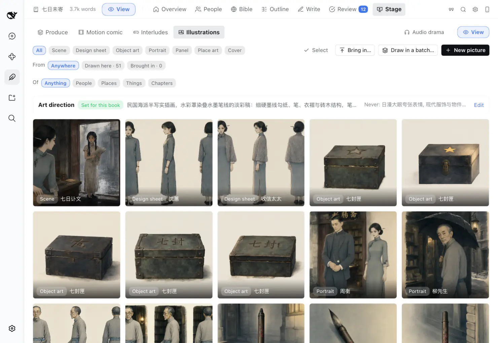

- Three rows of filters work together: **kind** (scene / design sheet / portrait / panel / place art / object art / cover), **From** (drawn here / brought in), **Of** (a person, a place, a chapter).
- **New picture**: an illustration for a chapter, or a *free prompt* — you write the picture and tick who is in it.
- **Draw in a batch…**: whatever is missing — sheets, design art, portraits, chapter illustrations, the cover — in one go.
- **Bring in…**: many pictures of your own at once.
- **Select**: delete several.
- Pictures drawn to compare and not taken wait at the top, "To take", for whenever you choose.

### A picture, opened

Wherever a picture is opened, the panel is the same: the picture on the left, and on the right **how it came to be** — the parts its prompt was put together from, the reference pictures that went with it, the very words sent to the image model.

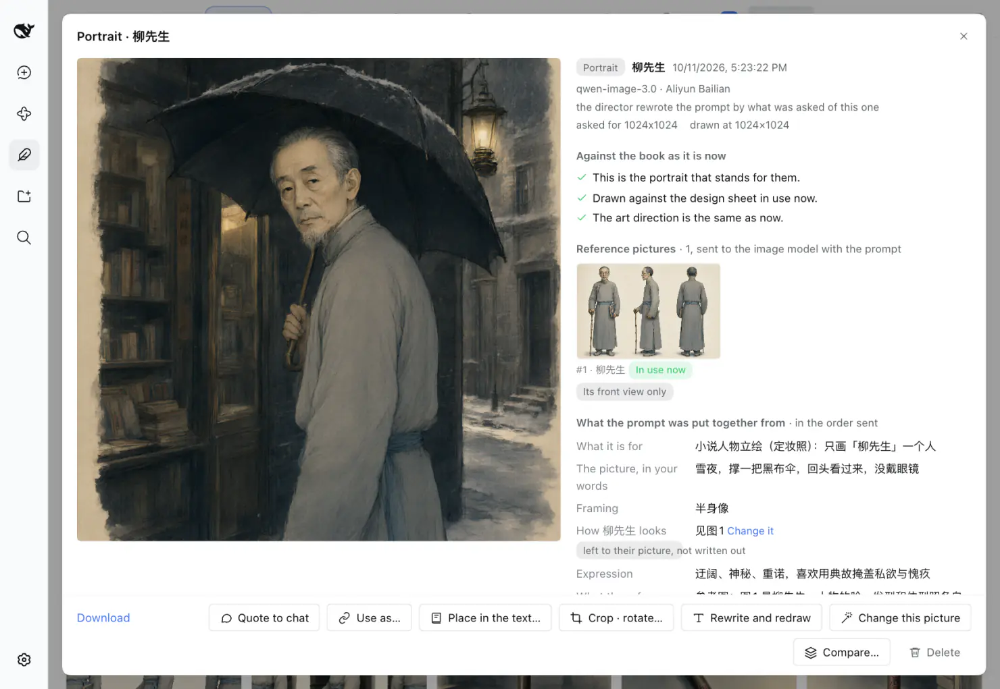

| Button | Does |
|---|---|
| **Rewrite and redraw** | the whole prompt and the keep-out list, for you to change; drawn again from what you leave |
| **Change this picture** | say what to change ("the dress in dark red"); the picture itself goes to the image model to be changed |
| **Compare…** | other models draw it again as it was |
| **Use as…** | say whose portrait or sheet it is, which place's design art, which chapter's picture — or the cover |
| **Place in the text…** | pick a chapter and a paragraph; it goes after it |
| **Crop · rotate…** | kept as a new picture; the original stays |
| **Quote to chat** | points the showrunner at this picture; go on to say what you want of it |

When a picture came out wrong, open it and read how it was made: a wrong appearance, an art direction pulling it off, a reference that did not go along — it shows here.

### How pictures get into the text

- **Write → select a passage → Illustrate**: the director works out who is in the passage and where, draws against their sheets, and the picture goes after the passage.
- In the editor, a picture in the text shows as the picture: under it you can change its caption, swap it for another, move it up or down, take it out.
- Portraits appear in *View* by a rule of their own: a signature scene where the text tells that moment, the plain likeness where the person first appears. Hide any you do not want.

### The album: people and world, in View

Press **View** beside the title. This is the book as a reader meets it — and what a phone, or a published site, shows.


**Text** switches between *Prose* and *Script*; with voices recorded there is a player at the bottom. A name with a card carries a faint underline; press it for the person's small card.

**People**: everybody laid out by weight; press one for a page of their own —


**World**: where a place has design art, the picture is a scene you can press — the courts inside it and the people who live there are marked on it, and a press takes you in. Drag the timeline to see it as it stands at a given chapter.

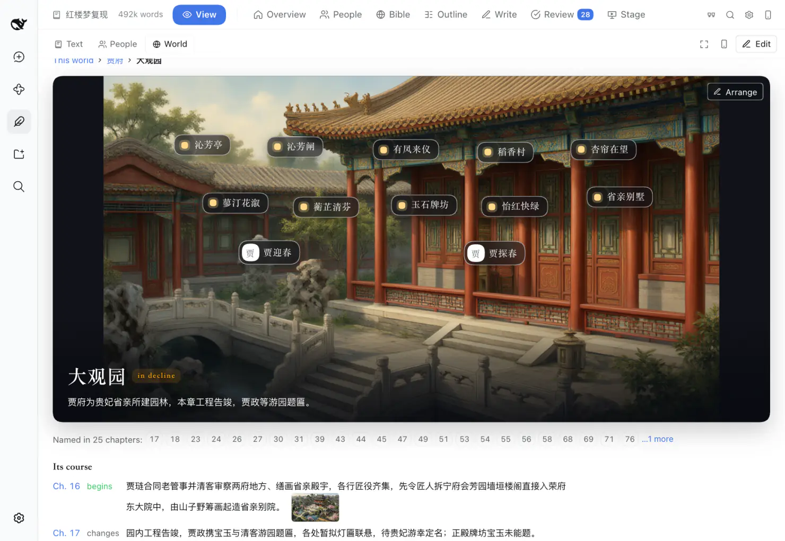

**Edit**, top right of every page, goes to that thing's editing page; **View** there comes back. How good the album looks depends on how many pictures the book has.

---

## 7. What else there is

**The plot graph** (Outline → Plot graph). A story may have more than one road: a line leaves after a chapter — another course, a side story, a separate tale in the same world — and all of it is one graph. Drag a chapter to move it; drag a line's end to change where it leaves.

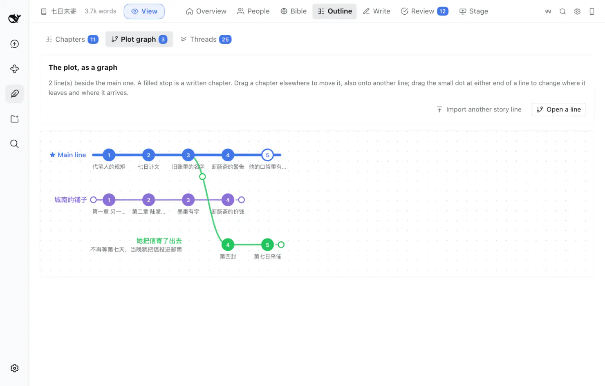

**Audio, motion comic, video** (Stage → Produce). Tick the steps and the chapters: script, voices, sound, storyboard, panels, and on to a video. Stopped midway, one more press picks it up.

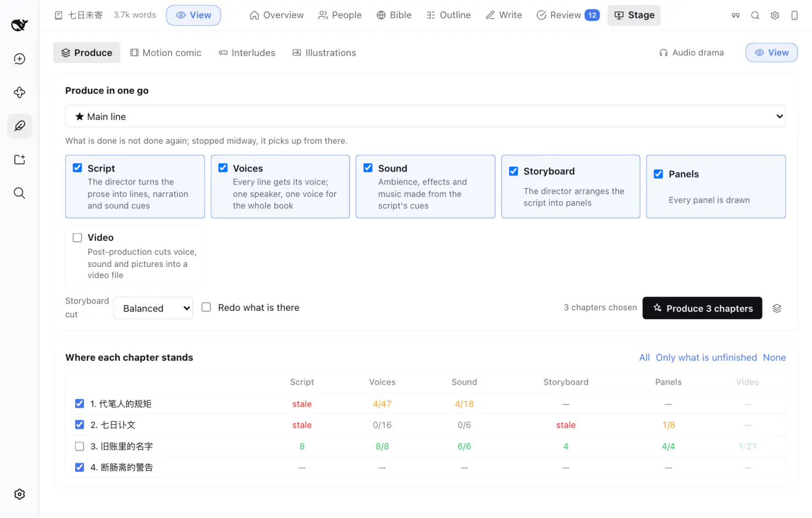

**Show it to somebody** (the phone icon on the View page). Read on a phone on the same network — or **Publish as a site**: one folder, put on any static host, where people read, listen and watch.

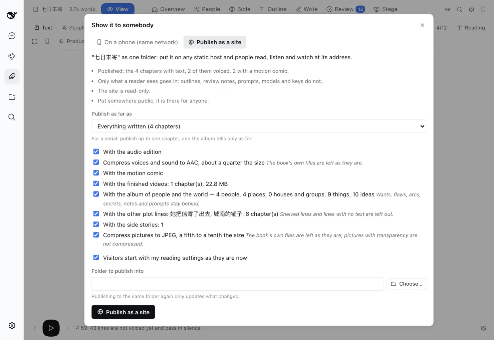

And:

| What | Where |
|---|---|
| **Interludes**: step in as one character; the director plays the rest | Stage → Interludes |
| **Translation**: chapters into another language, a glossary of names first | *Translate* on the Write page's toolbar |
| **References**: write by another book's world or style | Bible → References |
| **Jottings**: plot and lore not thought through yet | the quote-mark button in the header; Bible → Jottings |
| **Sealing a book, the private shelf** | the book's name in the header → *Seal and lock…*; below the bookshelf on the home page |
| **Export** as Markdown / TXT / HTML / EPUB | the foot of the overview |
| **Working the whole Studio from a phone** | the phone icon in the header (needs `dsh web`) |

What every setting means: [configuration.md](./configuration.md). Why it is built this way: [design.md](./design.md).

---

## 8. Cost, and when something is off

### Where the money goes

**Overview → Usage** (or Settings → *Usage and cost*) holds every call, by model, book and day. Put in what you really pay and it shows the cost.

Worth knowing:

- **An agent's work is paid by the step.** Each time the planner or continuity uses a tool, what it holds is sent again. A smaller range is cheaper — "only in the chapters I chose" costs far less than "the whole book".
- **Writing a chapter of a long book is not cheap.** The writer carries half the model's window of earlier text. What repeats hits the provider's cache, and the usage says how much did.
- **What is easiest to overlook runs by itself**: [Settings → Done by itself](#done-by-itself-have-a-look).
- **Pictures**: sheets drawn first, several models compared, a batch — all multiply the count. Each says how many it will draw before it starts.

### When something is off

| What you see | What to do |
|---|---|
| No "Whalesong Studio" in the sidebar | restart DSH once; check its version |
| "Whalesong Studio was updated" at the top | press **Restart** (the Studio's back half only) |
| "Subagents are switched off" at the top | DSH's Plugins page: enable *Subagent* |
| A button says images / speech are not set up | Settings → Guide, or that section of the settings |
| Something has been turning for long | open the run from the bar at the bottom to see where it is; stop it — the next try goes on from what was done |
| The import broke off | **Go on**, on the overview |
| A person looks different from picture to picture | draw the design sheet first; open a picture and see whether the reference went along. An image service that takes no references can only draw from the appearance in words |
| A new picture ignores the appearance I changed | draw the design sheet again — the other pictures are drawn against the sheet |
| Accepted the wrong thing | **Versions** in the Write page's side column |
| Rejected the wrong thing | Review → **Archive**, put it back |
| A card or an entry was spoiled | **History**, the clock icon |
| People of two plot lines got mixed | file the cards under their lines; or digest that line's chapters again |

Still there? Open an issue on [GitHub](https://github.com/xuhao1/whalesong-studio/issues) with what the page said.
