# 鲸歌工坊 · 新手教程

[English](./tutorial.md) | **简体中文**

从把插件装进 DSH（DeepSeek Harness），到把一章从大纲做到配好图。照着走一遍，工坊的主要页面就都摸过了。

> 截图里的书是一本测试用的短篇《七日未寄》，世界那一页用的是《红楼梦》。界面每一版都会有小变化，以你眼前的为准。

**目录**

1. [安装](#1-安装)
2. [接上模型](#2-接上模型)
3. [两种用法：和总编对话，或自己在工坊里点](#3-两种用法和总编对话或自己在工坊里点)
4. [把书放进来：导入已有的书，或开一本新的](#4-把书放进来)
5. [一章的工作流](#5-一章的工作流)：[推演](#51-推演接下来写什么) → [节拍](#52-把节拍改到满意) → [写](#53-写) → [收录](#54-收录让工坊记住这一章) → [审校与修改](#55-审校与修改) → [卡片更新](#56-卡片更新人物设定章纲) → [画人设](#57-画人设与设定图)
6. [图库与画册](#6-图库与画册)
7. [接下来还能做什么](#7-接下来还能做什么)
8. [花费与排错](#8-花费与排错)

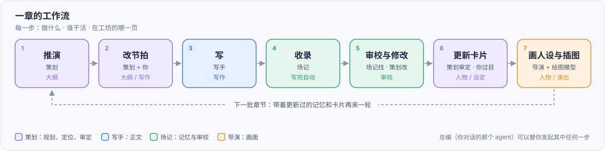

先认几个名字，后面一直用：

| 名字 | 是谁 | 干什么 |
|---|---|---|
| **总编** | 你在 DSH 对话里交谈的 agent | 听你说话、派活、汇报。它自己不写正文 |
| **写手** | 你为"写正文"挑的模型 | 起草、续写、改写 |
| **场记** | 班底 agent | 把每章收录成记忆；审校 |
| **策划** | 班底 agent | 推演大纲和节拍；定位并修改问题；审定设定建议 |
| **导演** | 班底 agent | 画面：外貌、名场面、插图的构思、分镜、有声脚本 |
| **后期** | 班底 agent | 把配音和画面剪成视频 |

---

## 1. 安装

需要 DeepSeek Harness `0.2.0-rc.2` 及以上（`< 0.3`）。

### 桌面版

1. 打开左侧栏的 **插件**，点右上角的 **添加插件**。
2. 在输入框里填下面任意一种，点 **安装**：
   - 发布包的绝对路径，例如 `/Users/you/Downloads/dsh-novel-writer-0.1.0.tgz`；
   - 已经构建好的源码目录的绝对路径——这是"链接"，以后在源码目录里重新构建，插件跟着更新；
   - `github:xuhao1/whalesong-studio`——应用会先问是否允许运行这个包的构建脚本。

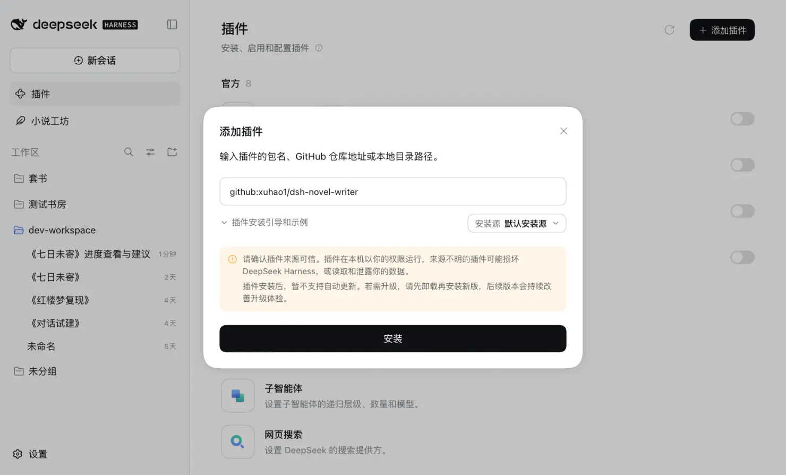

3. 装好后左侧栏多出 **鲸歌工坊**，新会话的预设菜单里多出 **小说家 Novelist**。没出现就重启一次 DSH。

### Web 界面（`dsh web`）

`dsh plugin` 要用到 pnpm，先确认它在 `PATH` 里。

```sh
dsh plugin --profile web add /absolute/path/to/dsh-novel-writer-0.1.0.tgz
```

发布包怎么来、怎么自己构建，见 [README 的"安装"一节](../README.zh.md#安装)。

### 装好之后

点左侧栏的 **鲸歌工坊**，就是工坊的主页：上面两个大按钮（**和总编对话**、**新创作**），下面是书架。


两件小事：

- **升级**：用发布包装的，在"插件"页卸载后再添加新版——书是工作区里的普通文件夹，不会被动到。用源码目录链接的，重新构建后工坊顶上会出现"鲸歌工坊更新了 **［重启］**"，点一下只重启工坊自己的后台，DSH 和对话不动。
- **可选的外部程序**：装了 `ffmpeg` 才能剪成片、才能在发布网站时压缩图片和声音。没装的话这些地方会明说，别的不受影响。

---

## 2. 接上模型

工坊用两类模型，在两个地方接。

### 文字模型：在 DSH 里接

总编、写手、班底用的都是 **DSH 自己的模型**。打开 DSH 左下角的 **设置 → 模型**，给至少一家提供商填上 key（或用登录接入的，比如经 Codex Connect 登录的 ChatGPT 订阅）。

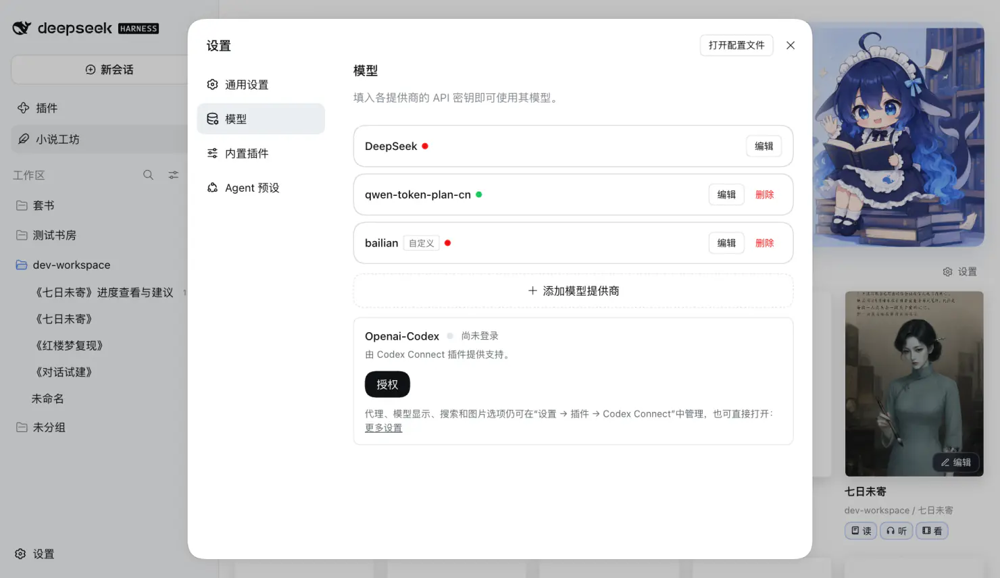

### 画图、配音、检索：在工坊里接

第一次打开工坊，会先到 **"先把模型接上"** 这一页：选一个服务，贴一个 API key，点 **一键配置**——画图、配音、语义检索按推荐一次配好。只想先写字的话，点 **好了，开始** 跳过，之后在"设置 → 引导页"随时回来。

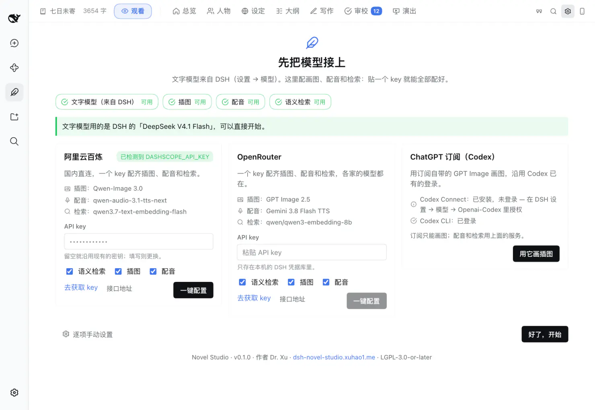

| 服务 | 一个 key 配齐 |
|---|---|
| 阿里云百炼 | 插图、配音、检索（国内直连） |
| OpenRouter | 插图、配音、检索（各家的模型都在） |
| OpenAI | 插图、配音、检索 |
| ChatGPT 订阅（Codex） | 只有插图，不用 key |

本机的绘图也能接：**设置 → 图像生成 → 服务** 里有 *自定义接口*（OpenAI 兼容，也可以是你自己的服务器）、*ComfyUI*、*Diffusers*。

密钥存进 DSH 的凭据库，不写进设置文件，也不会回显到页面上。

### 给角色分配模型

页头右边的齿轮是 **工坊的设置**。"模型"一节开始只有这几行，先照默认用就行：

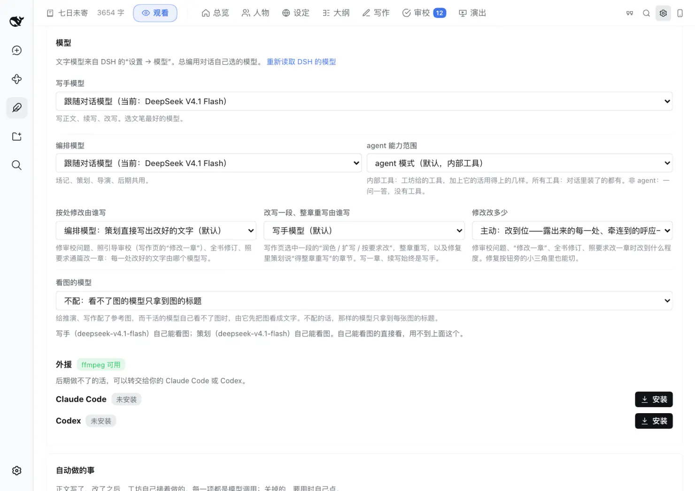

| 设置 | 意思 | 建议 |
|---|---|---|
| **写手模型** | 写正文的模型 | 挑文笔最好的 |
| **编排模型** | 场记、策划、导演、后期共用 | 挑会用工具、便宜、快的 |
| **agent 能力范围** | 班底能用哪些工具 | 默认（内部工具）就好 |
| 按处修改由谁写 / 改写由谁写 / 修改改多少 | 修问题时文字由谁写、改得多主动 | 用熟了再调 |
| **看图的模型** | 模型看不了图时，由谁把参考图看成文字 | 用到参考图再配 |

- 右上角 **高级选项** 打开才是逐个角色的模型、思考强度、上下文预算、并发。
- 最上面的 **在看谁的设置**：*全局* 对所有的书生效；切到 *这本书*，这本书可以有自己的模型、绘图和配音服务。

### 自动做的事：先看一眼

同一页往下是 **自动做的事**——正文写了、改了之后工坊自己接着做的几件事，每一件都是模型调用：

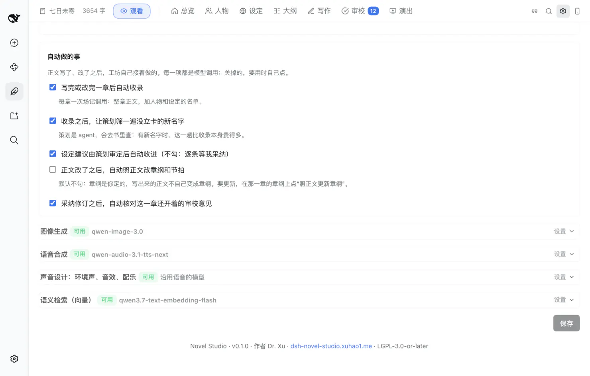

想省 token 时来这里关。先关"收录之后筛新名字"比关"自动收录"划算：前者是 agent 去书里查，比收录本身贵得多；后者关了，工坊就不再记得新写的章节。

---

## 3. 两种用法：和总编对话，或自己在工坊里点

工坊里每一件事都有两条路，随时可以换。

### 和总编对话

1. 新建会话，在输入框上方的预设菜单里选 **小说家 Novelist**。

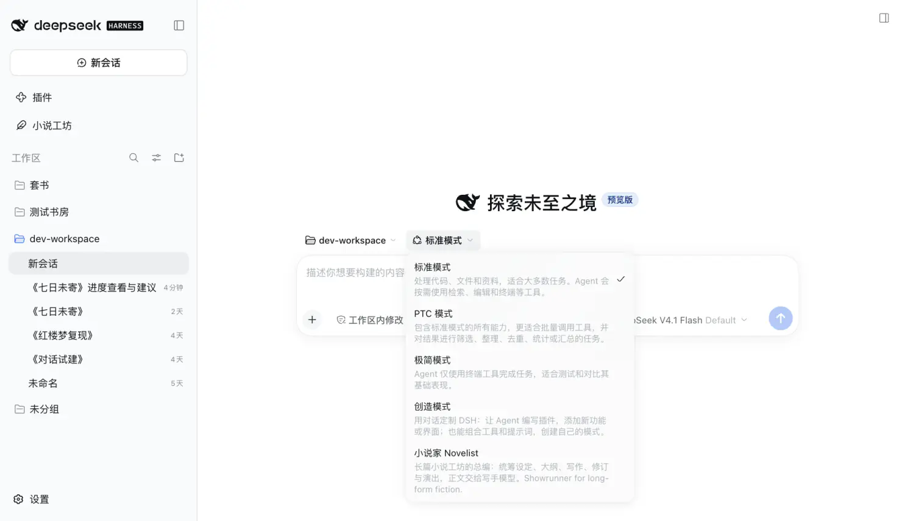

2. 直接说要什么。总编一开工，工坊会自己出现在对话右边，停在它正在动的那本书上。

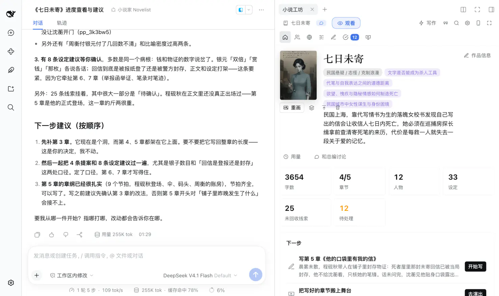

可以这样说：

- "把这本 txt 导进来：`/path/to/book.txt`，我要接着写。"
- "推演接下来三章，调子压抑一点，先给我看，别加进大纲。"
- "第三章的敲门声改成电话铃。"
- "给沈蘅画一张立绘，雨夜，回头看。"
- "现在写到哪了？下一步建议做什么？"

也可以从工坊主页点 **和总编对话**（先选一本书），或在书的总览页点 **和总编讨论**——回到这本书自己的那场对话。

### 自己在工坊里点

进了一本书，页头是这样一排：

| 页面 | 做什么 |
|---|---|
| **总览** | 这本书的现状和"下一步" |
| **人物** | 人物卡、履历表、关系图、龙套 |
| **设定** | 地点、家族与组织、物品、世界观、文风、画风、参考文献、随笔 |
| **大纲** | 章节与章纲、推演、剧情图、线索与伏笔 |
| **写作** | 编辑器，旁边是章纲、记忆、问题、提案、版本、配图 |
| **审校** | 修订提案、设定建议、审校和修订、归档 |
| **演出** | 一键制作、有声漫、幕间、插图（图库） |
| **观看**（书名旁的蓝色按钮） | 读者看到的样子：正文、人物、世界、番外 |

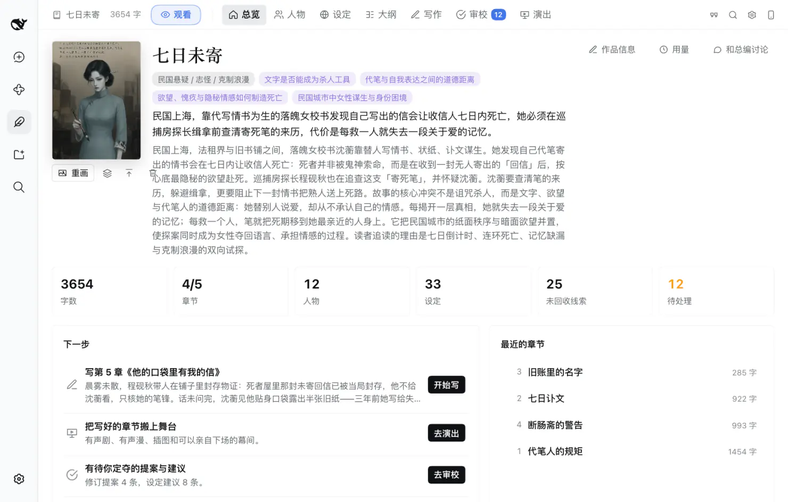

拿不准做什么，就看总览页的 **下一步**。

凡是要等一会儿的事，页面底部会有一条"进行中"的任务条：写着谁在干什么，能停；是班底 agent 在干的，点"看策划 / 看场记…"能进到它那场子对话里，看它查了什么、交回了什么。

---

## 4. 把书放进来

主页点 **新创作**。

### 导入一本已有的小说

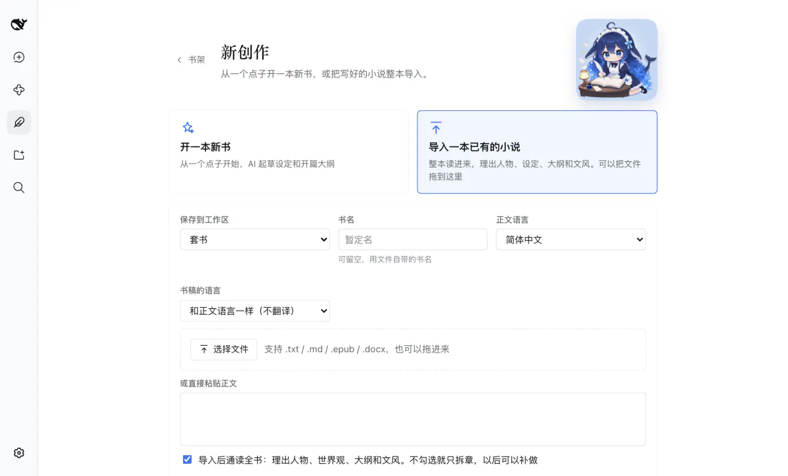

1. 选 **导入一本已有的小说**。
2. **保存到工作区**：书会成为这个工作区里的一个文件夹。
3. **书名** 可以留空，用文件自带的。**正文语言** 是这本书用什么语言写。
4. **书稿的语言**：和正文语言一样就不翻译；选别的，导入时直接译成正文语言（先定译名表，再逐章译）。
5. **选择文件**（`.txt` / `.md` / `.epub` / `.docx`，也可以拖进来），或者把正文贴进下面的框。
6. **导入后通读全书** 保持勾选——不勾只拆章，人物、设定都要以后再补。
7. 想加密就勾 **加密这本书**：从第一个文件起就是密文。

点导入之后，底部任务条会一步步走：

| 步骤 | 谁 | 得到什么 |
|---|---|---|
| 找章节 | 编辑（场记） | 读原文，认出章节，清掉网页留下的杂质 |
| 逐章收录 | 场记 | 每章的摘要、事实、谁在场、线索、名场面 |
| 归并人物表 | 策划 | 人物卡；同一个人的不同称呼并成别名 |
| 人物的成长 | 策划 | 主要人物的年龄段和变化的关键点 |
| 整理世界观、理关系 | 策划 | 地点 / 组织 / 物品 / 概念；谁住在哪、属于哪一家 |
| 梗概与分卷、文风、画风 | 策划 / 导演 | 大纲、这本书的文风档案和画风 |

长书要跑很久（逐章一次调用，人物表按批写）。中途停了没关系：总览页会出现 **继续分析**，从断的地方接着做。

导入完，先看三处：

- **总览**：章节数、人物数、还有什么没做完。
- **人物**：主要人物对不对、有没有同一个人被拆成两张卡。
- **审校 → 设定建议**：策划自动收进了哪些、没收哪些（见 [5.6](#56-卡片更新人物设定章纲)）。

### 开一本新书

选 **开一本新书**，写一句话或一段话说你想写什么。勾着"让 AI 起草"时，策划会给出故事核、主要人物、世界观、分卷和开篇章纲——都可以改。

建好之后，工坊会给这本书开一场它自己的对话，总览页上有入口。

> 一本书就是一个普通文件夹：人写的东西是 Markdown（人物卡、设定、章节），结构和记忆是 JSON。可以用自己的编辑器改，也适合用 git 管。格式见 [project-format.md](./project-format.md)。

---

## 5. 一章的工作流

下面七步是一章从无到有的路。不必每次都走全：只想写，就走 5.1–5.4；导入的书想修，就从 5.5 开始。

### 5.1 推演：接下来写什么

**大纲** 页，左边是章节列表，右边是选中那一章的章纲（梗概、这一章的作用、视角、出场人物、线索、节拍）。

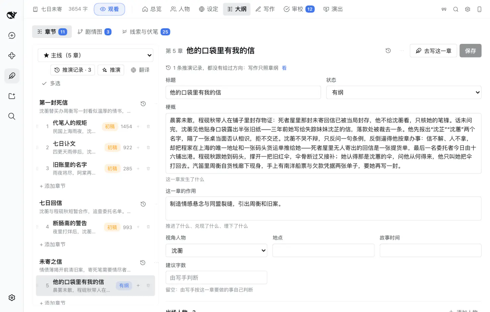

点章节列表上方的 **推演**：

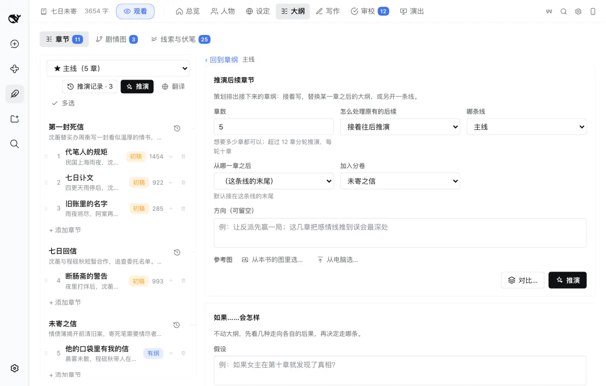

1. **章数**：推几章。
2. **怎么处理原有的后续**：接着往后推、**替换** 某一章之后的大纲，或 **另开一条剧情线**。
3. **方向**（可留空）：用自己的话写——发生什么、调子是轻是重。这句话会被记下来，之后排节拍、写这几章时一并交出去。
4. 可以带 **参考图**，让策划照着图排。
5. 点 **推演**。策划（agent）会自己去读前文、人物、设定，一两分钟后交回一版。

交回来的章纲 **先给你看，不进大纲**：

- 不满意某处：在 **修改意见** 里写一句，点 **照意见调整**——还是那位策划接着改，没说到的章节不动。
- 不想要某一章：取消它的勾。
- 满意了：点 **把选中的 N 章加入大纲**。

关掉窗口也不丢，按钮上会写"N 章待看"。（一次推超过 12 章时是分轮做的，每轮十章，直接进大纲。）每一次推演都留在 **推演记录** 里：当时的方向、策划的说明、它成了哪几章。

下面的 **如果……会怎样** 是假设推演：问一个"如果"，策划给出几条走向，不改大纲。

### 5.2 把节拍改到满意

节拍是一章里一场一场的戏。写手照节拍写，所以 **调子和走向在这里定**——排冷了的一章，事后补一句"要欢乐"很难救回来。

在大纲页那一章的章纲里往下滚到 **节拍**：

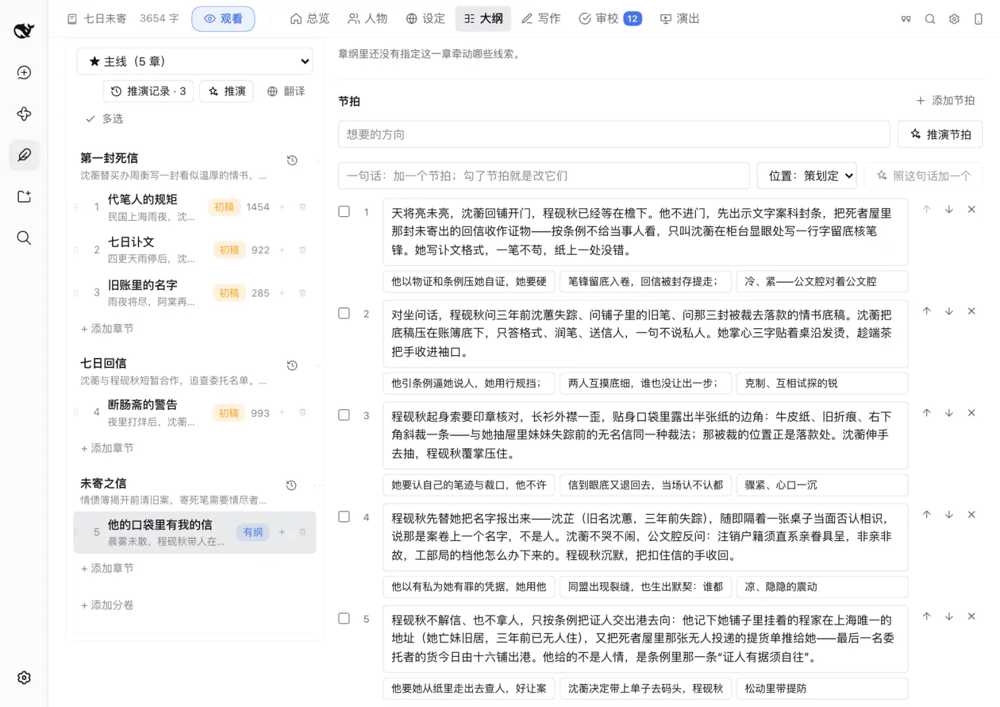

| 你想 | 怎么做 |
|---|---|
| 让策划把整章的节拍排出来 | 写一句"想要的方向"（可不写），点 **推演节拍** |
| 加一场戏 | 在"一句话"那一行写这场戏，点 **照这句话加一个**（位置可以让策划定） |
| 只改其中几个 | 勾上那几个节拍，写一句话，点 **照这句话改这 N 个**——别的一个字不动 |
| 自己写 | **添加节拍**，或直接改文字、用箭头调顺序 |

改完点右上角 **保存**。原来的章纲在时钟图标的 **历史版本** 里，随时能恢复。

### 5.3 写

**写作** 页：左边章节，中间编辑器，右边是这一章的章纲 / 记忆 / 问题 / 提案 / 版本 / 配图。

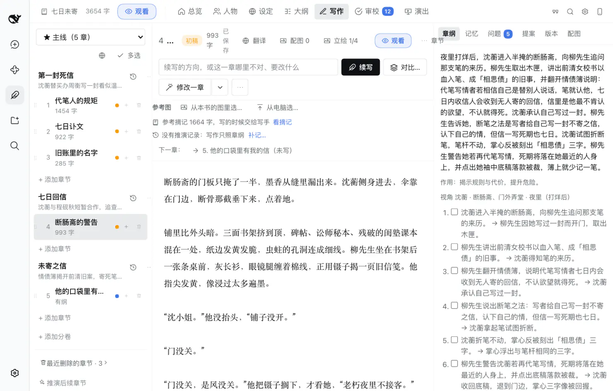

- 还没写的章：在要求框里写一句对写手的要求（可不写），点 **写这一章**。正文会一句句出现在编辑器里。
- 写了一半的章：点 **续写**。
- **对比…**：让几个模型各写一稿，并排着看，采纳一稿。
- 你也可以直接在编辑器里打字，自动保存。

写完想改：

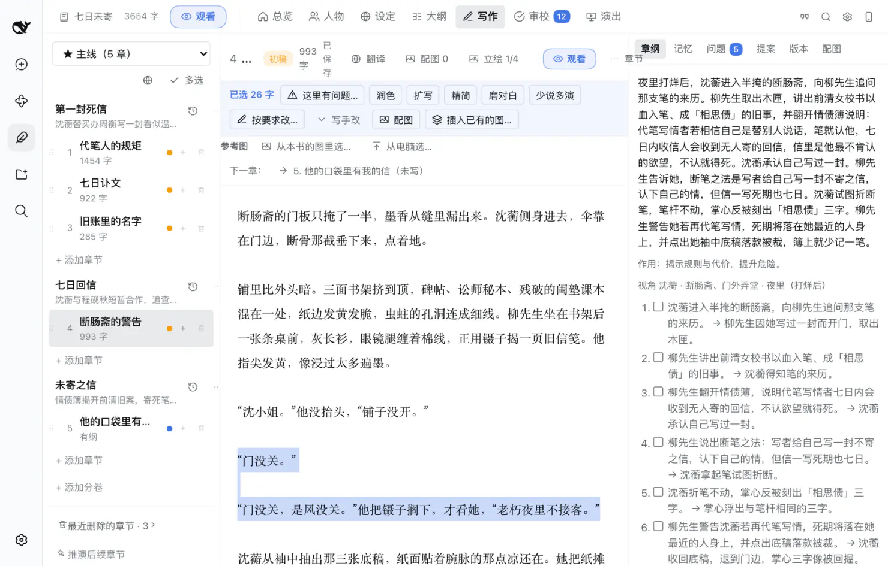

| 你想 | 怎么做 |
|---|---|
| 这一段哪里不对 | 选中它 → **这里有问题…** → 写一句哪里不对，回车。策划把同一个毛病在这一章里都找出来、改掉 |
| 换个写法 | 选中 → **润色 / 扩写 / 精简 / 按要求改…** |
| 这一章整体有个问题，或想让它改点什么 | 在要求框里写一句，点 **修订**——是毛病还是修改要求，策划自己判断（旁边的小三角里还有"只找出来""整章重写"）。要求框空着时，这个按钮是 **审校** |

这些改动都不直接落进正文，而是出 **提案**（见 [5.5](#55-审校与修改)）。

一次写好几章，用章节列表下面的 **批量写作**：

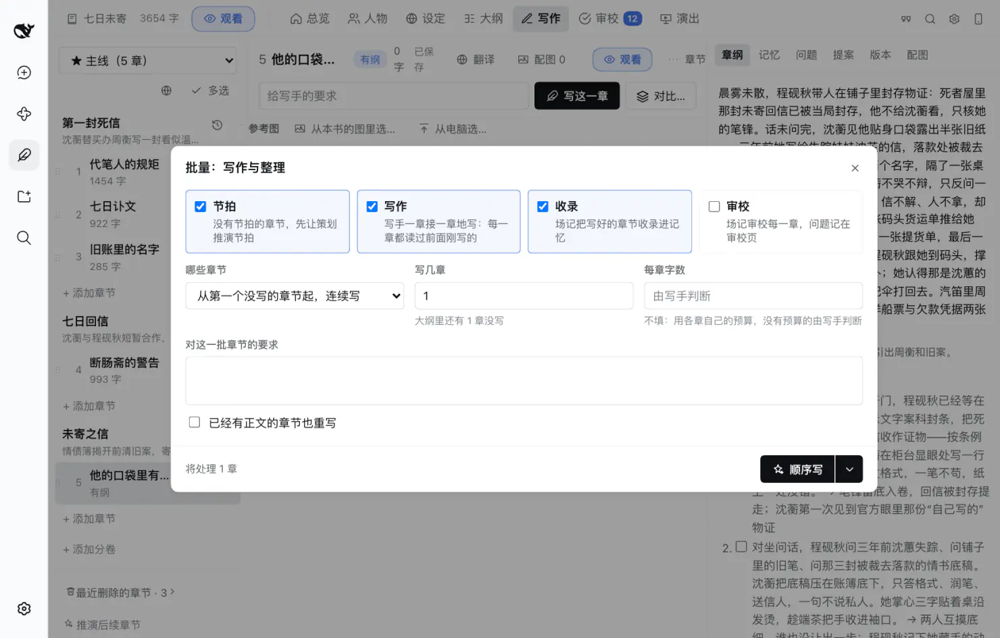

勾要做的步骤，选从哪一章起、写几章。开始按钮旁的小三角选写法：**顺序**（一章接一章，前后最一致）、**并发**（同时写，快）、**多轮迭代**（写完审校、成批修改，再审，直到重大问题没有了）。

### 5.4 收录：让工坊记住这一章

写完或改完一章，场记会把它 **收录** 成记忆——默认是自动的。右栏的 **记忆** 页签就是收录的结果：

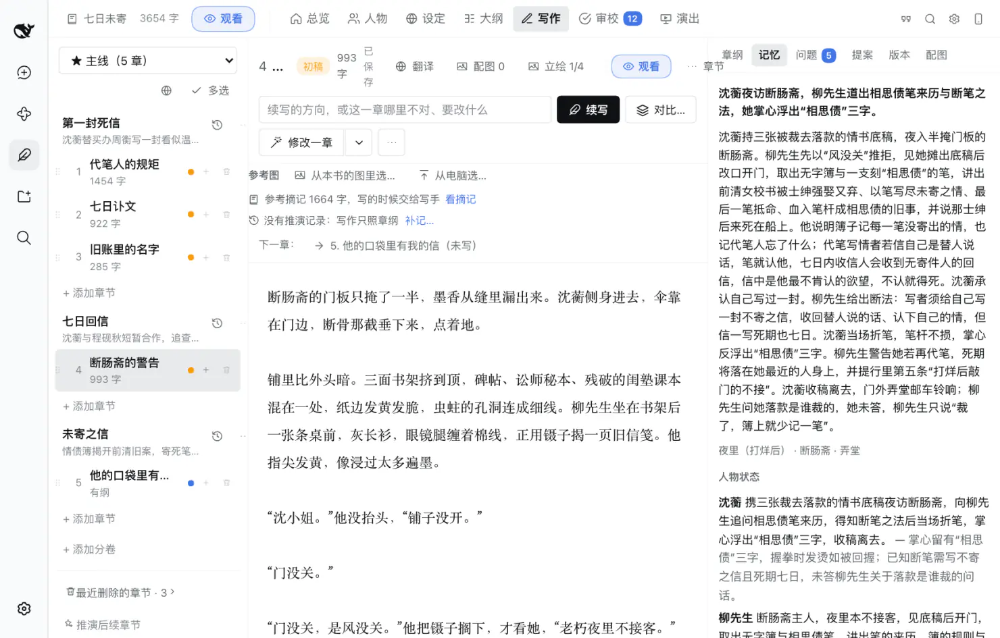

一次收录记下：这一章的摘要、硬事实、每个人在章末的状态、谁登场 / 离开 / 死了、线索的埋和收、新出现的名字和设定、称得上名场面的一幕。

后面的一切都读它：写下一章时的前情、人物的履历、设定建议、审校。所以：

- 手动收录：写作页的 **⋯ → 收录记忆**。
- 整本重来：总览页"已收录 N / M 章"旁的 **重新收录…**。
- 关了自动收录（[第 2 节](#自动做的事先看一眼)），页面上会写"N 章尚未收录"，想起来点一下就补齐。

### 5.5 审校与修改

**审校** 页的 **审校和修订**：最上面那一栏什么都不写，点 **审校未审的 N 章**（或在某一章那一行点 **审校**）。场记把这一章对着前文、设定、章纲读一遍，列出问题；默认接着交给策划修订，每条问题下面出现修订提案（按钮旁的小三角里可以改成只列问题）。

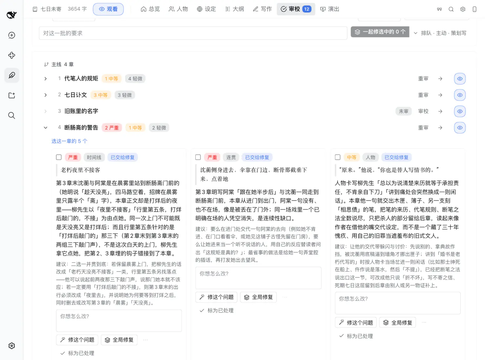

每条问题一张卡片：级别（严重 / 中等 / 轻微）、类型（时间线、连贯、人物、文风…）、引的原文、说明、建议。

| 你想 | 怎么做 |
|---|---|
| 修订这一条 | **修订这个问题**——策划定改哪几处，改好的出现在这张卡片下面 |
| 连别的章里牵连到的一起改 | **全书修订** |
| 说说你想怎么改 | 先在"你想怎么改？"里写一句，再点修订 |
| 一批一起修订 | 勾几条 → **一起修订选中的 N 个** |
| 只管要紧的 | **修订重大问题** |
| 它说错了 | **标为已处理** |

同一栏里写一句话再点 **修订**：你已经看出的毛病（"柳先生的眼镜一会儿有一会儿没有"），或者一条要照着改的要求（"把所有'灵力'改叫'炁'"）——是哪一种，策划自己判断。是毛病：去书里把它找出来，每一处记成问题，再修订，改动出现在各条问题下面。是要求：照着改，改动在 **修订提案** 里成一批。**只找出来** 是只查不改。写作页的要求框、右栏"问题"、选中一段之后的"审校和修订…"是同一个东西，只管那一章、那一段。

**每一处修订都是一条提案**，带红绿对比：

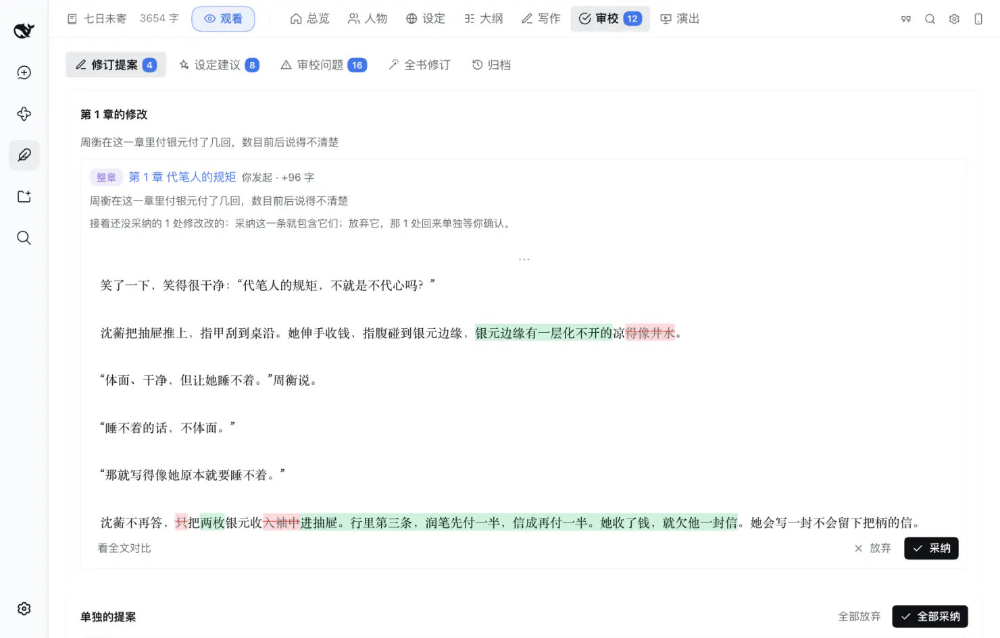

- **采纳**：写进正文，旧稿存成一个版本。之后工坊会把这一章还开着的问题对着新正文核对一遍，修好的自动标成已处理。
- **放弃**：不要这一条。手滑了，去 **归档** 页签里放回。

### 5.6 卡片更新：人物、设定、章纲

写得越多，设定集要跟上。大部分是自动的，你过目。

**设定建议**（审校页的第二个页签）。收录时发现的新设定、新线索，策划筛出来值得立卡的新人物，会由策划审定后 **自动收进**。这一页列着它收进了什么、没收什么，每条带理由：

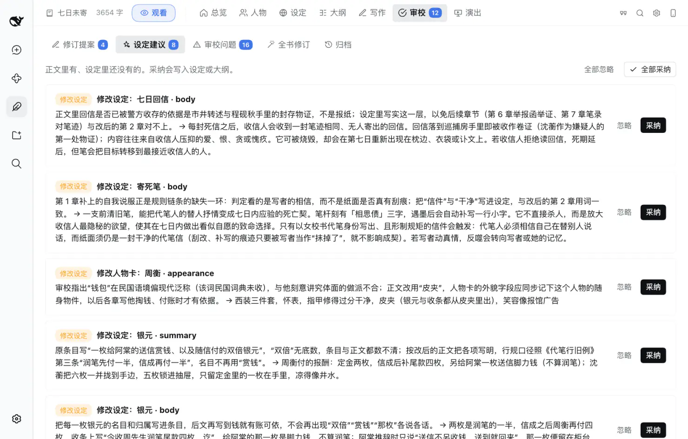

- **策划收进的**：点 **打开** 去改，或 **撤回**。
- **没收进的**：点 **收进**。
- 只有"修改已有设定"的建议不自动——那是改你写下的东西，等你点 **采纳**。

**人物** 页：


- **人物卡**：一句话人设、外貌、性格、来历、关系、声线。想补全，写一句方向点 **AI 补全**。
- **履历** 不是填的，是从各章收录里读出来的：哪一章登场、哪几章在场、哪里离开。要纠正就点 **记一笔**。
- **龙套** 页签：正文里有名字、还没立卡的人。勾几个 **立卡**，策划照收录的记载把卡写全。

**履历表** 页签把所有人排成一张表，一眼看出谁消失太久了：

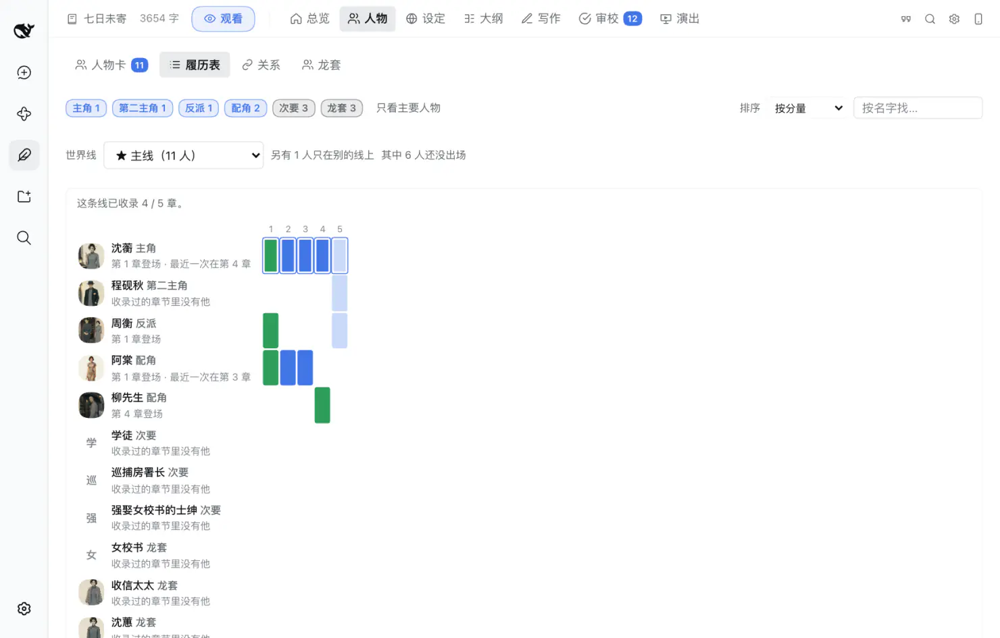

**设定** 页分 地点 / 家族与组织 / 物品 / 世界观。每个条目有概括、正文、"在这个世界里"（它在哪里面、谁住在这里）和轨迹（哪一章建成、衰败）：


- 列表上方的 **整理**：让策划找出记重了的条目和放错类别的，你勾选再合并。
- 书里有几条故事线时，条目和人物可以归到某条线：只属于那条线的，写别的线时不会带上。

**章纲不会自己跟着正文改**——章纲是你的设计。正文写偏了、想让章纲照正文来，在那一章的章纲上点 **照正文更新章纲**（或只更新节拍）。

人物卡、设定条目、文风、画风、章纲都有 **历史版本**（时钟图标）：整份恢复，或只恢复一栏。删掉的在列表最下面的"最近删除"里。

### 5.7 画人设与设定图

顺序是：**画风 → 外貌 → 人设图 → 立绘和别的图**。后一样照着前一样画，全书才是同一张脸。

**① 画风**（设定 → 画风）。每一张图都带着它：

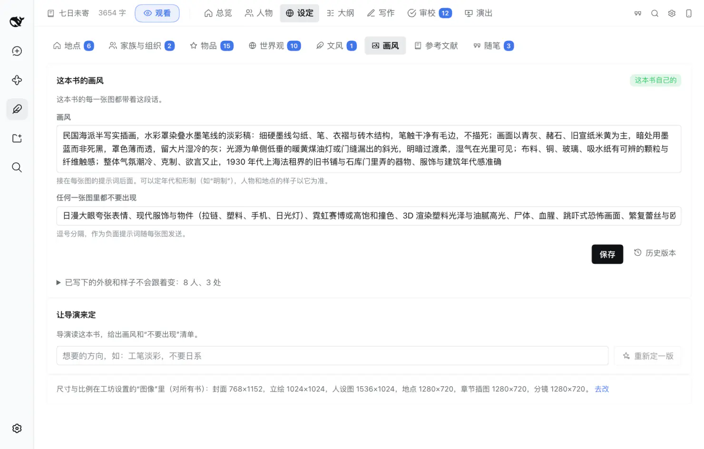

导入和起草时已经定过一份。想换：写一句方向，点 **重新定一版**；或者直接改文字。可以在这里定年代和形制（"服饰是明制"）。

**② 外貌**（人物卡 → 形象）。一段话，写手照它写，图也照它画。空着就点 **让导演写外貌**。

**③ 人设图**。在人物页左栏点 **生成人设图**（有了之后是"再画一张人设图"）：正面、侧面、背面三视图。之后每一张有这个人的图，都把它当参考图。

**④ 立绘**。点 **画立绘**。默认画两张：一张素底定妆，一张 **名场面**——导演从书里找出这个人最有代表性的几幕，列在人物卡的"名场面"里：

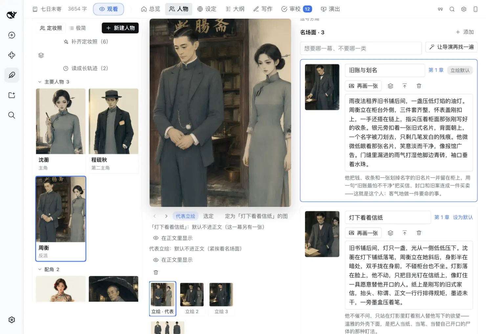

几个常用的：

| 你想 | 怎么做 |
|---|---|
| 这一张要特别的样子 | 画之前在按钮下面的框里随手写（"左眉有道疤；这张要雪夜，回头看"）。说这个人本身的进外貌，只说这一张的只用这一次 |
| 照一张参考图画 | "人设图参考图"那一行：从本书的图里选、从电脑选，或 **照别人的人设图**（画近亲） |
| 比一比哪个模型画得好 | 画图按钮旁边叠着几层的小图标：几个模型各画一张，采纳一张 |
| 用自己的图 | 按钮旁的向上箭头：从电脑导入 |
| 画地点、物品、组织 | 设定条目页的 **画设定图** |

画带人的图之前，工坊可能先问一句"这次会先补 N 张人设图"——缺人设图的常客先补上，后面的图才对得上。

---

## 6. 图库与画册

### 图库：这本书所有的图

**演出 → 插图**。


- 上面三排筛选叠着用：**类型**（场景插图 / 人设图 / 立绘 / 分镜 / 设定图 / 封面）、**来源**（这里画的 / 导入的）、**按对象**（某个人、某处地点、某一章）。
- **画一张**：照一章画插图，或"自由创作"自己写画面、勾画里有谁。
- **批量绘制…**：把缺的人设图、设定图、立绘、章节插图、封面一次补齐。
- **导入…**：一次带进很多张自己的图。
- **多选**：一批删除。
- 多模型对比时没采纳的图，都留在顶上的"待采纳"里，以后再选。

### 点开一张图

哪里点开的图都是同一个面板——左边大图，右边是 **这张图是怎么来的**：提示词由哪几部分拼成、带了哪几张参考图、发给绘图模型的原话。

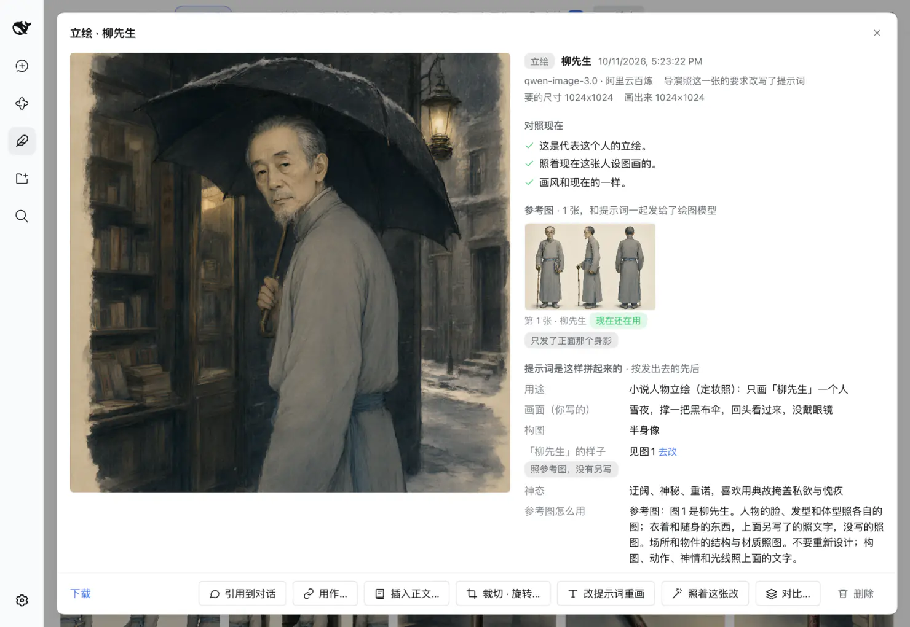

| 按钮 | 做什么 |
|---|---|
| **改提示词重画** | 整段提示词和"不要出现"拿出来改，照改过的重画 |
| **照着这张改** | 写一句改哪一处（"旗袍换成深红色"），把这张图本身交给绘图模型去改 |
| **对比…** | 换几个模型照原样各画一张 |
| **用作…** | 说它是谁的立绘 / 人设图、哪处的设定图、哪一章的图，或设为封面 |
| **插入正文…** | 选章、选段，放在那一段后面 |
| **裁切 · 旋转…** | 存成一张新图，原图留着 |
| **引用到对话** | 把这张图指给总编看，接着说要它怎样 |

图画歪了，先点开看来历：是外貌写错了、画风带偏了，还是参考图没带上——这里都看得出来。

### 图怎么进正文

- **写作页选中一段 → 配图**：导演认出这一段里是谁、在哪，照他们的人设图画，放在这段之后。
- 写作页里，正文里的图直接显示成图：图下面可以改说明、**换一张**、上移下移、取下。
- 立绘照规矩自己出现在"观看"里：名场面的那张出在讲到那一幕的地方，素底定妆出在这个人第一次出场处。不想要的逐张隐藏。

### 画册：观看里的人物和世界

点书名旁的 **观看**。这是读者看到的样子，也是手机上、发布出去的网站上看到的样子。


**正文** 可以切 *文字 / 脚本*，有配音时底下是播放条。有人物卡的名字带一道淡下划线，点一下出他的小卡片。

**人物**：所有人按戏份排开，点进去是一个人的整页——

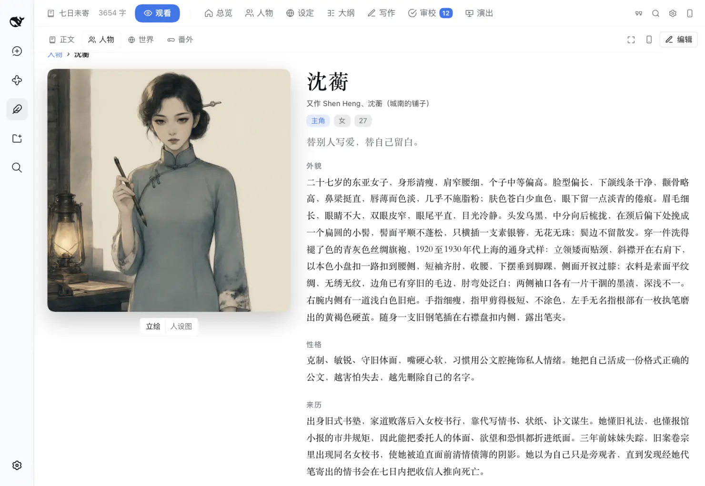

**世界**：有设定图的地方，图就是一个可以点的场景——里面的院落、住在这里的人标在画面上，点一下就进去；拖时间轴，看故事进行到某一章时的样子。

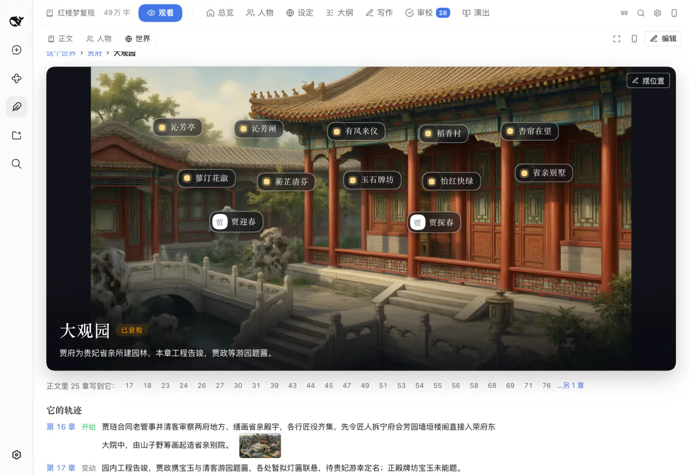

每一页右上角的 **编辑** 一步到这样东西的编辑页，编辑页上的 **观看** 一步回来。画册好不好看，取决于书里画了多少图。

---

## 7. 接下来还能做什么

**剧情图**（大纲 → 剧情图）。故事可以不止一条路：从某一章分出一条线，另一种走向、番外、互不相干的另一个故事，都在一张图上。拖章节换位置、拖线头改分叉点。

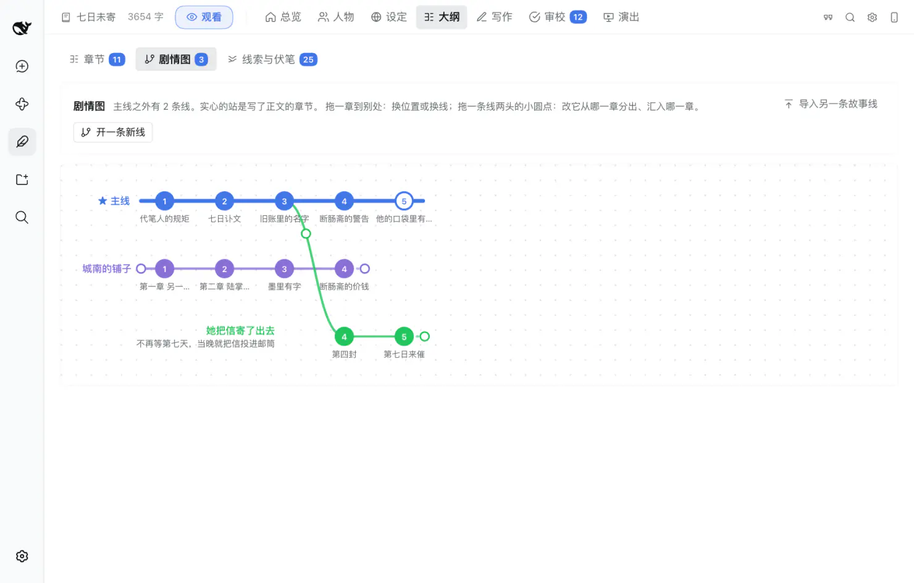

**有声版、有声漫、成片**（演出 → 一键制作）。勾要做的步骤和章节，从脚本、配音、声音、分镜、画面一路做到视频。中途停了，再点一次就接着做。

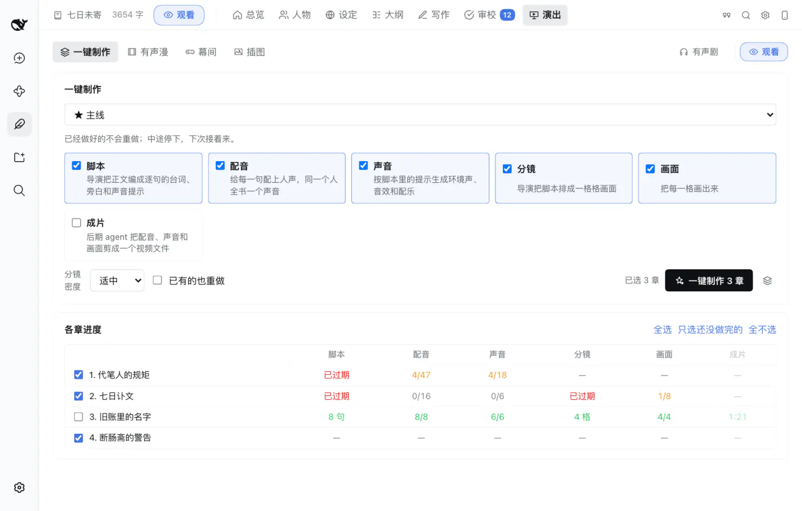

**给别人看**（观看页的手机图标）。同一个 Wi-Fi 下用手机读；或者 **发布成网站**——一个文件夹，放到任何静态托管上，别人打开就能读、听、看。

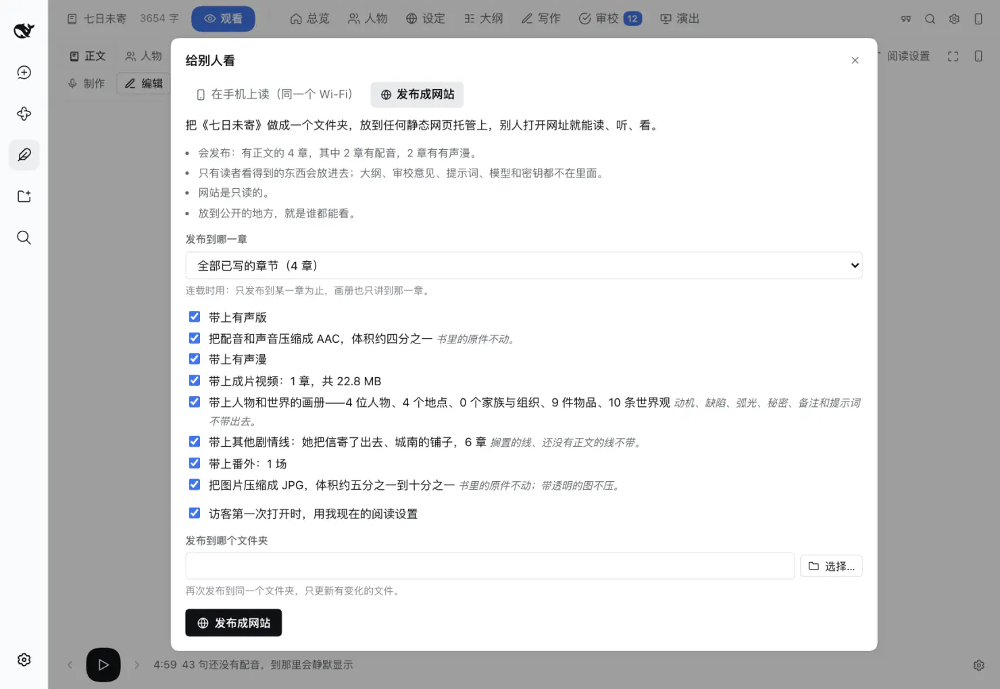

还有：

| 功能 | 在哪 |
|---|---|
| **幕间**：下场扮演一个人物，其余的由导演演出 | 演出 → 幕间 |
| **翻译**：整章译成另一种语言，先定译名表 | 写作页工具栏的"翻译" |
| **参考文献**：照着另一本书的世界观、文风来写 | 设定 → 参考文献 |
| **随笔**：没想好的剧情和设定，随手记 | 页头的引号按钮；设定 → 随笔 |
| **加密、私密书架** | 页头点书名 →"加密与上锁…"；主页书架下面 |
| **导出** Markdown / TXT / HTML / EPUB | 总览页最下面 |
| **手机上操作整个工坊** | 页头的手机图标（要 `dsh web`） |

每个设置项的含义见 [configuration.md](./configuration.md)，设计上的考虑见 [design.zh.md](./design.zh.md)。

---

## 8. 花费与排错

### 钱花在哪

**总览 → 用量**（或 设置 → 用量与成本）按模型、作品、日期记了每一次调用。填上你实际付的单价就能看到花费。

几条经验：

- **agent 干的活按步数算**：策划、场记每调一次工具，就要把手上的材料再发一遍。范围越小越省——"只在我选的章节里找"比"全书"便宜得多。
- **长书上写一章不便宜**：写手带着模型窗口一半的前文。重复的部分会命中缓存，命中了多少记在用量里。
- **最容易被忽略的是自动跟着跑的那几样**：[设置 → 自动做的事](#自动做的事先看一眼)。
- **画图**：先补人设图、多模型对比、批量绘制，都是成倍的张数——开始之前都会先说要画几张。

### 常见问题

| 现象 | 怎么办 |
|---|---|
| 左侧栏没有"鲸歌工坊" | 重启一次 DSH；确认 DSH 版本够新 |
| 工坊顶上写"鲸歌工坊更新了" | 点 **重启**（只重启工坊后台） |
| 顶上提示"子智能体没有开启" | DSH 左侧栏的"插件"页，把"子智能体"打开 |
| 按钮点了说"还没有配置图像生成 / 配音" | 设置 → 引导页，或设置里对应那一节 |
| 一件事转了很久 | 底部任务条点"看策划 / 看场记"进去看它卡在哪；点停止，再来一次会接着上次的做 |
| 导入断了 | 总览页点 **继续分析** |
| 画出来的人前后不一样 | 先画人设图；点开图看参考图带上没有。绘图服务不收参考图时，只能照外貌的文字画 |
| 新画的图没照我改的外貌 | 外貌改了之后重画一次人设图——别的图照的是人设图 |
| 采纳错了 | 写作页右栏 **版本**，恢复上一版 |
| 放弃错了 | 审校 → **归档**，放回 |
| 人物卡 / 设定被改坏了 | 时钟图标的 **历史版本** |
| 两条故事线的人串了 | 人物卡上"世界线"归一下；或重新收录那条线的章节 |

问题还在的话，到 [GitHub](https://github.com/xuhao1/whalesong-studio/issues) 提一条，带上当时页面上的提示。
